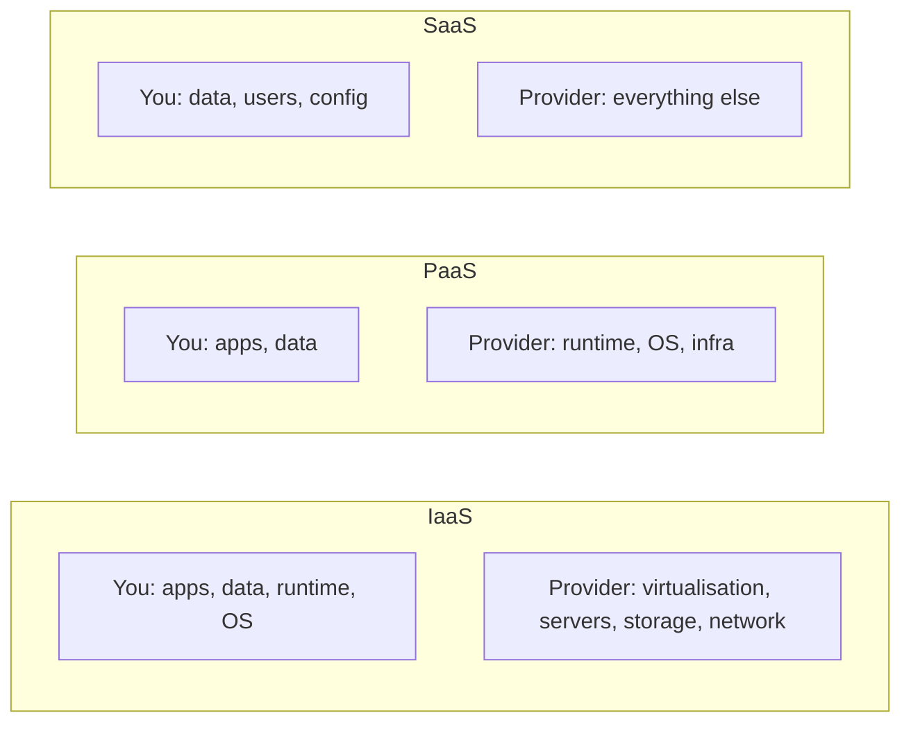

# Cloud Concepts

AZ-900 · Cloud concepts

## What is cloud computing?

**Delivering computing services — compute, storage, networking, databases, analytics, AI — over the internet, on demand, paying only for what you use.**

- You **rent** resources instead of buying and running hardware.
- The provider manages the physical datacenter: servers, power, cooling, networking.
- You spend time on applications and workloads, not on procurement and racking.
- Resources can be created and removed in minutes.

### Traditional datacenter vs. cloud

| Situation | On-premises | Cloud |
|---|---|---|
| New project | Buy, install, configure hardware — weeks/months | Provision resources in minutes |
| Demand drops | Hardware sits idle, still maintained | Delete resources, stop paying |
| Cost model | Upfront investment | Pay for consumption |
| Maintenance | Your team (hardware refresh every ~3–5 years) | Provider |

## Cloud models (deployment types)

| | Public cloud | Private cloud | Hybrid cloud |
|---|---|---|---|
| Owned/managed by | Cloud provider (Microsoft, AWS, Google) | Your organisation (on-prem or hosted) | Mix |
| Access | Over the internet, any customer | Your organisation (and federated partners) | Both |
| Hardware control | None — can't bring your own servers | Full control | Partial |
| New features | Very frequent | Your pace | Mixed |
| Cost model | OpEx | CapEx | Mostly OpEx |
| Example use | Startups, web apps, burst capacity | Strict regulation, legacy hardware | Web tier in Azure, database on-prem |

- **Multi-cloud**: using two or more public cloud providers (e.g. Azure + AWS).
- **Azure Arc** manages servers, Kubernetes clusters and databases running on-prem or in other clouds from Azure → see [Management tools](10-management-tools.md#azure-arc).
- **Azure VMware Solution** runs VMware workloads natively in Azure.

### Use cases

- **Public**: no capital investment, quick scale, global reach, unpredictable demand.
- **Private**: full control, data that must stay on specific hardware, very specific compliance.
- **Hybrid**: keep sensitive systems on-prem while using cloud scale; gradual migration; cloud bursting; disaster recovery.

## CapEx vs. OpEx

| Capital Expenditure (CapEx) | Operational Expenditure (OpEx) |
|---|---|
| Buy physical assets upfront | Pay for services/products as you use them |
| Value depreciates over time | Billed per period (hour, second, month) |
| Assumes long-term use; idle when demand drops | Remove unneeded resources anytime |
| Example: building a datacenter | Example: running Azure VMs |

Cloud computing is mainly **OpEx**.

## Consumption-based model & pricing

- **Consumption-based**: no upfront cost, pay for what you use, stop paying when you stop using it.
- **Pay-as-you-go** pricing: billed per use (per second/hour/GB/transaction).

Pricing models compared:

| Model | Description |
|---|---|
| **Pay-as-you-go** | No commitment, highest unit price, maximum flexibility |
| **Reserved instances / reservations** | Commit to 1 or 3 years for a specific resource → large discount |
| **Savings plan for compute** | Commit to an hourly spend for 1 or 3 years across compute services |
| **Spot VMs** | Unused capacity at a big discount; can be evicted at any time |
| **Azure Hybrid Benefit** | Reuse existing Windows Server/SQL Server licences in Azure |

See [Cost Management](11-cost-management.md).

## Serverless

- You deploy **code or workflows**, the provider runs and scales the infrastructure automatically.
- **Event-driven**, scales to zero, billed per execution/usage.
- Azure examples: **Azure Functions**, **Logic Apps**, **Azure Container Apps** (consumption), Event Grid.
- "Serverless" ≠ no servers — you just don't manage them.

## Benefits of the cloud

| Benefit | Meaning |
|---|---|
| **High availability** | Resources stay available despite failures; measured by **SLAs** (e.g. 99.9%) |
| **Scalability** | Adjust capacity to demand. **Vertical** = bigger resource (scale up/down: more CPU/RAM). **Horizontal** = more instances (scale out/in) |
| **Elasticity** | Scaling happens **automatically** in response to demand |
| **Reliability** | Recover from failures; decentralised global design, availability zones, region pairs |
| **Fault tolerance** | Keep running when a component fails (redundancy) |
| **Disaster recovery** | Restore service after a major event (backup, geo-replication, Azure Site Recovery) |
| **Predictability** | *Performance* predictability (autoscaling, load balancing) and *cost* predictability (pricing & TCO tools, budgets) |
| **Security & governance** | Templates, policies, compliance features; provider handles physical security and patching (for PaaS/SaaS) |
| **Manageability** | *Of* the cloud: autoscaling, monitoring, templates. *In* the cloud: portal, CLI, APIs, PowerShell |
| **Global reach** | Deploy close to users in many regions |
| **Agility** | Provision and experiment quickly |

## Cloud service types

### Infrastructure as a Service (IaaS)

- Rent infrastructure: **VMs, disks, virtual networks**.
- **Most control and most responsibility** (you patch the OS).
- Ideal for **lift-and-shift** migrations, test/dev, custom software.
- Azure examples: Virtual Machines, VM Scale Sets, Managed Disks, Virtual Network.

### Platform as a Service (PaaS)

- A managed environment to build and run applications — the provider handles OS, patching, runtime.
- Focus on code and data.
- Azure examples: App Service, Azure SQL Database, Azure Functions, Container Apps, AKS (managed control plane).

### Software as a Service (SaaS)

- Complete, ready-to-use software, usually per-user subscription.
- **Least management**.
- Examples: Microsoft 365, Teams, Dynamics 365, Outlook.com.

| | IaaS | PaaS | SaaS |
|---|---|---|---|
| Control | Highest | Medium | Lowest |
| You manage | OS, runtime, apps, data | Apps, data | Data, users, settings |
| Example | Azure VM | App Service, Azure SQL DB | Microsoft 365 |
| Use case | Lift-and-shift, full control | Develop apps fast | Email, CRM, productivity |

## Shared responsibility model

| Responsibility | On-prem | IaaS | PaaS | SaaS |
|---|---|---|---|---|
| Information & data | You | You | You | You |
| Devices (mobile, PCs) | You | You | You | You |
| Accounts & identities | You | You | You | You |
| Identity & directory infrastructure | You | You | Shared | Shared |
| Applications | You | You | Shared | Microsoft |
| Network controls | You | You | Shared | Microsoft |
| Operating system | You | You | Microsoft | Microsoft |
| Physical hosts, network, datacenter | You | Microsoft | Microsoft | Microsoft |

!!! tip "Always yours, in every model"
    **Data, devices, and accounts/identities**. Always Microsoft's in cloud: **physical datacenter, hosts and network**.

## Quick recap

- [x] Cloud = on-demand resources, pay for use (OpEx).
- [x] Public / private / hybrid (+ multi-cloud); Azure Arc for hybrid management.
- [x] IaaS (most control) → PaaS → SaaS (least management).
- [x] You always own data, devices, identities.
- [x] Scale up (vertical) vs scale out (horizontal); elasticity = automatic scaling.
- [x] Serverless = event-driven, scale to zero, pay per execution.
