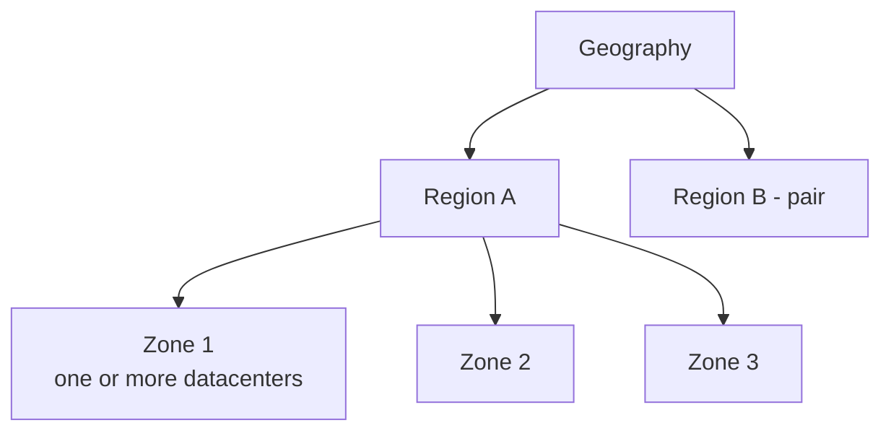
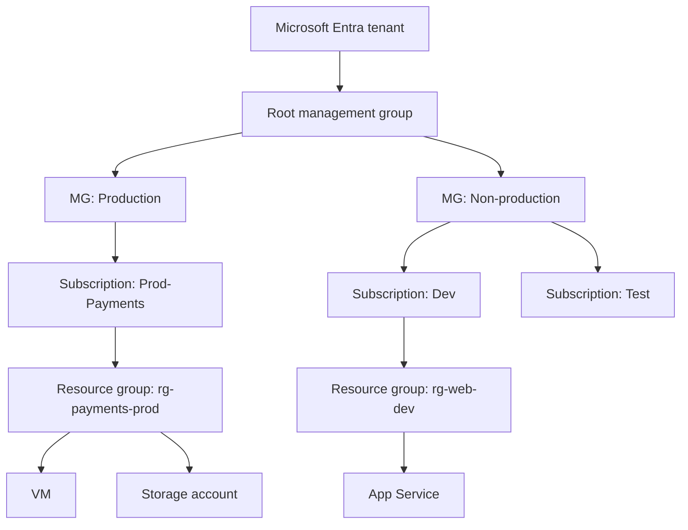
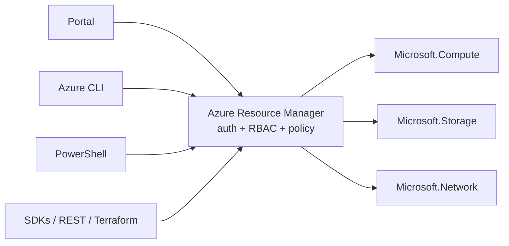

# Azure Architecture

AZ-900 · Architecture & services

## Physical architecture

### Datacenters

- Facilities full of networked servers, storage and power/cooling.
- You **never pick a datacenter** — you pick a **region**.

### Regions

- A set of datacenters in a geographic area connected by a dedicated **low-latency regional network**.
- You choose the region where resources run and data is stored → **latency, data residency, compliance, price, service availability**.
- Azure has **60+ regions** worldwide (more than any other provider), grouped into **geographies** (e.g. Europe, Asia Pacific) that respect data-residency boundaries.
- Not every service or VM size is available in every region.
- Some services are **global** (not tied to a region): Microsoft Entra ID, Azure Front Door, Traffic Manager, Azure DNS.

### Region pairs

- Many regions are **paired** with another region in the same geography, usually **at least 300 miles (≈ 480 km)** apart. Example: East US ↔ West US, North Europe ↔ West Europe.
- Benefits:
    - Some services replicate to the pair automatically (e.g. **GRS storage**).
    - Platform updates roll out to **one region of the pair at a time**.
    - In a broad outage, one region of each pair is **prioritised for recovery**.
    - Data stays in the same geography (except Brazil South, which pairs outside its geography).
- Most pairs are bidirectional; a few are one-directional.

!!! note "Newer regions"
    Many recently launched regions have **no pair** — they rely on **availability zones** for resiliency. Use multi-region designs where you need DR.

### Availability zones

- **Physically separate locations within a region**, each with **independent power, cooling and networking** (one or more datacenters each).
- Zone-enabled regions have **at least 3 zones**.
- Protect against a **datacenter failure** inside a region.
- Services relate to zones in three ways:
    - **Zonal** — pinned to one zone (a VM, a managed disk, a public IP).
    - **Zone-redundant** — automatically replicated across zones (ZRS storage, zone-redundant SQL Database, Standard Load Balancer).
    - **Non-regional** — always available (global services).
- Running in multiple zones may add small **inter-zone data transfer** costs.

### Sovereign regions

Isolated instances of Azure for compliance/legal reasons:

| Sovereign cloud | Notes |
|---|---|
| **Azure Government** (US) | Physically isolated; for US federal, state, local agencies and partners; screened US personnel; FedRAMP High, DoD IL2/4/5, CJIS, ITAR, IRS 1075 |
| **Azure operated by 21Vianet** (China) | Operated by 21Vianet (not Microsoft); data stays in mainland China; separate from global Azure |

## Logical architecture (management hierarchy)

### Tenant

- A dedicated instance of **Microsoft Entra ID** (formerly Azure AD) created when an organisation signs up for a Microsoft cloud service.
- Holds users, groups, apps; subscriptions **trust one tenant** for authentication.

### Management groups

- Containers that **group subscriptions** to apply **Azure Policy and RBAC** at scale.
- Everything sits under one **root management group** per tenant.
- Can be **nested up to 6 levels** deep (excluding root and subscription level).
- Up to **10,000 management groups** per directory.
- Each management group/subscription has **one parent**.

### Subscriptions

- A **billing boundary** (separate invoices/costs) and an **access-control boundary** (RBAC, policy).
- Linked to one tenant; a tenant can have many subscriptions.
- Types/offers: Free account, Pay-As-You-Go, Enterprise Agreement, Microsoft Customer Agreement, CSP, Visual Studio/Dev-Test.
- Common reasons for multiple subscriptions: environments (prod/dev), departments, billing separation, **subscription limits/quotas**.

### Resource groups

- **Logical container** for resources that share a lifecycle.
- Each resource lives in **exactly one** resource group; RGs **cannot be nested**.
- The RG has a region (stores its metadata) but can contain resources from **any region**.
- Resources can be **moved** between RGs/subscriptions (for supported types).
- **Deleting an RG deletes everything inside it.**
- Scope for RBAC, policy, locks and cost reporting.

### Resources

- Instances of services: VM, storage account, VNet, SQL database, public IP, Key Vault…
- Created in a subscription + resource group + (usually) a region.
- Identified by a **resource ID**: `/subscriptions//resourceGroups/<rg>/providers/<namespace>/<type>/<name>`.

### Hierarchy & inheritance

| Level | Example scope for… |
|---|---|
| Management group | Org-wide policies (allowed regions), RBAC for platform teams |
| Subscription | Billing, budgets, environment-wide policies |
| Resource group | App-level RBAC, locks, cost by workload |
| Resource | Fine-grained RBAC, individual locks |

**RBAC assignments, policies and locks are inherited downwards.** Tags are **not** inherited (unless a policy copies them).

## Azure Resource Manager (ARM)

- The **deployment and management service** for Azure — every request from the portal, CLI, PowerShell, SDKs, REST API or Terraform goes through ARM.
- ARM **authenticates and authorises** each request (Entra ID + RBAC), then sends it to the resource provider.
- Provides consistent management, **declarative templates** (ARM JSON / Bicep), tags, locks, RBAC, dependency handling and activity logging.

## Quick recap

- [x] Datacenter → availability zone (≥3 per zone-enabled region) → region → geography.
- [x] Region pairs ≈ 300+ miles apart: sequential updates, recovery priority, GRS replication.
- [x] Sovereign: Azure Government (US), Azure operated by 21Vianet (China).
- [x] Tenant → management groups (6 levels) → subscriptions (billing + access boundary) → resource groups (no nesting) → resources.
- [x] ARM = single control plane for every request; RBAC/policy/locks inherit down.
