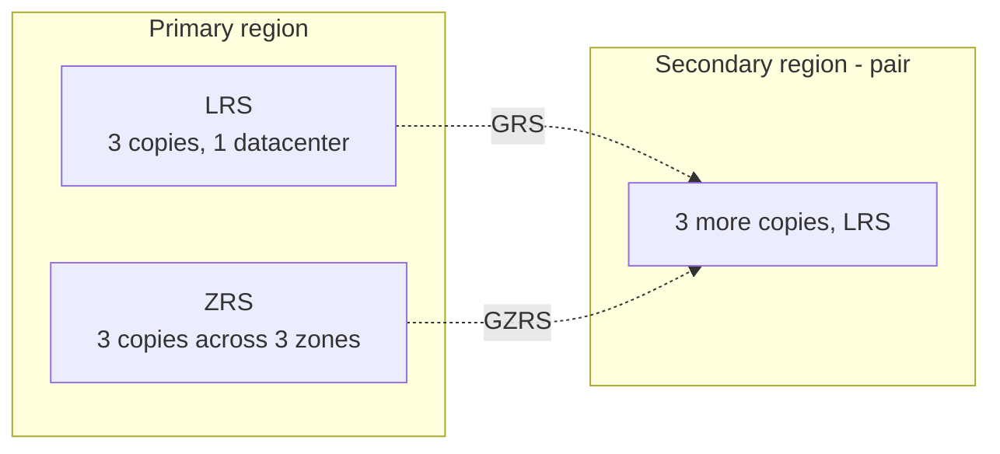

# Storage

<span class="exam-tag">AZ-900 · Architecture & services</span>

## Storage accounts

A **storage account** is a uniquely named container (globally unique, 3–24 lowercase letters/numbers) for Azure Storage data services, reachable over HTTP/HTTPS.

- Data is **encrypted at rest by default** (Storage Service Encryption, AES-256; Microsoft- or customer-managed keys) and in transit with HTTPS.
- Each service has its own endpoint:

| Service | Endpoint |
|---|---|
| Blob | `https://<account>.blob.core.windows.net` |
| Data Lake Storage | `https://<account>.dfs.core.windows.net` |
| Files | `https://<account>.file.core.windows.net` |
| Queue | `https://<account>.queue.core.windows.net` |
| Table | `https://<account>.table.core.windows.net` |

### Account types

| Type | Services | Redundancy | Use |
|---|---|---|---|
| **Standard general-purpose v2** | Blob (incl. Data Lake), Files, Queues, Tables | LRS, GRS, RA-GRS, ZRS, GZRS, RA-GZRS | Most scenarios (recommended default) |
| **Premium block blobs** | Block & append blobs | LRS, ZRS | High transaction rates, low latency |
| **Premium file shares** | Azure Files | LRS, ZRS | Enterprise / high-performance file shares (SMB & NFS) |
| **Premium page blobs** | Page blobs | LRS, ZRS | Page blob scenarios |

## Storage services

| Service | Stores | Use cases |
|---|---|---|
| **Blob Storage** | Unstructured objects (block, append, page blobs) | Images, video, backups, logs, data lakes, static websites |
| **Azure Files** | Managed file shares (**SMB** port 445, **NFS**) | Lift-and-shift file servers, shared config, mapped drives |
| **Queue Storage** | Messages up to **64 KB** | Asynchronous work queues between components |
| **Table Storage** | NoSQL key/attribute entities (schemaless) | Simple structured data, metadata |
| **Managed Disks** | Block-level volumes for VMs | OS and data disks |

### Blob Storage

- Objects in **containers** inside the storage account; accessed via REST, SDKs, AzCopy, Storage Explorer.
- Block blobs (files, up to ~190 TiB), append blobs (logs), page blobs (random-access, VHD disks).
- **Data Lake Storage** = Blob with hierarchical namespace for analytics.

### Azure Files

- Fully managed shares mountable by Windows, Linux and macOS; can replace or supplement on-prem file servers.
- Port **445** must be open outbound for SMB from clients.
- Quotas per share; snapshots; **Azure File Sync** caches shares on Windows Servers on-prem.

### Queue Storage

- Millions of messages, accessed via HTTP/HTTPS.
- Max message size **64 KB**; default time-to-live 7 days.
- **No guaranteed FIFO ordering** — use **Service Bus** queues/sessions when strict ordering, transactions or larger messages are needed.

### Table Storage

- Key/attribute store: entities (rows) with properties (columns), partition + row key.
- No joins, foreign keys or secondary indexes. **Azure Cosmos DB for Table** offers the same API with global distribution and more performance.

### Managed Disks

| Disk type | Media | Use |
|---|---|---|
| **Ultra Disk** | SSD | Sub-ms latency, extreme IOPS (SAP HANA, top-tier DBs) |
| **Premium SSD v2** | SSD | Performance tuned independently of size |
| **Premium SSD** | SSD | Production, performance-sensitive workloads |
| **Standard SSD** | SSD | Web servers, light enterprise apps, dev/test |
| **Standard HDD** | HDD | Backups, non-critical, infrequent access |

A VM has an **OS disk**, optional **data disks**, and often a **temporary disk** (non-persistent).

!!! warning "Retired: unmanaged disks"
    Unmanaged disks (VHDs you managed in your own storage accounts) were retired on **30 Sep 2025**. Use **managed disks**.

## Blob access tiers

| Tier | Online/offline | Minimum storage | Storage cost | Access cost | Use |
|---|---|---|---|---|---|
| **Hot** | Online | — | Highest | Lowest | Frequently accessed data |
| **Cool** | Online | **30 days** | Lower | Higher | Infrequently accessed (short-term backup) |
| **Cold** | Online | **90 days** | Lower still | Higher | Rarely accessed but needs fast retrieval |
| **Archive** | **Offline** | **180 days** | Lowest | Highest | Long-term archives, compliance |

- Hot and cool can be the **account default**; tiers can also be set **per blob**.
- Archive data must be **rehydrated** (to hot/cool/cold) before reading — **up to 15 hours** (standard priority).
- Deleting/moving a blob before its minimum period → **early deletion charge**.
- **Lifecycle management policies** move blobs between tiers automatically (e.g. cool after 30 days, archive after 180).

## Redundancy options



| Option | Copies | Protects against | Durability (per year) |
|---|---|---|---|
| **LRS** — locally redundant | 3, in one datacenter | Server/drive/rack failure | ≥ 11 nines |
| **ZRS** — zone-redundant | 3, across 3 availability zones | Datacenter (zone) failure | ≥ 12 nines |
| **GRS** — geo-redundant | 6: LRS in primary + LRS in secondary region | Regional outage | ≥ 16 nines |
| **GZRS** — geo-zone-redundant | 6: ZRS in primary + LRS in secondary | Zone **and** regional failure | ≥ 16 nines |
| **RA-GRS / RA-GZRS** | As above | As above + **read access** to secondary at any time | ≥ 16 nines |

- Replication to the secondary region is **asynchronous** (RPO usually < 15 minutes).
- Without RA-, the secondary is readable only **after a failover**.
- Archive tier supports only LRS, GRS, RA-GRS.

## Moving data

| Tool | Use |
|---|---|
| **AzCopy** | Command-line copy/sync of blobs and files (to/from Azure, between accounts). One-direction sync only |
| **Azure Storage Explorer** | Free desktop GUI (Windows/macOS/Linux) to manage blobs, files, queues, tables; uses AzCopy under the hood |
| **Azure File Sync** | Sync Windows file servers with Azure Files; **cloud tiering** keeps hot files local; bidirectional |

```bash
azcopy login
azcopy copy './data' 'https://mystorage.blob.core.windows.net/backups' --recursive
azcopy sync './site' 'https://mystorage.blob.core.windows.net/$web' --delete-destination=true
```

## Migration options

| Tool | Use |
|---|---|
| **Azure Migrate** | Hub to **discover, assess and migrate** servers, databases, web apps and VDI to Azure; integrated tools (Discovery & assessment, Server Migration, Database Migration Service, Data Box) plus business case for cost |
| **Azure Data Box** | Microsoft ships a **physical, ruggedised storage device**; copy data offline and ship it back — for very large datasets, limited bandwidth, or exporting data out of Azure |

Rule of thumb: if transferring over the network would take too long or cost too much, use **Data Box**.

## Quick recap

- [x] Storage account: globally unique name, encrypted by default, GPv2 = default choice.
- [x] Blob (objects), Files (SMB/NFS shares), Queues (64 KB messages, no strict FIFO), Tables (NoSQL), Disks (VMs).
- [x] Tiers: Hot / Cool (30d) / Cold (90d) / Archive (180d, offline, rehydrate up to 15h).
- [x] LRS (3 copies, 1 DC) · ZRS (3 zones) · GRS / GZRS (6 copies, 2 regions) · RA- = read secondary.
- [x] AzCopy (CLI), Storage Explorer (GUI), File Sync (hybrid file servers); Azure Migrate & Data Box for migration.
