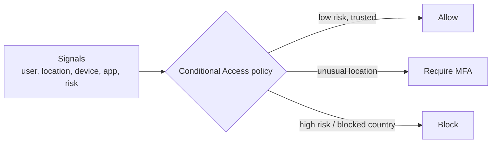

# Identity & Access

AZ-900 · Architecture & services

!!! warning "Renamed"
    **Azure Active Directory (Azure AD)** was renamed **Microsoft Entra ID** in 2023. Capabilities, licences and APIs stayed the same. **Azure AD Connect** → **Microsoft Entra Connect**; **Azure AD DS** → **Microsoft Entra Domain Services**.

## Microsoft Entra ID

Microsoft's cloud-based **identity and access management** service.

- **Authentication**: verify identity (passwords, MFA, passwordless, SSO).
- **Application management**: SSO to cloud & on-prem apps, enterprise apps, app registrations.
- **Device management**: register/join devices, use with Intune and Conditional Access.
- **Identity protection**: detect risky sign-ins and leaked credentials.
- **Hybrid identity**: sync with on-prem Active Directory Domain Services.

Who uses it: IT admins (control access), developers (add sign-in to apps), users (self-service), Microsoft 365/Azure/Dynamics subscribers (already included).

### Entra ID vs. on-prem AD DS

| | Microsoft Entra ID | Active Directory Domain Services |
|---|---|---|
| Built for | Cloud & web apps | On-prem Windows networks |
| Protocols | OAuth 2.0, OpenID Connect, SAML, WS-Fed | Kerberos, NTLM, LDAP |
| Structure | Flat users/groups, administrative units | OUs, GPOs, forests/domains |
| Device join | Entra join / registration | Domain join |

### Users & groups

- **Member** users (your organisation) and **guest** users (B2B external collaborators).
- **Cloud-only** or **synchronized** (hybrid) identities.
- Groups: security or Microsoft 365; **assigned** or **dynamic membership** (rules on user/device attributes, needs Entra ID P1).
- **Administrative units** scope admin permissions to a subset of users/groups (e.g. one department).

### Licences (overview)

| Edition | Adds |
|---|---|
| **Free** | Users/groups, basic SSO, MFA via security defaults, Entra Connect sync |
| **P1** | Conditional Access, dynamic groups, SSPR with on-prem writeback, hybrid features |
| **P2** | Identity Protection (risk-based policies), Privileged Identity Management (PIM), access reviews |

## Microsoft Entra Domain Services

- **Managed domain services** — domain join, Group Policy, LDAP, Kerberos/NTLM — **without deploying domain controllers**.
- Lets legacy apps that need traditional AD protocols run in Azure.
- One-way sync **from** Entra ID **to** the managed domain.

## Microsoft Entra Connect (hybrid identity)

- **Entra Connect Sync** (installed on-prem) or **Entra Cloud Sync** (lightweight agent) synchronise users, groups and password hashes from on-prem AD to Entra ID.
- Sign-in options: **password hash sync** (recommended), **pass-through authentication**, or **federation** (AD FS).
- Gives users the **same identity** on-prem and in the cloud (SSO).
- **IdFix** helps clean up on-prem directory attributes before syncing.

## Authentication methods

### Single sign-on (SSO)

- Sign in **once** and access many apps without re-entering credentials.
- Fewer passwords → better security and less helpdesk work; disabling one identity removes access everywhere.

### Multifactor authentication (MFA)

Requires two or more of:

| Factor | Example |
|---|---|
| **Something you know** | Password, PIN |
| **Something you have** | Phone with Microsoft Authenticator, FIDO2 key, hardware token |
| **Something you are** | Fingerprint, face (Windows Hello) |

- Users register methods before use; methods include Authenticator push/number matching, OATH codes, FIDO2/passkeys, SMS and voice (weakest).
- **Security defaults** enable baseline MFA for free tenants.
- Azure now **enforces MFA** for signing in to the Azure portal and other management tools (CLI, PowerShell, IaC).

### Passwordless

| Method | Notes |
|---|---|
| **Windows Hello for Business** | Biometric/PIN tied to the device; ideal for dedicated Windows PCs |
| **Microsoft Authenticator** | Phone becomes a passwordless credential |
| **FIDO2 security keys / passkeys** | Phishing-resistant hardware or device-bound keys |
| **Certificate-based authentication** | Smart cards / certificates |

Passwordless is both **more secure** and **more convenient**.

## External identities

Let people **outside your organisation** use their own identities:

- **B2B collaboration**: invite partners as **guest users** to your apps and resources (they sign in with their own work, school, Microsoft or social account).
- **B2B direct connect**: mutual trust with another Entra organisation (e.g. Teams shared channels).
- **Microsoft Entra External ID (external tenant)**: customer-facing (CIAM) sign-up/sign-in for your apps.

!!! note "Azure AD B2C"
    Azure AD B2C is **no longer sold to new customers** (since May 2025); new CIAM projects use **Microsoft Entra External ID**.

## Conditional Access

- **Policy engine** (Entra ID P1) that uses **signals** to decide access: *if* conditions *then* grant/block.
- **Signals**: user/group, location/IP, device platform & compliance, application, sign-in and user **risk**, client app.
- **Decisions**: allow, **require MFA**, require compliant/hybrid-joined device, require password change, **block**.

Example: require MFA for admins; block legacy authentication; allow HR app only from compliant devices.

## Self-service password reset (SSPR)

- Users reset or unlock their own passwords **without helpdesk**.
- Users register one or more methods (Authenticator, phone, email, security questions); admin chooses how many are required (1 or 2).
- **Password writeback** (P1 + Entra Connect) writes changes back to on-prem AD.

## Azure RBAC

Authorisation for Azure resources (who can do what, where) — covered in [Governance](09-governance-compliance.md#azure-role-based-access-control-rbac).

## Zero Trust

> "Never trust, always verify."

| Principle | Meaning |
|---|---|
| **Verify explicitly** | Authenticate and authorise using all available signals (identity, location, device, service, data classification) |
| **Use least-privilege access** | Just-in-time / just-enough access (JIT/JEA), risk-based adaptive policies |
| **Assume breach** | Minimise blast radius, segment access, encrypt end-to-end, use analytics to detect threats |

Zero Trust replaces the old "trusted corporate network" perimeter model — every request is treated as if it came from an untrusted network. Conditional Access, MFA, PIM and segmentation are core building blocks.

## Quick recap

- [x] Entra ID (ex-Azure AD) = cloud IAM: SSO, MFA, apps, devices, hybrid.
- [x] Entra Domain Services = managed domain join/LDAP/Kerberos without DCs.
- [x] Entra Connect = sync on-prem AD → Entra ID (PHS, PTA, federation).
- [x] MFA = know / have / are; passwordless = Windows Hello, Authenticator, FIDO2.
- [x] External identities: B2B guests, External ID for customers.
- [x] Conditional Access = signals → decisions (P1).
- [x] Zero Trust: verify explicitly, least privilege, assume breach.
