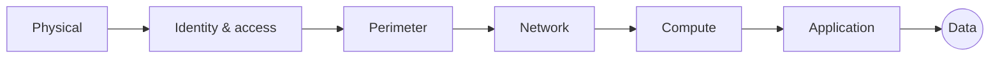

# Security

<span class="exam-tag">AZ-900 · Architecture & services</span>

!!! warning "Renamed"
    **Azure Security Center** + **Azure Defender** → **Microsoft Defender for Cloud** (2021). **Azure Sentinel** → **Microsoft Sentinel**.

## Defense in depth

Protect information with **multiple layers**, so if one layer is breached the next still protects the data.

| Layer | Examples |
|---|---|
| **Physical security** | Datacenter access control (Microsoft's responsibility) |
| **Identity & access** | Entra ID, MFA, Conditional Access, SSO, auditing |
| **Perimeter** | DDoS Protection, perimeter firewalls |
| **Network** | NSGs, segmentation, deny by default, private endpoints |
| **Compute** | Patch VMs, endpoint protection, secure remote access (Bastion, JIT) |
| **Application** | Secure development, no secrets in code (Key Vault), WAF |
| **Data** | Encryption at rest/in transit, access control, classification |



Combine it with **Zero Trust** (see [Identity](07-identity.md#zero-trust)).

## Microsoft Defender for Cloud

**Cloud-native application protection platform (CNAPP)** for Azure, on-premises (via Azure Arc) and other clouds (AWS, GCP).

| Capability | Description |
|---|---|
| **Cloud security posture management (CSPM)** | Continuous assessment, **secure score**, security recommendations, attack path analysis |
| **Regulatory compliance** | Dashboard against standards (Microsoft cloud security benchmark, ISO 27001, PCI DSS, CIS…) |
| **Cloud workload protection (CWP)** | Defender plans for servers, containers, storage, SQL, Key Vault, App Service, APIs… — threat detection and alerts |
| **DevOps security** | Scan code repos and IaC (GitHub, Azure DevOps, GitLab) |

- Free tier: foundational CSPM (secure score, recommendations). Paid Defender plans add workload protection.
- Covers **assess → secure → defend**.

## Microsoft Sentinel

- Cloud-native **SIEM** (security information and event management) and **SOAR** (security orchestration, automation and response).
- **Collect** data from users, devices, apps and infrastructure across clouds and on-prem (connectors).
- **Detect** threats with analytics and threat intelligence.
- **Investigate** incidents with AI and graph views.
- **Respond** automatically with playbooks (Logic Apps).

| | Defender for Cloud | Microsoft Sentinel |
|---|---|---|
| Focus | Posture + workload protection | SIEM/SOAR across the whole estate |
| Answers | "Are my resources configured securely? Is this workload under attack?" | "What is happening across all my security signals, and how do I respond?" |

Microsoft is consolidating Sentinel into the unified **Microsoft Defender portal** experience.

## Azure Key Vault

Centralised, secure store for:

- **Secrets** — connection strings, passwords, API keys.
- **Keys** — encryption keys (software or **HSM-protected**).
- **Certificates** — provision, store and auto-renew TLS/SSL certificates.

Benefits: no secrets in code, access via **RBAC** or access policies, **auditing** of every access, soft delete & purge protection, integration with App Service, AKS (Secrets Store CSI), VMs and pipelines. **Managed HSM** provides dedicated FIPS 140-3 Level 3 HSMs.

```bash
az keyvault create -g rg-sec -n kv-molla-demo --enable-rbac-authorization true
az keyvault secret set --vault-name kv-molla-demo -n DbPassword --value 'S3cr3t!'
az keyvault secret show --vault-name kv-molla-demo -n DbPassword --query value -o tsv
```

## Azure Dedicated Host

- A **physical server dedicated to one Azure subscription** to host your VMs.
- For compliance/isolation requirements; control over **maintenance windows**.
- Use **Azure Hybrid Benefit** for Windows Server/SQL Server licences; pay per host (not per VM).
- Host groups across fault domains/zones for availability.

Related: **Azure confidential computing** (VMs/containers protecting data in use with hardware TEEs).

## Network security

### Network security groups (NSGs)

- Filter traffic **to and from** Azure resources in a VNet — attached to a **subnet** and/or a **NIC**.
- Rules: priority (100–4096, lower = evaluated first), source/destination (IP, CIDR, **service tag**, application security group), port, protocol, **Allow/Deny**.
- **Default rules** (priority 65000+) can't be deleted but can be **overridden** by custom rules with a lower priority number:
    - Inbound: allow VNet traffic, allow Azure Load Balancer, **deny all else**.
    - Outbound: allow VNet, allow Internet, deny all else.
- Stateful: return traffic is allowed automatically.
- One NSG can be reused on many subnets/NICs.

```bash
az network nsg create -g rg-net -n nsg-web
az network nsg rule create -g rg-net --nsg-name nsg-web -n allow-https \
  --priority 100 --direction Inbound --access Allow --protocol Tcp \
  --destination-port-ranges 443 --source-address-prefixes Internet
```

### Azure Firewall

- Managed, **stateful, cloud-native firewall-as-a-service** with built-in HA and autoscaling (zone support).
- Network rules (L3/L4), application rules (FQDN filtering), DNAT, **threat-intelligence-based filtering**.
- Multiple public IPs, central policy with **Azure Firewall Manager**, logs/metrics in Azure Monitor.
- SKUs: **Basic** (SMB), **Standard**, **Premium** (adds **IDPS** and **TLS inspection**, URL filtering).

### Azure DDoS Protection

| Tier | What you get |
|---|---|
| **DDoS infrastructure protection** | Free, automatic, always on for every Azure public IP — protects the platform |
| **DDoS IP Protection** | Paid, per protected public IP: adaptive tuning, metrics/alerts, mitigation reports |
| **DDoS Network Protection** | Paid, per VNet (100 IPs): everything in IP Protection + **DDoS rapid response**, **cost protection**, WAF discount |

Protects against volumetric, protocol (L3/L4) attacks; combine with a **WAF** (Application Gateway / Front Door) for L7 attacks.

!!! warning "Renamed"
    The old **Basic** (free) and **Standard** tiers are now **infrastructure protection** and **Network Protection**.

### Other network security services

| Service | Purpose |
|---|---|
| **Web Application Firewall (WAF)** | OWASP protection on Application Gateway / Front Door |
| **Azure Bastion** | Browser-based RDP/SSH to VMs without public IPs |
| **Private Link / private endpoints** | Keep PaaS traffic private |
| **Just-in-time VM access** (Defender for Cloud) | Open management ports only when needed |

## Quick recap

- [x] Defense in depth: physical → identity → perimeter → network → compute → application → data.
- [x] Defender for Cloud = posture (secure score) + workload protection, multicloud.
- [x] Sentinel = SIEM + SOAR.
- [x] Key Vault = secrets, keys, certificates (HSM-backed option).
- [x] Dedicated Host = physical server for one customer.
- [x] NSG (L3/L4 allow/deny, priorities), Azure Firewall (managed, stateful, Premium = IDPS/TLS), DDoS (free infrastructure + IP/Network Protection).
