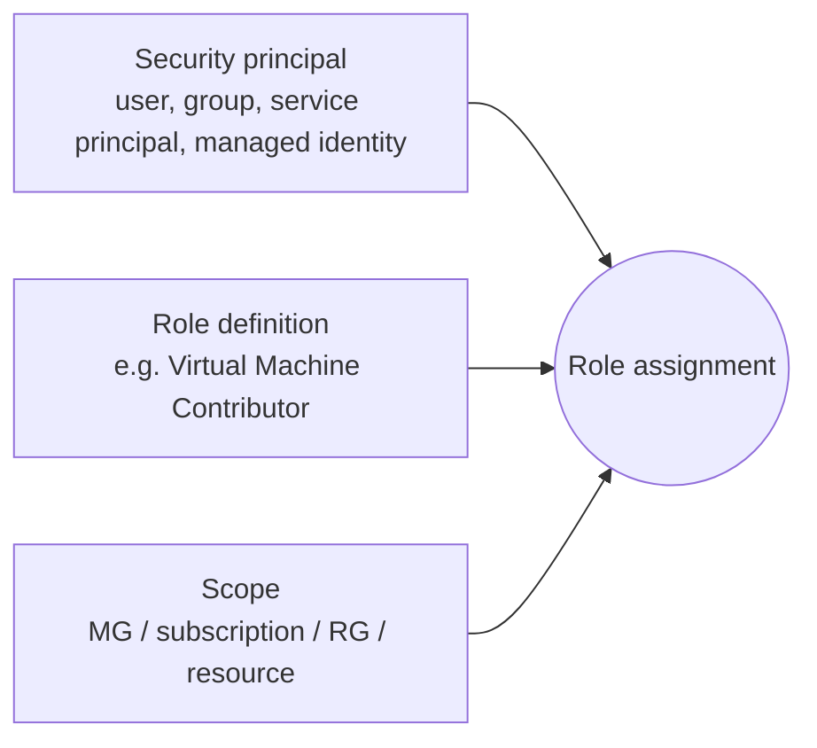

# Governance & Compliance

<span class="exam-tag">AZ-900 · Management & governance</span>

## Azure role-based access control (RBAC)

Authorisation system for **Azure resources**: who (**security principal**) can do what (**role definition**) where (**scope**).



- **Built-in roles** cover common needs; create **custom roles** when needed.

| Built-in role | Can |
|---|---|
| **Owner** | Everything, including assigning roles |
| **Contributor** | Create/manage all resources, **cannot grant access** |
| **Reader** | View only |
| **User Access Administrator** | Manage user access only |
| Service-specific | e.g. Virtual Machine Contributor, Storage Blob Data Reader, Key Vault Secrets User |

- Scopes: **management group → subscription → resource group → resource**. Assignments are **inherited** by child scopes.
- RBAC is an **allow model** — effective permissions are the union of all assignments. **Deny assignments** (created by Azure, e.g. Deployment Stacks/managed apps) override allows.
- Enforced by **Azure Resource Manager** for every request.
- Example: assign *Virtual Machine Contributor* to the Helpdesk group on `rg-prod-vms` → they can manage only VMs in that resource group.

!!! note "Azure RBAC vs. Microsoft Entra roles"
    **Azure RBAC** controls access to Azure **resources**. **Microsoft Entra roles** (Global Administrator, User Administrator…) control the **directory** (users, groups, apps).

```bash
az role assignment create --assignee helpdesk@contoso.com \
  --role "Virtual Machine Contributor" \
  --scope /subscriptions/<sub-id>/resourceGroups/rg-prod-vms
az role assignment list --resource-group rg-prod-vms -o table
```

## Resource tags

- **Name–value pairs** applied to resources, resource groups and subscriptions.
- Uses: **cost management** (group costs by `CostCenter`), resource management, operations (criticality, SLA), security (data classification), governance/automation.
- **Not inherited** by default — use Azure Policy (e.g. *Inherit a tag from the resource group*) to apply/require them.
- Up to 50 tags per resource; not every resource type supports tags.

```bash
az group update -n rg-payments --tags Env=Prod CostCenter=1234 Owner=abdallah
az resource list --tag Env=Prod -o table
```

## Resource locks

Prevent **accidental deletion or modification**.

| Lock | Effect |
|---|---|
| **CanNotDelete** ("Delete") | Read and modify allowed; **delete blocked** |
| **ReadOnly** | Read only — no modify, no delete |

- Apply at **subscription, resource group or resource**; **inherited** by children.
- Apply even to **Owners** — the lock must be **removed first** (requires `Microsoft.Authorization/locks/*` permission, e.g. Owner or User Access Administrator).
- ReadOnly can have side effects (e.g. blocks listing storage keys, scaling).

```bash
az lock create -n no-delete -g rg-payments --lock-type CanNotDelete
az lock list -g rg-payments -o table
```

## Azure Policy

Create, assign and manage rules that **evaluate resources** for compliance and **enforce** organisational standards.

- **Policy definition**: a rule (JSON) — e.g. *Allowed locations*, *Require a tag*, *Only HTTPS for App Service*, *Allowed VM SKUs*.
- **Initiative**: a group of policy definitions (e.g. *Microsoft cloud security benchmark*, ISO 27001).
- **Assignment** at a scope: management group, subscription or resource group (with exclusions).
- **Effects**:

| Effect | Behaviour |
|---|---|
| `Deny` | Block non-compliant create/update |
| `Audit` / `AuditIfNotExists` | Allow but flag as non-compliant |
| `Append` / `Modify` | Add or change properties/tags |
| `DeployIfNotExists` | Deploy a missing resource/config (e.g. diagnostic settings) |
| `Disabled` | Turn off |

- Evaluates **new and existing** resources; **remediation tasks** fix existing non-compliant ones.
- Hundreds of built-in definitions; integrates with Azure DevOps/GitHub for policy-as-code.

Example: assign *App Service apps should only be accessible over HTTPS* with `Deny` → creating a web app without HTTPS fails.

| | Azure RBAC | Azure Policy |
|---|---|---|
| Controls | **User actions** (who can do what) | **Resource properties** (what resources may look like) |
| Default | Deny unless granted | Allow unless a policy denies |

## Azure Blueprints → Deployment Stacks

!!! warning "Retiring: Azure Blueprints"
    Azure Blueprints packaged role assignments, policy assignments, ARM templates and resource groups into repeatable environments. It is being **retired on 31 January 2027** (phased retirement started July 2026). Replacements: **Template Specs** (store/version templates) + **Deployment Stacks** (deploy, manage lifecycle and lock resources with deny assignments), or IaC from Git (Bicep/Terraform) + Azure Policy. For landing zones, use the **Azure Landing Zones** accelerators.

## Microsoft Purview

Unified **data governance, risk and compliance** solution.

- **Data governance**: discover, classify and catalogue data across on-prem, multicloud and SaaS (Data Map, Unified Catalog, lineage).
- **Risk & compliance**: protect sensitive data (Information Protection labels), DLP, insider risk, eDiscovery, audit, **Compliance Manager** (compliance score).
- Works across Microsoft 365, Azure (Storage, SQL…), AWS, on-prem.

## Frameworks

| Framework | Purpose |
|---|---|
| **Cloud Adoption Framework (CAF)** | Guidance, best practices and tools for the whole cloud journey: Strategy → Plan → Ready (landing zones) → Adopt (migrate/innovate) → Govern → Secure → Manage |
| **Well-Architected Framework (WAF)** | Design quality of workloads: **Reliability, Security, Cost Optimization, Operational Excellence, Performance Efficiency** |

## Privacy, compliance & trust documents

| Resource | What it is |
|---|---|
| **Microsoft Privacy Statement** | What personal data Microsoft collects, how and why it uses it |
| **Microsoft Product Terms** (formerly *Online Services Terms*) | Licensing terms and conditions for Microsoft products & online services |
| **Data Protection Addendum (DPA)** | Microsoft's data-processing and security commitments for customer data (processing, location/transfer, retention/deletion, GDPR) |
| **Microsoft Trust Center** | Portal on Microsoft's approach to security, privacy, compliance and transparency |
| **Service Trust Portal** | Download **audit reports** (SOC, ISO, PCI), compliance guides and whitepapers; requires sign-in for some content |
| **Compliance offerings** | Azure holds the broadest set of certifications: **global** (ISO 27001, SOC 1/2/3), **US government** (FedRAMP, DoD IL), **industry** (HIPAA, PCI DSS), **regional** (GDPR, regional clouds) |

## Quick recap

- [x] RBAC = principal + role + scope; inherited; allow model; Owner/Contributor/Reader/User Access Admin.
- [x] Tags = name–value metadata, **not inherited** (use Policy).
- [x] Locks = CanNotDelete / ReadOnly, inherited, apply to Owners too.
- [x] Policy = rules on resource properties; effects Deny/Audit/Modify/DeployIfNotExists; initiatives.
- [x] Blueprints retiring (Jan 2027) → Template Specs + Deployment Stacks.
- [x] Purview = data governance & compliance; CAF = adoption journey; WAF = 5 pillars.
- [x] Service Trust Portal = audit reports.
