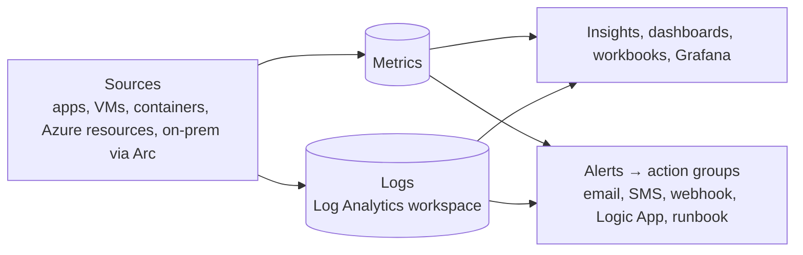

# Management & Monitoring Tools

<span class="exam-tag">AZ-900 · Management & governance</span>

## Ways to interact with Azure

| Tool | Best for |
|---|---|
| **Azure portal** | Visual management, learning, one-off tasks, dashboards |
| **Azure Cloud Shell** | Browser-based CLI/PowerShell, pre-authenticated, nothing to install |
| **Azure CLI** (`az`) | Cross-platform scripting with Bash-style commands |
| **Azure PowerShell** (`Az` module) | Scripting with PowerShell cmdlets and objects |
| **Azure mobile app** | Monitor and act on resources from a phone |
| **REST APIs / SDKs** | Programmatic access from apps |
| **IaC** (ARM, Bicep, Terraform) | Repeatable, versioned deployments |
| **Copilot in Azure** | Natural-language help and actions in the portal |

All of them go through **Azure Resource Manager**.

### Azure portal

- Web console at <https://portal.azure.com>: create/manage resources, search everything, custom **dashboards**, favourites, notifications, Cloud Shell, Copilot.
- Resilient (runs in every datacenter), updated continuously, no downtime for maintenance.

### Azure Cloud Shell

- Browser-based shell launched from the portal or <https://shell.azure.com>.
- Choose **Bash** or **PowerShell**; Azure CLI, Azure PowerShell, kubectl, Terraform, Git, editors and more are preinstalled.
- **Automatically authenticated** with your portal identity.
- Persistent `$HOME` via an Azure Files share (5 GB) in a storage account, or an **ephemeral session** without storage (nothing kept).
- Session times out after **20 minutes** of inactivity.

### Azure CLI vs. Azure PowerShell

| | Azure CLI | Azure PowerShell |
|---|---|---|
| Syntax | `az <group> <subgroup> <command>` | `Verb-AzNoun` cmdlets |
| Example | `az vm list -o table` | `Get-AzVM` |
| Output | JSON/table/tsv/yaml (text) | .NET objects |
| Install | Windows, macOS, Linux, Docker | Windows, macOS, Linux (PowerShell 7) |
| Use | Bash scripts, CI pipelines | PowerShell automation |

Both support interactive and scripted use — pick what your team knows. They can do the same things.

```bash
az login
az account set --subscription "<name-or-id>"
az group create -n rg-demo -l westeurope
az vm list -g rg-demo -o table
```

```powershell
Connect-AzAccount
Set-AzContext -Subscription "<name-or-id>"
New-AzResourceGroup -Name rg-demo -Location westeurope
Get-AzVM -ResourceGroupName rg-demo
```

!!! warning "Retired: AzureRM PowerShell module"
    The old **AzureRM** module was retired on 29 Feb 2024. Use the **Az** module.

## Azure Arc

Extends **Azure management and governance** to resources **outside Azure** — on-premises, other clouds (AWS, GCP), edge.

- Projects non-Azure resources into ARM so you can use **Azure Policy, RBAC, tags, Defender for Cloud, Azure Monitor, Update Manager** on them.
- Supported: **servers** (Windows/Linux), **Kubernetes clusters** (any CNCF-conformant, with GitOps/Flux), **Azure data services** (SQL Managed Instance, PostgreSQL), **SQL Server**, VMware vSphere / SCVMM VMs.
- Key enabler for **hybrid and multi-cloud** governance.

## Infrastructure as code (IaC)

Manage infrastructure through **code files** instead of manual steps → consistent, repeatable, versioned, reviewable deployments.

- **Declarative** (describe the end state — ARM, Bicep, Terraform) vs **imperative** (scripted steps — CLI/PowerShell scripts).
- Tools on Azure: **ARM templates**, **Bicep**, **Terraform**, Pulumi, Ansible.

### ARM templates

- **JSON** files that declaratively define resources; deployed by Azure Resource Manager.
- Benefits: declarative, **idempotent** (re-deploy gives same result), built-in **validation**, orchestration of dependencies (parallel where possible), modular (linked/nested templates), **export** from existing resources, what-if preview, CI/CD integration.

```json
{
  "$schema": "https://schema.management.azure.com/schemas/2019-04-01/deploymentTemplate.json#",
  "contentVersion": "1.0.0.0",
  "parameters": {
    "storageName": { "type": "string" }
  },
  "resources": [
    {
      "type": "Microsoft.Storage/storageAccounts",
      "apiVersion": "2023-05-01",
      "name": "[parameters('storageName')]",
      "location": "[resourceGroup().location]",
      "sku": { "name": "Standard_LRS" },
      "kind": "StorageV2"
    }
  ],
  "outputs": {}
}
```

### Bicep

- Microsoft's **domain-specific language** that compiles to ARM JSON — simpler syntax, modules, type safety, first-class tooling. Recommended over hand-written JSON.

```bicep
param storageName string
param location string = resourceGroup().location

resource sa 'Microsoft.Storage/storageAccounts@2023-05-01' = {
  name: storageName
  location: location
  sku: { name: 'Standard_LRS' }
  kind: 'StorageV2'
}

output blobEndpoint string = sa.properties.primaryEndpoints.blob
```

```bash
az deployment group what-if  -g rg-demo -f main.bicep -p storageName=stmolla001
az deployment group create   -g rg-demo -f main.bicep -p storageName=stmolla001
```

For Terraform on Azure (`azurerm` provider) see the [Terraform section](../terraform/index.md).

## Monitoring

### Azure Advisor

- Free, personalised **recommendations** based on your resource configuration and usage.
- Five categories (aligned with the Well-Architected Framework): **Reliability**, **Security**, **Performance**, **Cost**, **Operational excellence**.
- Example: right-size or shut down under-used VMs; enable backup; add zone redundancy.
- Available in the portal and via API; alerts on new recommendations.

### Azure Service Health

| Component | Shows |
|---|---|
| **Azure status** | Global status page of Azure services in all regions (public) |
| **Service Health** | Personalised view of incidents, **planned maintenance**, health & security advisories affecting **your** subscriptions/regions; set alerts |
| **Resource Health** | Health of your **individual resources** (is this VM available?) and history |

Keeps a history of incidents (useful for root-cause analysis and SLA claims).

### Azure Monitor

The platform for **collecting, analysing and acting on** telemetry from Azure, on-prem and other clouds.



| Feature | Description |
|---|---|
| **Metrics** | Numeric time-series (CPU %, requests/sec), near real-time, 93-day retention for platform metrics |
| **Logs / Log Analytics** | Query logs and events with **KQL** (Kusto Query Language) in a **Log Analytics workspace** |
| **Alerts** | Metric, log, activity-log alerts; notify and automate via **action groups** |
| **Application Insights** | APM for web apps: requests, dependencies, exceptions, availability tests, distributed tracing (OpenTelemetry) |
| **Insights** | Curated experiences: VM insights, Container insights, Network insights |
| **Activity log** | Who did what at the control plane (create/delete/update) — retained 90 days |

```kusto
// Top 10 VMs by average CPU in the last hour
Perf
| where TimeGenerated > ago(1h) and CounterName == "% Processor Time"
| summarize AvgCPU = avg(CounterValue) by Computer
| top 10 by AvgCPU
```

## Quick recap

- [x] Portal (GUI), Cloud Shell (browser Bash/PowerShell, 20-min timeout), CLI (`az`), PowerShell (`Az`), mobile app.
- [x] Azure Arc = Azure management/governance for on-prem & other clouds.
- [x] IaC: ARM (JSON) / Bicep (compiles to ARM) / Terraform; declarative & idempotent.
- [x] Advisor = recommendations (Reliability, Security, Performance, Cost, Operational excellence).
- [x] Service Health = Azure status + Service Health + Resource Health.
- [x] Azure Monitor = metrics, logs (Log Analytics/KQL), alerts, Application Insights.
