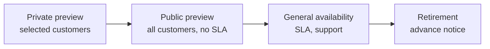

# SLAs & Service Lifecycle

## Service Level Agreements (SLAs)

- Microsoft's formal **commitment for uptime and connectivity** of each service, published in the *Service Level Agreements for Online Services* document.
- Expressed as a percentage of monthly availability: 99.9%, 99.95%, 99.99%…
- Each service has its own SLA; many depend on configuration (tier, redundancy, number of instances).
- **Free services and preview features have no SLA.**
- If Microsoft misses the SLA, you can claim **service credits** (a percentage of the monthly fee) — you must request them.

### Downtime per month

| SLA | Max downtime / month |
|---|---|
| 99% | ~7 h 18 m |
| 99.5% | ~3 h 39 m |
| 99.9% | ~43 m 50 s |
| 99.95% | ~21 m 55 s |
| 99.99% | ~4 m 23 s |
| 99.999% | ~26 s |

### Example VM SLAs

| Deployment | SLA |
|---|---|
| Single VM with Premium SSD/Ultra disks | 99.9% |
| Two or more VMs in an **availability set** | 99.95% |
| Two or more VMs across **availability zones** | 99.99% |

### Composite SLA

When services depend on each other, multiply their SLAs:

- Web app **99.95%** × SQL Database **99.99%** = **99.94%** (lower than either).
- Adding **redundancy** (e.g. a second region with failover) raises availability: P(both down) = (1 − 0.9994)² → ≈ **99.99996%** (ignoring the failover mechanism's own SLA).

### Factors that increase availability

- Choose tiers/SKUs with higher SLAs.
- Use **availability zones**, multiple instances, zone-redundant services.
- Use **multi-region** designs and disaster recovery (Azure Site Recovery, geo-replication).
- Remember: the SLA is a promise of compensation, not a guarantee — design for your own **availability targets (SLOs)**, **RTO** and **RPO**.

## Service lifecycle

| Stage | Notes |
|---|---|
| **Private preview** | Limited audience by invitation |
| **Public preview** | Anyone can try (portal "Preview" label); **no SLA**, limited support, may change; covered by *Supplemental Terms of Use for Previews* |
| **General availability (GA)** | Fully supported, SLA applies; rolled out region by region |
| **Retirement** | Under the Modern Lifecycle Policy, Microsoft typically gives at least **12 months' notice** before retiring a service without a replacement (shorter notice for some features/security reasons) |

Track changes:

- **Azure Updates** — <https://azure.microsoft.com/updates/> — new features, previews, GA and retirements (RSS feed, filters).
- **Retirement workbooks** in Azure Advisor show retiring services in your subscriptions.
- Enable previews per subscription in **Preview features** in the portal.

## Quick recap

- [x] SLA = uptime commitment per service; credits if missed; none for free/preview.
- [x] 99.9% ≈ 43 min/month, 99.99% ≈ 4 min/month.
- [x] Composite SLA = multiply; redundancy raises availability.
- [x] Lifecycle: private preview → public preview (no SLA) → GA → retirement (advance notice); watch Azure Updates.
