# Microsoft Azure

Microsoft Azure is Microsoft's public cloud platform: compute, networking, storage, databases, identity, security, AI and management services delivered on demand from datacenters around the world.

!!! note "Scope & baseline"
    These notes cover the **AZ-900: Microsoft Azure Fundamentals** syllabus (skills measured as of **July 2026**) and add practical DevOps context (Azure CLI, Bicep, networking details). Renamed or retired products (Azure AD, Security Center, Blueprints, Single Server databases…) appear only in :material-alert: *Deprecated / Renamed* boxes.

## Learning path

```mermaid
flowchart LR
    A[Cloud concepts] --> B[Azure architecture]
    B --> C[Compute]
    C --> D[Networking]
    D --> E[Storage]
    E --> F[Databases]
    F --> G[Identity]
    G --> H[Security]
    H --> I[Governance & compliance]
    I --> J[Management & monitoring]
    J --> K[Cost]
    K --> L[SLA & lifecycle]
    L --> M[Solutions: IoT, data, AI, DevOps]
```

## Pages

| # | Page | AZ-900 domain |
|---|------|---------------|
| 1 | [Cloud Concepts](01-cloud-concepts.md) | Cloud concepts (25–30%) |
| 2 | [Azure Architecture](02-architecture.md) | Architecture & services (35–40%) |
| 3 | [Compute Services](03-compute.md) | Architecture & services |
| 4 | [Networking](04-networking.md) | Architecture & services |
| 5 | [Storage](05-storage.md) | Architecture & services |
| 6 | [Databases](06-databases.md) | — (good to know) |
| 7 | [Identity & Access](07-identity.md) | Architecture & services |
| 8 | [Security](08-security.md) | Architecture & services |
| 9 | [Governance & Compliance](09-governance-compliance.md) | Management & governance (30–35%) |
| 10 | [Management & Monitoring Tools](10-management-tools.md) | Management & governance |
| 11 | [Cost Management](11-cost-management.md) | Management & governance |
| 12 | [SLAs & Service Lifecycle](12-sla-lifecycle.md) | — (good to know) |
| 13 | [IoT, Data, AI & DevOps Solutions](13-solutions.md) | — (good to know) |
| 14 | [Hands-on Labs](14-labs.md) | practice |
| 15 | [Azure CLI Cheat Sheet](15-cheatsheet.md) | quick review |
| 16 | [AZ-900 Exam Guide](16-exam.md) | all |
| 17 | [What Changed vs. the Course](17-changes.md) | — |

## Useful links

- Azure docs: <https://learn.microsoft.com/azure/>
- AZ-900 study guide: <https://learn.microsoft.com/credentials/certifications/resources/study-guides/az-900>
- Free Learn path: <https://learn.microsoft.com/training/courses/az-900t00>
- Azure Updates (roadmap): <https://azure.microsoft.com/updates/>
- Pricing calculator: <https://azure.microsoft.com/pricing/calculator/>
