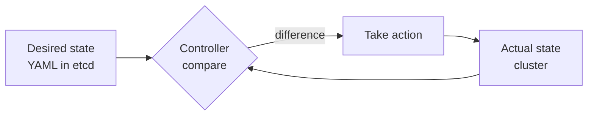

# Kubernetes Fundamentals

## What is Kubernetes?

| | |
|---|---|
| **What** | An open-source container-orchestration platform that automates deploying, scaling and operating containerised apps across a cluster of machines. |
| **Why** | Containers on a single host don't survive a crashed node, don't scale on demand and don't self-heal. Production needs something to schedule, monitor and repair them automatically. |
| **How** | You **declare the desired state** in YAML ("3 replicas of this app, always"); **control loops** continuously reconcile the actual state to match it. |

The name comes from Greek for "helmsman"; **K8s** = K + 8 letters + s.

## From bare metal to Kubernetes

| Era | Description | Problem |
|---|---|---|
| **Traditional** | Apps run directly on physical servers | No isolation, resource conflicts, poor utilisation |
| **Virtualised** | Hypervisor runs many VMs per server | Each VM carries a full OS — heavy, slow to boot |
| **Containers** | Share the host kernel, isolate filesystem/process/network (namespaces + cgroups) | Dozens/hundreds of containers need placement, scaling, networking, recovery |
| **Kubernetes** | Automation layer that orchestrates containers across many nodes | — |

## Containers vs. virtual machines

| | Virtual machine | Container |
|---|---|---|
| Isolation | Full guest OS via a hypervisor | Process-level, shares host kernel |
| Size | Gigabytes | Megabytes |
| Boot time | Minutes | Seconds (or less) |
| Density | Few per host | Many per host |
| Portability | Tied to hypervisor/image format | Anywhere an OCI runtime exists |

Containers are built from **OCI images** (Docker/Podman/Buildah build them) and run by a **container runtime** (containerd, CRI-O).

## Core features

- **Self-healing** — restarts failed containers, replaces and reschedules Pods when a node fails.
- **Horizontal scaling** — manual, scheduled or automatic (HPA) on CPU/memory/custom metrics.
- **Service discovery & load balancing** — stable DNS names and virtual IPs for groups of Pods.
- **Automated rollouts & rollbacks** — gradual updates with instant rollback.
- **Declarative configuration** — desired state in YAML, ideal for Git/GitOps.
- **Storage orchestration** — local, cloud (EBS/EFS) or network storage mounted automatically.
- **Secret & config management** — update config without rebuilding images.
- **Batch execution** — Jobs and CronJobs.
- **Extensibility** — CRDs, Operators and a huge ecosystem (Helm, Argo CD, Istio, Prometheus).

## The declarative model & control loops

Every controller runs **observe → compare → act → repeat**. You never tell Kubernetes *how* to start 3 Pods — you say there should be 3, and the ReplicaSet controller makes it true, forever.

## CNCF & ecosystem

- Created at **Google** (inspired by the internal **Borg** system), open-sourced in **2014**.
- Donated in **2015** to the **Cloud Native Computing Foundation (CNCF)** (Linux Foundation), which governs it.
- CNCF also hosts: Prometheus, Envoy, containerd, CRI-O, Helm, Argo, Cilium, etcd, CoreDNS…
- **Vendor-neutral**: the same manifests run on EKS, GKE, AKS, OpenShift, RKE2, k3s or kubeadm clusters.
- New minor release roughly **every 4 months**; each minor is supported for about **14 months** (latest 3 minors).

## Interview questions

??? question "Why not just run containers with Docker in production?"
    Docker alone has no cross-host scheduling, self-healing, service discovery or rolling updates. Kubernetes adds that orchestration layer.

??? question "What is the core idea of the declarative model?"
    You describe the desired end state; control loops continuously compare it to the actual state and reconcile the difference.

??? question "What does the CNCF do?"
    It's the neutral governance body (under the Linux Foundation) that hosts Kubernetes and related projects, ensuring vendor neutrality.

## Quick recap

- [x] Kubernetes = container orchestration: scheduling, healing, scaling, networking, storage.
- [x] Containers share the kernel; VMs carry a full OS.
- [x] Declarative desired state + reconciliation loops.
- [x] CNCF-governed, vendor-neutral, ~3 releases per year.
