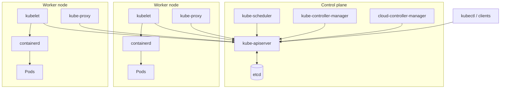
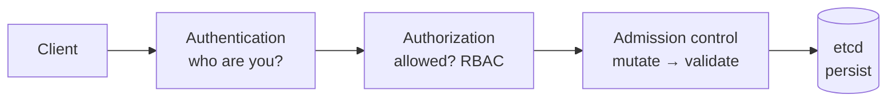
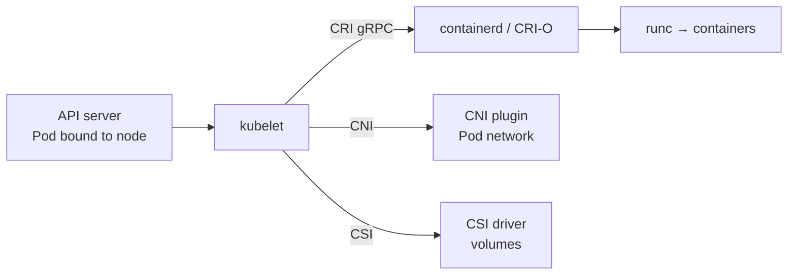

# Kubernetes Architecture

CKA

## Cluster overview

A **cluster** = a set of machines (**nodes**) split into:

- **Control plane** — makes global decisions and stores cluster state (the "brain").
- **Worker nodes** — run the application Pods.

## Control-plane components

| Component | Role |
|---|---|
| **kube-apiserver** | The front door. Every client (kubectl, controllers, kubelets) talks to the cluster **only** through it. The **only** component that talks to etcd. Scales horizontally. |
| **etcd** | Consistent, distributed key-value store — the single source of truth for all cluster state. |
| **kube-scheduler** | Watches for unscheduled Pods and assigns each to a suitable node. |
| **kube-controller-manager** | Runs core control loops: Node, ReplicaSet, Deployment, Job, EndpointSlice, ServiceAccount, Namespace… |
| **cloud-controller-manager** | Cloud-specific loops: node lifecycle, routes, provisioning cloud load balancers for `LoadBalancer` Services. |

On kubeadm clusters these run as **static Pods** defined in `/etc/kubernetes/manifests/` on the control-plane node.

### API server request flow

- **Authentication**: client certs, bearer tokens, OIDC → else `401 Unauthorized`.
- **Authorization**: RBAC (default), Node, Webhook → else `403 Forbidden`.
- **Admission**: mutating then validating admission controllers/webhooks/policies (e.g. Pod Security Admission, ResourceQuota, LimitRanger, ValidatingAdmissionPolicy).

### etcd

| | |
|---|---|
| **What** | Strongly consistent distributed key-value store holding every object (Pods, Secrets, RBAC…). |
| **Why** | One authoritative, crash-consistent record that several control-plane replicas can read/write safely. |
| **How** | **Raft** consensus across an **odd** number of members (3 or 5). Quorum = ⌊n/2⌋+1 → 3 members tolerate 1 failure, 5 tolerate 2. Listens on **2379** (clients) / **2380** (peers). |

!!! danger
    Only the API server should talk to etcd. Back it up regularly — see [Maintenance](17-maintenance.md).

### kube-scheduler

| | |
|---|---|
| **What** | Decides which node a new Pod runs on. |
| **Why** | Manual placement is impossible at scale and can't respect resources, affinity or taints. |
| **How** | **Filter** nodes that satisfy hard constraints → **score** the rest → **bind** the Pod to the best node. See [Scheduling](08-scheduling-autoscaling.md). |

### Controller managers

- Each controller runs an independent **watch → compare → act** loop against the API server.
- Splitting cloud logic into the **cloud-controller-manager** keeps Kubernetes cloud-agnostic: AWS, GCP and Azure each ship their own.

## Worker-node components

| Component | Role |
|---|---|
| **kubelet** | Node agent. Registers the node, receives Pod specs, ensures their containers run and are healthy, reports status. Also runs static Pods. Not a Pod itself (systemd service). |
| **kube-proxy** | Programs node networking rules (iptables / IPVS / nftables) so Service traffic reaches backend Pods. Some CNIs (Cilium) replace it with eBPF. |
| **Container runtime** | Pulls images and runs containers: **containerd** or **CRI-O**, via the **CRI** (gRPC). |

### kubelet ↔ runtime

!!! warning "Removed: dockershim (Kubernetes 1.24)"
    The kubelet no longer talks to Docker Engine directly. Use any CRI runtime (containerd, CRI-O). Images built with Docker still work everywhere — they're standard OCI images. Debug containers on nodes with **`crictl`** (`crictl ps`, `crictl logs`, `crictl images`).

## Control plane vs. worker node

| | Control plane | Worker node |
|---|---|---|
| Role | Global decisions, stores state | Runs application containers |
| Components | API server, etcd, scheduler, controller managers | kubelet, kube-proxy, runtime |
| Talks to | etcd directly; clients via API server | API server only |
| Typical count | 3 (or 5) for HA | Scales with demand |
| If it fails | No new changes/scheduling; running Pods keep running | Its Pods are rescheduled elsewhere (if managed by a controller) |

## Important ports

| Port | Component |
|---|---|
| 6443 | kube-apiserver |
| 2379-2380 | etcd |
| 10250 | kubelet API |
| 10257 | kube-controller-manager |
| 10259 | kube-scheduler |
| 30000-32767 | NodePort Services |

## Interview questions

??? question "What happens if etcd is unavailable?"
    The API server can't read or write state — running Pods keep running, but no new scheduling, scaling or changes happen.

??? question "kube-controller-manager vs cloud-controller-manager?"
    The former runs cloud-agnostic core loops; the latter runs cloud-provider logic (e.g. provisioning an AWS NLB), keeping the core cloud-neutral.

??? question "Why was dockershim removed?"
    To simplify the kubelet and standardise on the CRI — any CRI-compliant runtime works without a special shim.

??? question "Why does etcd need an odd number of members?"
    Raft needs a majority (quorum). 4 members tolerate the same 1 failure as 3, so even numbers add cost without extra fault tolerance.

## Quick recap

- [x] Control plane: API server (front door) · etcd (state) · scheduler (placement) · controller managers (reconcile).
- [x] Nodes: kubelet · kube-proxy · CRI runtime.
- [x] Request flow: AuthN → AuthZ → Admission → etcd.
- [x] Docker shim removed in 1.24 → containerd / CRI-O; use `crictl` on nodes.
