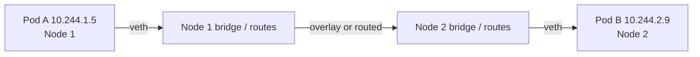

# Networking, CNI & DNS

<span class="exam-tag">CKA</span>

## The Kubernetes networking model

1. Every Pod gets its **own unique IP** — no NAT between Pods, cluster-wide.
2. All Pods can reach all other Pods across nodes without NAT.
3. Nodes can reach all Pods (and vice versa) without NAT.
4. Containers in one Pod share a network namespace → talk over `localhost`.

This flat model is what makes Services, DNS and Ingress simple for applications.

Three IP ranges to keep apart:

| Range | Example | Set by |
|---|---|---|
| Node IPs | `10.0.1.0/24` (VPC) | Infrastructure |
| Pod CIDR | `192.168.0.0/16` | `kubeadm init --pod-network-cidr` / CNI |
| Service CIDR | `10.96.0.0/12` | `--service-cluster-ip-range` (kube-apiserver) |

## Container Network Interface (CNI)

| | |
|---|---|
| **What** | A spec + plugin interface for configuring container networking. |
| **Why** | Kubernetes implements no Pod networking itself; environments (bare metal, cloud VPC) differ. |
| **How** | The container runtime (on the kubelet's behalf) calls the CNI plugin when a Pod is created/deleted; the plugin allocates an IP (IPAM) and wires the Pod's network namespace. Config in `/etc/cni/net.d/`, binaries in `/opt/cni/bin/`. |

### Popular CNI plugins

| Plugin | Notable for |
|---|---|
| **Calico** | BGP routing or VXLAN, strong NetworkPolicy support |
| **Cilium** | eBPF dataplane, L3–L7 policy, Hubble observability, can replace kube-proxy |
| **Flannel** | Simple VXLAN overlay, **no NetworkPolicy enforcement** |
| **AWS VPC CNI** | Default on EKS; Pods get real VPC IPs |

### Pod-to-Pod across nodes



The CNI plugin programs routes (or a VXLAN/Geneve tunnel) so the packet travels with real Pod IPs; apps never need to know node placement.

## kube-proxy and Service routing

kube-proxy watches **Services** and **EndpointSlices** and programs rules on every node so traffic to a Service's virtual IP is load-balanced to a ready Pod.

| Mode | Notes |
|---|---|
| `iptables` | Default on most clusters; random backend selection |
| `ipvs` | Kernel load balancer, more algorithms; better at very large scale |
| `nftables` | Modern replacement for iptables mode (GA in 1.33) |
| eBPF (Cilium) | kube-proxy replacement |

!!! note "Endpoints → EndpointSlices"
    The old `Endpoints` API is deprecated in favour of **EndpointSlices** (`kubectl get endpointslices`). `kubectl get endpoints` still works for troubleshooting but prints a deprecation warning on recent versions.

## DNS — CoreDNS

| | |
|---|---|
| **What** | The cluster DNS server (Deployment `coredns` in `kube-system`, Service named `kube-dns` for compatibility). |
| **Why** | Pod IPs change constantly; apps need stable names. |
| **How** | Each Service gets a record `<svc>.<ns>.svc.cluster.local`; the kubelet sets every Pod's `/etc/resolv.conf` to use CoreDNS. Config: ConfigMap `coredns` (Corefile). |

```bash
# From any Pod
curl backend                                # same namespace
curl backend.production                     # other namespace
curl backend.production.svc.cluster.local   # FQDN
nslookup db-headless.production.svc.cluster.local   # headless → Pod IPs
```

| Record | Format |
|---|---|
| Service (A/AAAA) | `my-svc.my-ns.svc.cluster.local` |
| Headless Service | Returns all ready Pod IPs |
| StatefulSet Pod | `pod-0.my-headless.my-ns.svc.cluster.local` |
| SRV (named ports) | `_http._tcp.my-svc.my-ns.svc.cluster.local` |
| Pod (by IP) | `10-244-1-5.my-ns.pod.cluster.local` |

Pod DNS policies: `ClusterFirst` (default), `Default` (node's resolv.conf), `ClusterFirstWithHostNet`, `None` (+ `dnsConfig`).

!!! warning "Legacy: kube-dns"
    CoreDNS replaced kube-dns as the default in **1.13**. The Service is still *named* `kube-dns` and Pods carry the label `k8s-app=kube-dns`.

### Debug DNS

```bash
kubectl run tmp --rm -it --image=busybox:1.36 --restart=Never -- nslookup kubernetes.default
kubectl -n kube-system get pods -l k8s-app=kube-dns
kubectl -n kube-system logs -l k8s-app=kube-dns
kubectl -n kube-system get configmap coredns -o yaml
```

## Interview questions

??? question "Why doesn't Kubernetes ship its own Pod networking?"
    Environments differ too much (bare metal, VPCs, overlays). The CNI lets each environment plug in the right implementation while keeping the same flat model.

??? question "How does a Pod resolve a Service name?"
    `/etc/resolv.conf` points to the CoreDNS Service IP with search domains (`<ns>.svc.cluster.local`, `svc.cluster.local`, `cluster.local`), so a short name expands to the FQDN.

## Quick recap

- [x] Flat network: unique Pod IPs, no NAT.
- [x] CNI does Pod networking; Flannel doesn't enforce NetworkPolicy.
- [x] kube-proxy (iptables/IPVS/nftables) implements Services using EndpointSlices.
- [x] CoreDNS: `<svc>.<ns>.svc.cluster.local`.
