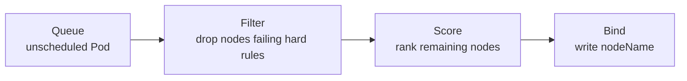

# Scheduling & Autoscaling

<span class="exam-tag">CKA</span>

## How the scheduler places a Pod



- **Filter**: enough CPU/memory (requests), nodeSelector/affinity, taints/tolerations, ports, volume topology.
- **Score**: spread, affinity preferences, image locality, balanced utilisation.
- Setting `spec.nodeName` directly **bypasses the scheduler**.
- No node fits → Pod stays `Pending` with a `FailedScheduling` event.

## nodeSelector

```bash
kubectl label nodes worker-1 disktype=ssd
```

```yaml
apiVersion: v1
kind: Pod
metadata: { name: fast-storage-pod }
spec:
  nodeSelector:
    disktype: ssd
  containers:
    - { name: app, image: myapp:1.0 }
```

Simplest constraint: exact label match. Well-known labels: `kubernetes.io/hostname`, `kubernetes.io/os`, `kubernetes.io/arch`, `topology.kubernetes.io/zone`, `node.kubernetes.io/instance-type`.

## Taints and tolerations

| | |
|---|---|
| **What** | A **taint** on a node repels Pods; a matching **toleration** lets a Pod schedule there. |
| **Why** | Reserve nodes (GPU, dedicated tenant, spot) — opt-in instead of opt-out. |
| **How** | `kubectl taint nodes <node> key=value:Effect` + `tolerations` in the Pod. |

```bash
kubectl taint nodes gpu-node-1 workload=gpu:NoSchedule
kubectl taint nodes gpu-node-1 workload=gpu:NoSchedule-     # remove (trailing -)
kubectl describe node gpu-node-1 | grep -i taint
```

```yaml
spec:
  tolerations:
    - key: workload
      operator: Equal          # or Exists (no value)
      value: gpu
      effect: NoSchedule
```

| Effect | Behaviour |
|---|---|
| `NoSchedule` | New Pods without toleration won't be scheduled |
| `PreferNoSchedule` | Avoid if possible |
| `NoExecute` | Also **evicts** running Pods that don't tolerate it (`tolerationSeconds` to delay) |

!!! note
    A toleration **allows** a Pod onto a tainted node — it doesn't **force** it there. Combine with node affinity to pin workloads. Control-plane nodes carry `node-role.kubernetes.io/control-plane:NoSchedule`.

## Node affinity & Pod (anti-)affinity

| | |
|---|---|
| **What** | Expressive placement: operators `In`, `NotIn`, `Exists`, `DoesNotExist`, `Gt`, `Lt`; hard and soft rules. Pod affinity co-locates or separates Pods relative to each other. |
| **How** | `requiredDuringSchedulingIgnoredDuringExecution` = hard; `preferredDuringSchedulingIgnoredDuringExecution` = weighted soft preference. "IgnoredDuringExecution" = running Pods aren't evicted if labels change. |

```yaml
spec:
  affinity:
    nodeAffinity:
      requiredDuringSchedulingIgnoredDuringExecution:
        nodeSelectorTerms:
          - matchExpressions:
              - { key: disktype, operator: In, values: [ssd] }
      preferredDuringSchedulingIgnoredDuringExecution:
        - weight: 50
          preference:
            matchExpressions:
              - { key: topology.kubernetes.io/zone, operator: In, values: [us-east-1a] }
    podAntiAffinity:
      requiredDuringSchedulingIgnoredDuringExecution:
        - labelSelector:
            matchLabels: { app: web }
          topologyKey: kubernetes.io/hostname    # never two web Pods on one node
  containers:
    - { name: web, image: nginx:1.27 }
```

## Topology spread constraints

Spread replicas evenly across zones/nodes — usually better than anti-affinity for large replica counts.

```yaml
spec:
  topologySpreadConstraints:
    - maxSkew: 1
      topologyKey: topology.kubernetes.io/zone
      whenUnsatisfiable: DoNotSchedule      # or ScheduleAnyway
      labelSelector:
        matchLabels: { app: web }
```

| Use | Mechanism |
|---|---|
| Keep everything else off special nodes | Taints & tolerations |
| Require/prefer node characteristics | Node affinity / nodeSelector |
| Dedicated nodes for one workload | **Both**: taint + toleration + affinity |
| Spread replicas for HA | Topology spread / pod anti-affinity |

## DaemonSets

| | |
|---|---|
| **What** | Runs exactly **one Pod per node** (or per selected node). |
| **Why** | Node-scoped agents: log collectors, monitoring agents, CNI/CSI node plugins, kube-proxy. |
| **How** | New nodes automatically get a Pod; removed nodes' Pods are garbage-collected. |

```yaml
apiVersion: apps/v1
kind: DaemonSet
metadata: { name: node-log-agent, namespace: logging }
spec:
  selector:
    matchLabels: { app: log-agent }
  template:
    metadata:
      labels: { app: log-agent }
    spec:
      tolerations:
        - operator: Exists          # run on tainted nodes too
      containers:
        - name: agent
          image: fluent/fluent-bit:3.2
```

## Resource requests & limits

| | |
|---|---|
| **requests** | Guaranteed minimum; used by the **scheduler** for placement |
| **limits** | Hard ceiling enforced at runtime |
| CPU over limit | **Throttled** (not killed) |
| Memory over limit | **OOMKilled** |

```yaml
resources:
  requests:
    cpu: "250m"       # 0.25 vCPU
    memory: "256Mi"
  limits:
    cpu: "500m"
    memory: "512Mi"
```

Units: CPU `1` = 1 vCPU = `1000m`; memory `Mi`/`Gi` (binary) vs `M`/`G` (decimal).

### QoS classes (eviction order under node pressure)

| Class | Condition | Evicted |
|---|---|---|
| **Guaranteed** | Every container has requests = limits for CPU and memory | Last |
| **Burstable** | At least one request/limit set, not Guaranteed | Middle |
| **BestEffort** | No requests/limits at all | First |

### In-place Pod resize

Since **1.35 (GA)** you can change CPU/memory of a running Pod without recreating it (`kubectl patch pod ... --subresource resize`), controlled per resource by `resizePolicy`.

## ResourceQuota & LimitRange

```yaml
apiVersion: v1
kind: ResourceQuota
metadata: { name: team-a-quota, namespace: team-a }
spec:
  hard:
    requests.cpu: "10"
    requests.memory: 20Gi
    limits.memory: 40Gi
    pods: "50"
    persistentvolumeclaims: "10"
    requests.nvidia.com/gpu: "2"
---
apiVersion: v1
kind: LimitRange
metadata: { name: defaults, namespace: team-a }
spec:
  limits:
    - type: Container
      defaultRequest: { cpu: 100m, memory: 128Mi }
      default: { cpu: 500m, memory: 512Mi }      # default limits
      max: { cpu: "2", memory: 2Gi }
```

- **ResourceQuota** caps a namespace's total usage/object counts.
- **LimitRange** sets per-container defaults and min/max.
- With a CPU/memory quota, Pods **without** requests/limits are rejected — unless a LimitRange supplies defaults.

## Priority & preemption

```yaml
apiVersion: scheduling.k8s.io/v1
kind: PriorityClass
metadata: { name: critical }
value: 100000
globalDefault: false
preemptionPolicy: PreemptLowerPriority
description: "Business-critical services"
---
spec:
  priorityClassName: critical
```

Higher-priority Pods can **preempt** (evict) lower-priority ones when the cluster is full. Built-ins: `system-cluster-critical`, `system-node-critical`.

## Autoscaling

| Tool | Scales | Based on |
|---|---|---|
| **HPA** | Pod replicas | CPU, memory, custom/external metrics |
| **VPA** | Pod requests/limits | Historical usage (recommend or apply) |
| **Cluster Autoscaler** | Nodes (node groups) | Pending Pods / underused nodes |
| **Karpenter** | Nodes (just-in-time, right-sized instances) | Pending Pods |
| **KEDA** | Pods (incl. to/from zero) | Event sources: queues, Kafka lag, Prometheus |

HPA scales Pods; Cluster Autoscaler/Karpenter add nodes to fit them — they work together. HPA needs **metrics-server** for CPU/memory.

```yaml
apiVersion: autoscaling/v2
kind: HorizontalPodAutoscaler
metadata: { name: web-hpa }
spec:
  scaleTargetRef: { apiVersion: apps/v1, kind: Deployment, name: web }
  minReplicas: 3
  maxReplicas: 10
  metrics:
    - type: Resource
      resource:
        name: cpu
        target: { type: Utilization, averageUtilization: 70 }   # % of requests
  behavior:
    scaleDown:
      stabilizationWindowSeconds: 300
---
apiVersion: policy/v1
kind: PodDisruptionBudget
metadata: { name: web-pdb }
spec:
  minAvailable: 2          # or maxUnavailable: 1
  selector:
    matchLabels: { app: web }
```

```bash
kubectl autoscale deployment web --cpu-percent=70 --min=3 --max=10
kubectl get hpa -w
```

!!! warning "Deprecated: `autoscaling/v2beta1`, `v2beta2`"
    Removed (1.25 / 1.26). Use **`autoscaling/v2`**. (`autoscaling/v1` still exists but supports CPU only.)

**PodDisruptionBudget** limits *voluntary* disruptions (drains, upgrades) — not node crashes.

## Common mistakes

- :x: Limits without requests → requests default to limits, nodes under-packed.
- :x: No PDB on critical apps → a node drain takes them offline.
- :x: Taints without affinity → workloads still drift to other nodes.
- :x: No spread/anti-affinity → all replicas on one node.

## Interview questions

??? question "How does Kubernetes schedule a Pod?"
    Filter nodes that meet hard constraints, score the rest, bind the Pod to the best node.

??? question "Requests vs limits?"
    Requests = guaranteed minimum used for scheduling; limits = ceiling (memory → OOMKill, CPU → throttling).

??? question "Taints vs node affinity?"
    Taints repel by default (nodes choose Pods); affinity attracts (Pods choose nodes). Dedicated nodes use both.

??? question "HPA vs Cluster Autoscaler?"
    HPA changes replica counts; Cluster Autoscaler/Karpenter changes node counts when Pods can't fit.

## Quick recap

- [x] Filter → score → bind; `nodeName` bypasses the scheduler.
- [x] Taints repel, tolerations permit, affinity attracts, topology spread distributes.
- [x] DaemonSet = one Pod per node.
- [x] Requests schedule, limits cap; QoS Guaranteed/Burstable/BestEffort.
- [x] Quota (namespace totals) + LimitRange (defaults).
- [x] HPA (`autoscaling/v2`) + PDB + Cluster Autoscaler/Karpenter.
