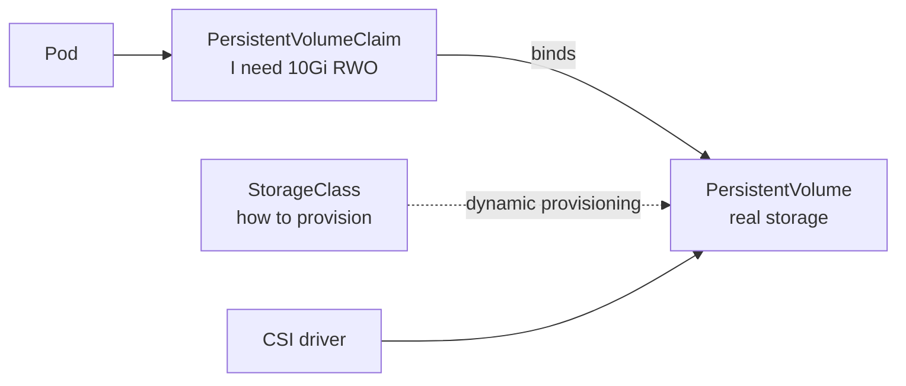

# Storage

<span class="exam-tag">CKA</span>

## Overview

- Container filesystems are **ephemeral** — data is lost when the container restarts.
- A **volume** is storage attached to a Pod.
- **Persistent storage** (PV/PVC) decouples data lifecycle from any Pod.

### Ephemeral volume types

| Type | Use |
|---|---|
| `emptyDir` | Scratch space, shared between containers in a Pod; deleted with the Pod (`medium: Memory` for tmpfs) |
| `configMap` / `secret` / `downwardAPI` / `projected` | Inject config and metadata as files |
| `hostPath` | Mount a node path — ties the Pod to the node and is a **security risk**; use only for node agents |
| `image` | Mount an OCI image's content as a read-only volume (newer feature) |

```yaml
spec:
  containers:
    - name: app
      image: myapp:1.0
      volumeMounts:
        - { name: cache, mountPath: /tmp/cache }
        - { name: node-logs, mountPath: /var/log/host, readOnly: true }
  volumes:
    - name: cache
      emptyDir: { sizeLimit: 1Gi }
    - name: node-logs
      hostPath:
        path: /var/log
        type: Directory
```

## PV, PVC and StorageClass



| Object | Scope | Created by | Meaning |
|---|---|---|---|
| **PersistentVolume (PV)** | Cluster | Admin or CSI (dynamic) | A piece of real storage (EBS volume, NFS share) |
| **PersistentVolumeClaim (PVC)** | Namespace | Developer | A request: size, access mode, class |
| **StorageClass** | Cluster | Admin | Template telling a provisioner how to create PVs |

A PVC binds to a PV that satisfies size, access mode and StorageClass (1:1). With **dynamic provisioning** the PV is created on demand.

### Access modes

| Mode | Short | Meaning |
|---|---|---|
| ReadWriteOnce | RWO | Read-write by **one node** |
| ReadOnlyMany | ROX | Read-only by many nodes |
| ReadWriteMany | RWX | Read-write by many nodes (EFS, NFS, CephFS) |
| ReadWriteOncePod | RWOP | Read-write by **one Pod** (GA 1.29) |

### Reclaim policy

| Policy | When PVC is deleted |
|---|---|
| `Delete` | PV and backing storage deleted (default for dynamic) |
| `Retain` | PV kept (`Released`); admin cleans up / reuses manually |
| `Recycle` | **Deprecated** — basic `rm -rf`; don't use |

### Static provisioning

```yaml
apiVersion: v1
kind: PersistentVolume
metadata: { name: pv-data }
spec:
  capacity: { storage: 10Gi }
  accessModes: [ReadWriteOnce]
  persistentVolumeReclaimPolicy: Retain
  storageClassName: manual
  hostPath: { path: /mnt/data }        # lab only
---
apiVersion: v1
kind: PersistentVolumeClaim
metadata: { name: data-pvc }
spec:
  accessModes: [ReadWriteOnce]
  storageClassName: manual
  resources:
    requests: { storage: 5Gi }
```

### Dynamic provisioning (AWS EBS CSI)

```yaml
apiVersion: storage.k8s.io/v1
kind: StorageClass
metadata:
  name: gp3
  annotations:
    storageclass.kubernetes.io/is-default-class: "true"
provisioner: ebs.csi.aws.com           # out-of-tree CSI driver
parameters:
  type: gp3
  encrypted: "true"
volumeBindingMode: WaitForFirstConsumer   # create the volume in the Pod's AZ
reclaimPolicy: Delete
allowVolumeExpansion: true
---
apiVersion: v1
kind: PersistentVolumeClaim
metadata: { name: data-pvc }
spec:
  accessModes: [ReadWriteOnce]
  storageClassName: gp3
  resources:
    requests: { storage: 10Gi }
---
apiVersion: v1
kind: Pod
metadata: { name: writer }
spec:
  containers:
    - name: app
      image: busybox:1.36
      command: ["sh", "-c", "echo hello > /data/test.txt && sleep 3600"]
      volumeMounts: [{ name: data, mountPath: /data }]
  volumes:
    - name: data
      persistentVolumeClaim: { claimName: data-pvc }
```

- `volumeBindingMode: WaitForFirstConsumer` delays provisioning until a Pod is scheduled — avoids an EBS volume in the wrong AZ.
- `allowVolumeExpansion: true` lets you grow a PVC by editing `spec.resources.requests.storage`.
- PVC without `storageClassName` uses the **default** class; `storageClassName: ""` disables dynamic provisioning.

!!! warning "Removed: in-tree `kubernetes.io/aws-ebs` provisioner"
    In-tree cloud volume plugins were migrated to CSI and the AWS EBS in-tree plugin was removed in **1.27**. Install the **aws-ebs-csi-driver** (EKS add-on) and use `ebs.csi.aws.com`.

## Container Storage Interface (CSI)

| | |
|---|---|
| **What** | Standard interface for storage vendors to write drivers outside Kubernetes core. |
| **Why** | In-tree plugins were coupled to Kubernetes releases. CSI decouples them. |
| **How** | A CSI driver has a **controller** (create/attach/snapshot) and a **node plugin** DaemonSet (mount). A StorageClass names the driver as `provisioner`. |

Also via CSI: **VolumeSnapshots** (`VolumeSnapshotClass`, `VolumeSnapshot`), cloning, expansion.

## EBS vs. EFS on Kubernetes

| | Amazon EBS (CSI) | Amazon EFS (CSI) |
|---|---|---|
| Access mode | RWO (one node, one AZ) | RWX (many nodes, multi-AZ) |
| Best for | Databases, single writer | Shared files, uploads, multi-writer |
| Provisioning | One EBS volume per PV | Access points on one filesystem |
| Performance | Provisioned IOPS/throughput | Elastic |

## Troubleshooting

| Symptom | Investigate | Likely cause | Fix |
|---|---|---|---|
| PVC `Pending` | `kubectl describe pvc` | No matching PV, wrong/missing StorageClass, CSI driver down, `WaitForFirstConsumer` waiting for a Pod | Fix class name, check CSI Pods, create the Pod |
| Pod stuck `ContainerCreating` | `describe pod` events | Volume attach/mount failure, volume in another AZ | Check CSI node logs, AZ topology |
| PV `Released` not reusable | `kubectl get pv` | `Retain` policy keeps old claimRef | Clean data, remove `claimRef` |

## Quick recap

- [x] emptyDir = Pod-lifetime scratch; hostPath = risky.
- [x] PVC (request, namespaced) ↔ PV (storage, cluster-scoped) ↔ StorageClass (template).
- [x] RWO / ROX / RWX / RWOP; reclaim Delete or Retain.
- [x] EBS via `ebs.csi.aws.com`, `WaitForFirstConsumer`, gp3, encrypted.
