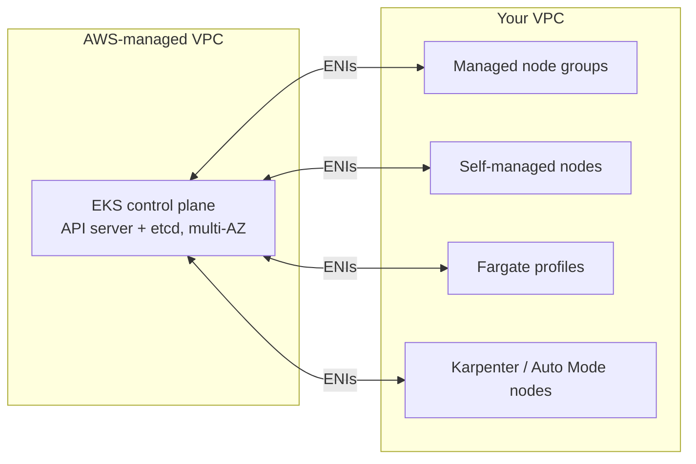

# Amazon EKS

## What is EKS?

| | |
|---|---|
| **What** | AWS's managed Kubernetes: AWS runs and scales the control plane (API server, etcd) across multiple AZs. |
| **Why** | Running an HA control plane (etcd quorum, upgrades, certificates) is real work. EKS removes it while staying upstream-compatible. |
| **How** | The control plane lives in an AWS-managed VPC; your nodes join through ENIs in your VPC. |

## Architecture & compute options



| Option | You manage | Notes |
|---|---|---|
| **Managed node groups** | Instance types, scaling | AWS handles provisioning, draining on updates |
| **Self-managed nodes** | Everything (AMI, patching) | Maximum control |
| **Fargate** | Nothing (per-Pod serverless) | No DaemonSets, no GPUs, no privileged Pods |
| **Karpenter** | NodePools / NodeClasses | Fast, right-sized, spot-aware node provisioning |
| **EKS Auto Mode** | Very little | AWS manages compute, networking, storage add-ons (Karpenter-based) |

Networking: **Amazon VPC CNI** gives Pods real VPC IPs (watch subnet IP capacity; use prefix delegation for density).

## Create a cluster with eksctl

```bash
eksctl create cluster \
  --name demo \
  --region us-east-1 \
  --version 1.35 \
  --nodegroup-name standard \
  --node-type t3.medium \
  --nodes 3 --nodes-min 2 --nodes-max 5 \
  --managed

aws eks update-kubeconfig --name demo --region us-east-1
kubectl get nodes
eksctl delete cluster --name demo --region us-east-1
```

eksctl drives CloudFormation (VPC, IAM roles, node groups). In production, prefer **Terraform** (`terraform-aws-modules/eks/aws`) — see the [Terraform section](../terraform/index.md).

What gets created (console or IaC):

- VPC with public + private subnets across ≥ 2 AZs.
- IAM role for the cluster, IAM role for nodes.
- The EKS cluster (control plane) and node groups / Fargate profiles.
- Access configuration: **access entries**.

## Cluster access — access entries

```bash
aws eks create-access-entry --cluster-name demo \
  --principal-arn arn:aws:iam::123456789012:role/DevOps
aws eks associate-access-policy --cluster-name demo \
  --principal-arn arn:aws:iam::123456789012:role/DevOps \
  --policy-arn arn:aws:eks::aws:cluster-access-policy/AmazonEKSClusterAdminPolicy \
  --access-scope type=cluster
```

!!! warning "Legacy: `aws-auth` ConfigMap"
    Mapping IAM roles in the `aws-auth` ConfigMap is deprecated in favour of **access entries** (API-managed, auditable, can't lock you out by a YAML typo).

## Pod permissions to AWS — Pod Identity / IRSA

Give each Pod its own least-privilege IAM role instead of using the node role.

| | **EKS Pod Identity** (recommended) | **IRSA** |
|---|---|---|
| Setup | Install `eks-pod-identity-agent` add-on, create an association | OIDC provider + role trust policy per cluster |
| Trust policy | Generic `pods.eks.amazonaws.com` | Cluster-specific OIDC issuer |
| Reuse across clusters | Easy | Trust policy per cluster |

```bash
aws eks create-pod-identity-association --cluster-name demo \
  --namespace shop --service-account s3-reader \
  --role-arn arn:aws:iam::123456789012:role/shop-s3-read
```

## Essential add-ons

| Add-on | Purpose |
|---|---|
| Amazon VPC CNI | Pod networking |
| CoreDNS | Cluster DNS |
| kube-proxy | Service routing |
| EBS CSI driver / EFS CSI driver | Persistent volumes |
| EKS Pod Identity Agent | Pod IAM credentials |
| AWS Load Balancer Controller (Helm) | ALB for Ingress, NLB for Services |
| metrics-server | `kubectl top`, HPA |

```bash
aws eks list-addons --cluster-name demo
aws eks create-addon --cluster-name demo --addon-name aws-ebs-csi-driver
```

## Production best practices

- Managed node groups, Karpenter or Auto Mode over hand-rolled nodes.
- **Pod Identity / IRSA** for every workload that calls AWS; block IMDS access from Pods where possible.
- Node groups across multiple AZs; PDBs on critical apps.
- Stay on a supported version: EKS offers ~14 months **standard support** per version, then paid **extended support**. Upgrade control plane → node groups → add-ons, one minor at a time.
- Enable control-plane logs (api, audit, authenticator) to CloudWatch.
- KMS envelope encryption for Secrets; private API endpoint where possible.

## Interview questions

??? question "What does AWS manage in EKS?"
    The control plane (API server, etcd) across AZs, its scaling, patching and backups. You manage nodes (unless Fargate/Auto Mode), networking config, add-ons and workloads.

??? question "IRSA / Pod Identity — why?"
    So each Pod gets its own scoped IAM role instead of inheriting the node's permissions — least privilege.

## Quick recap

- [x] EKS = managed control plane; compute via managed node groups, self-managed, Fargate, Karpenter or Auto Mode.
- [x] Access entries replace `aws-auth`.
- [x] Pod Identity (or IRSA) for AWS permissions per Pod.
- [x] Install add-ons explicitly; upgrade one minor at a time.
