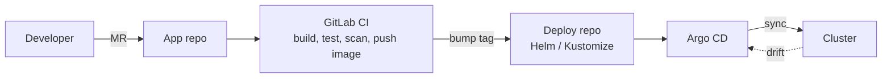

# Production & GitOps

## Production readiness checklist

**Resources & availability**

- [ ] Requests/limits on every container; ResourceQuota + LimitRange per namespace.
- [ ] ≥ 3 replicas, topology spread / anti-affinity, PodDisruptionBudgets, multi-AZ nodes.
- [ ] Probes (startup/liveness/readiness) and graceful shutdown (`preStop`, grace period).
- [ ] HPA (+ Cluster Autoscaler / Karpenter).

**Delivery**

- [ ] Immutable, versioned images (semantic version or digest) — never `:latest`.
- [ ] GitOps: cluster state in Git, reconciled by **Argo CD** / **Flux** — no untracked `kubectl apply`.
- [ ] Progressive delivery (Argo Rollouts, Gateway API weights) for risky changes.

**Security**

- [ ] RBAC least privilege, audited; no shared ServiceAccounts.
- [ ] Default-deny NetworkPolicies.
- [ ] Hardened SecurityContext; Pod Security `restricted` where possible.
- [ ] Secrets from a secret manager (External Secrets), encryption at rest.
- [ ] Image scanning + admission policies.

**Operations**

- [ ] Backups: etcd snapshots (self-managed) + **Velero** for apps and PVs; test restores.
- [ ] Monitoring, logging, alerting, dashboards.
- [ ] Upgrade plan: stay within the supported window (latest 3 minors).

## Cluster lifecycle

- Kubernetes supports the **latest 3 minor versions** (~14 months each).
- Read the deprecation guide before every upgrade — removed APIs break manifests (e.g. PSP in 1.25, `batch/v1beta1` CronJob in 1.25, `autoscaling/v2beta2` in 1.26).
- Find deprecated APIs ahead of time: `kubectl convert` plugin, **pluto**, **kubent**, API server metrics (`apiserver_requested_deprecated_apis`).
- Upgrade control plane first, then node groups one at a time.

## GitOps with Argo CD

| | |
|---|---|
| **What** | Git is the single source of truth; an in-cluster agent (Argo CD / Flux) continuously syncs the cluster to it. |
| **Why** | Manual applies leave no audit trail and cause drift. GitOps gives reviewed changes (MRs), rollback via `git revert`, drift detection, multi-cluster consistency. |
| **How** | CI builds and pushes the image, then bumps the tag in the deploy repo. Argo CD detects the commit, renders Helm/Kustomize and applies. `selfHeal` reverts manual changes. |



```yaml
apiVersion: argoproj.io/v1alpha1
kind: Application
metadata: { name: shop-prod, namespace: argocd }
spec:
  project: default
  source:
    repoURL: https://gitlab.example.com/platform/shop-deploy.git
    targetRevision: main
    path: overlays/production          # Kustomize overlay
  destination:
    server: https://kubernetes.default.svc
    namespace: shop
  syncPolicy:
    automated: { prune: true, selfHeal: true }
    syncOptions: [CreateNamespace=true]
```

```bash
argocd app list
argocd app get shop-prod
argocd app sync shop-prod
argocd app history shop-prod
argocd app diff shop-prod
```

In GitOps a rollback is a **`git revert`**, not a kubectl command.

Other useful pieces: **ApplicationSet** (generate apps per cluster/env), **App of Apps** pattern, **sync waves/hooks** for ordering, **Argo CD Image Updater** for automatic tag bumps.

## Quick recap

- [x] Resources, HA, probes, PDBs, autoscaling, pinned images, GitOps, least privilege, backups.
- [x] Latest 3 minors supported; scan for deprecated APIs before upgrading.
- [x] Argo CD `Application` with `automated: {prune, selfHeal}`; rollback = git revert.
