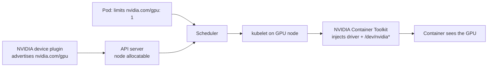
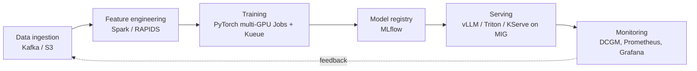

# AI Infrastructure & GPUs on Kubernetes

## Why GPUs on Kubernetes?

| Workload | Need |
|---|---|
| **Training** | Many GPU-hours, multi-GPU/multi-node batch jobs, queueing and quotas |
| **Inference** | Low latency, autoscaling on request load, high availability |
| **Notebooks / dev** | Cheap shared access |

GPUs are expensive and often under-utilised. Kubernetes adds **scheduling, sharing (time-slicing, MIG), quotas and autoscaling** on a shared GPU fleet.

## How a Pod gets a GPU



```yaml
apiVersion: v1
kind: Pod
metadata: { name: gpu-training }
spec:
  restartPolicy: Never
  tolerations:
    - { key: nvidia.com/gpu, operator: Exists, effect: NoSchedule }
  nodeSelector:
    nvidia.com/gpu.product: NVIDIA-A100-SXM4-40GB     # label from GPU Feature Discovery
  containers:
    - name: train
      image: nvcr.io/nvidia/pytorch:<tag>              # pin a tested NGC tag
      command: ["python", "train.py"]
      resources:
        limits:
          nvidia.com/gpu: 2          # whole GPUs; requests default to limits
```

- `nvidia.com/gpu` is an **extended resource** — only in `limits` (requests = limits), integers only, no overcommit by default.
- No `nvidia.com/gpu` limit → **no GPU** in the container.

## NVIDIA GPU Operator

Automates the whole GPU software stack on every GPU node using DaemonSets, configured by a `ClusterPolicy` CRD.

| Component | Role |
|---|---|
| **Driver** | NVIDIA kernel driver as a container (or use pre-installed drivers) |
| **Container Toolkit** | Runtime hooks so containers can use GPUs |
| **Device plugin** | Advertises `nvidia.com/gpu` (and MIG resources) |
| **GPU Feature Discovery (GFD)** | Labels nodes: product, memory, MIG capability |
| **DCGM Exporter** | GPU metrics for Prometheus |
| **MIG Manager** | Applies MIG partition layouts from node labels |

```bash
helm repo add nvidia https://helm.ngc.nvidia.com/nvidia && helm repo update
helm install gpu-operator nvidia/gpu-operator -n gpu-operator --create-namespace
kubectl get pods -n gpu-operator
kubectl describe node <gpu-node> | grep -A5 Allocatable
kubectl run gpu-test --rm -it --restart=Never \
  --image=nvcr.io/nvidia/cuda:12.4.1-base-ubuntu22.04 \
  --overrides='{"spec":{"containers":[{"name":"gpu-test","image":"nvcr.io/nvidia/cuda:12.4.1-base-ubuntu22.04","command":["nvidia-smi"],"resources":{"limits":{"nvidia.com/gpu":1}}}]}}'
```

On EKS, GPU AMIs (EKS-optimized accelerated AMIs / Bottlerocket NVIDIA) already include drivers — run the operator with `driver.enabled=false`, or just the device plugin.

## Sharing GPUs

### Time-slicing

The device plugin advertises **N replicas** per physical GPU; CUDA contexts are interleaved.

- :x: **No memory isolation** — one Pod can OOM all others.
- :x: **No guaranteed compute**.
- :white_check_mark: Works on any NVIDIA GPU. Good for notebooks, dev, CI, light inference.

```yaml
apiVersion: v1
kind: ConfigMap
metadata: { name: time-slicing-config, namespace: gpu-operator }
data:
  any: |-
    version: v1
    flags:
      migStrategy: none
    sharing:
      timeSlicing:
        resources:
          - name: nvidia.com/gpu
            replicas: 4
```

```bash
kubectl patch clusterpolicies.nvidia.com/cluster-policy -n gpu-operator --type merge \
  -p '{"spec":{"devicePlugin":{"config":{"name":"time-slicing-config","default":"any"}}}}'
kubectl describe node gpu-node-1 | grep nvidia.com/gpu      # allocatable 1 → 4
```

The scheduler doesn't know the 4 "GPUs" share hardware.

### Multi-Instance GPU (MIG)

Hardware partitioning into up to **7 instances**, each with dedicated SMs, memory and L2 cache → real **fault and memory isolation**.

Supported on data-centre GPUs: **A100, A30, H100, H200, B200** (and newer).

| | Time-slicing | MIG |
|---|---|---|
| Memory isolation | None | Full |
| Compute isolation | None | Dedicated SMs |
| Max partitions | Configurable | 7 (hardware) |
| GPUs | All NVIDIA | A100/A30/H100/H200/B200… |
| Best for | Dev, light inference | Production inference with SLAs |

A100 40GB profiles: `1g.5gb` (×7) · `2g.10gb` (×3) · `3g.20gb` (×2) · `4g.20gb` (×1) · `7g.40gb` (×1).

```bash
# Let MIG Manager apply a layout
kubectl label node gpu-node nvidia.com/mig.config=all-1g.5gb --overwrite
kubectl describe node gpu-node | grep mig
#   nvidia.com/mig-1g.5gb: 7
```

```yaml
# GPU Operator values
mig:
  strategy: mixed     # exposes nvidia.com/mig-<profile>; "single" exposes them as nvidia.com/gpu
migManager:
  enabled: true
---
apiVersion: v1
kind: Pod
metadata: { name: mig-inference }
spec:
  containers:
    - name: triton
      image: nvcr.io/nvidia/tritonserver:<tag>
      resources:
        limits:
          nvidia.com/mig-1g.5gb: 1
```

Also: **MPS** (Multi-Process Service) sharing — better throughput than time-slicing, limited isolation.

## Dynamic Resource Allocation (DRA)

| | |
|---|---|
| **What** | API for requesting devices via **ResourceClaims** and **DeviceClasses** — successor to simple device-plugin counts. Core DRA is **GA since 1.34**. |
| **Why** | Device plugins only say "N GPUs". AI workloads need "a GPU with ≥ 40 GB", "a specific MIG profile", or "one GPU shared by two containers". |
| **How** | A vendor DRA driver publishes **ResourceSlices** with device attributes; Pods reference a claim with **CEL** selectors; the scheduler allocates a matching device. |

```yaml
apiVersion: resource.k8s.io/v1
kind: ResourceClaimTemplate
metadata: { name: big-gpu }
spec:
  spec:
    devices:
      requests:
        - name: gpu
          exactly:
            deviceClassName: gpu.nvidia.com
            selectors:
              - cel:
                  expression: device.capacity["gpu.nvidia.com"].memory.compareTo(quantity("40Gi")) >= 0
---
apiVersion: v1
kind: Pod
metadata: { name: dra-pod }
spec:
  resourceClaims:
    - name: gpu
      resourceClaimTemplateName: big-gpu
  containers:
    - name: app
      image: nvcr.io/nvidia/cuda:12.4.1-base-ubuntu22.04
      command: ["nvidia-smi"]
      resources:
        claims:
          - name: gpu
```

Device plugins still work; DRA is where the ecosystem is heading (check your driver's supported API version).

## Batch scheduling: Kueue & gang scheduling

- **Kueue** (SIG Scheduling) queues Jobs and admits them when quota allows; then the normal scheduler places Pods.
- **ClusterQueue** = quotas per resource flavor (e.g. `nvidia.com/gpu: 8` for team A), **LocalQueue** per namespace; Jobs set label `kueue.x-k8s.io/queue-name`.
- **All-or-nothing admission**: distributed training starts only when all workers fit — no half-started jobs holding GPUs.
- Supports quota borrowing, priorities and preemption. Alternatives: Volcano, YuniKorn.

```yaml
apiVersion: batch/v1
kind: Job
metadata:
  name: train-llm
  labels:
    kueue.x-k8s.io/queue-name: team-a
spec:
  parallelism: 4
  completions: 4
  suspend: true          # Kueue unsuspends when admitted
  template:
    spec:
      restartPolicy: Never
      containers:
        - name: worker
          image: myorg/trainer:1.0
          resources:
            limits: { nvidia.com/gpu: 1 }
```

## Model serving — vLLM example

```yaml
apiVersion: apps/v1
kind: Deployment
metadata: { name: llm-server }
spec:
  replicas: 1
  selector:
    matchLabels: { app: llm }
  template:
    metadata:
      labels: { app: llm }
    spec:
      tolerations:
        - { key: nvidia.com/gpu, operator: Exists, effect: NoSchedule }
      containers:
        - name: vllm
          image: vllm/vllm-openai:<tested-version>
          args: ["--model", "Qwen/Qwen2.5-1.5B-Instruct", "--max-model-len", "4096"]
          ports: [{ containerPort: 8000 }]          # OpenAI-compatible API
          resources:
            limits: { nvidia.com/gpu: 1 }
          readinessProbe:
            httpGet: { path: /health, port: 8000 }
            initialDelaySeconds: 60
          volumeMounts:
            - { name: cache, mountPath: /root/.cache/huggingface }
      volumes:
        - name: cache
          emptyDir: {}            # use a PVC to avoid re-downloading models
```

- Scale on **queue depth / latency**, not CPU: KEDA or HPA on `vllm:num_requests_waiting`.
- **KServe** adds model CRDs, canary rollouts and scale-to-zero; **Triton** serves many frameworks; **KubeRay** for Ray clusters.
- GPU nodes start slowly — use long scale-down delays and consider warm capacity.

## Monitoring GPUs (DCGM + Prometheus)

```promql
# GPU utilisation per node/GPU
avg by (Hostname, gpu) (DCGM_FI_DEV_GPU_UTIL)

# Framebuffer memory used (MiB) — key OOM signal with time-slicing
DCGM_FI_DEV_FB_USED

# Utilisation per workload
sum by (namespace, pod) (DCGM_FI_DEV_GPU_UTIL)

# Allocated but idle for 30 min = wasted money
avg_over_time(DCGM_FI_DEV_GPU_UTIL[30m]) < 5

# Hardware errors
DCGM_FI_DEV_XID_ERRORS > 0
```

Labels may appear as `exported_pod` / `exported_namespace` depending on scrape config. NVIDIA publishes a ready-made DCGM Grafana dashboard.

## End-to-end ML platform on Kubernetes



Rule of thumb: **MIG** for production inference, **time-slicing** for dev/notebooks, **dedicated GPUs** for large training.

## Best practices

1. Always set `nvidia.com/gpu` in limits.
2. Taint GPU nodes (`nvidia.com/gpu=present:NoSchedule`) and use tolerations + nodeSelector/affinity on GFD labels.
3. Monitor with DCGM Exporter + Grafana (utilisation, memory, temperature, XID/ECC errors).
4. MIG for SLA-bound inference; never time-slice training jobs.
5. Quotas per team (`requests.nvidia.com/gpu` in ResourceQuota, Kueue ClusterQueues).
6. Autoscale GPU node pools (Cluster Autoscaler / Karpenter) with long scale-down delays.

## Troubleshooting

| Symptom | Investigate | Likely cause | Fix |
|---|---|---|---|
| `Pending: Insufficient nvidia.com/gpu` | `describe node` (Allocatable/Allocated) | Device plugin down, GPUs in use, missing toleration | Check gpu-operator Pods; add capacity/toleration |
| Node advertises 0 GPUs | `kubectl get pods -n gpu-operator` | Driver/toolkit DaemonSet failing (kernel mismatch) | Read driver Pod logs; pin a compatible driver |
| `no CUDA-capable device` | `kubectl exec <pod> -- nvidia-smi` | No GPU limit, missing runtime hooks | Request `nvidia.com/gpu`; check toolkit |
| CUDA OOM on shared GPU | `nvidia-smi`, `DCGM_FI_DEV_FB_USED` | Time-sliced Pods share VRAM | Fewer replicas, MIG, or dedicated GPU |

## Interview questions

??? question "How does a Pod access a GPU?"
    The device plugin advertises `nvidia.com/gpu`; the Pod requests it in limits; the scheduler places it; the NVIDIA Container Toolkit injects driver and devices.

??? question "Time-slicing vs MIG?"
    Time-slicing oversubscribes with no isolation (dev, notebooks); MIG provides hardware-isolated slices with guaranteed memory (production inference).

??? question "Why gang scheduling for distributed training?"
    All workers must run together; partial placement wastes GPUs and can deadlock. Kueue admits a job only when every Pod fits.

??? question "How to autoscale LLM inference?"
    Scale on queue depth/latency (KEDA/HPA custom metrics), let Karpenter/Cluster Autoscaler add GPU nodes, use long scale-down delays.

## Quick recap

- [x] Device plugin → `nvidia.com/gpu` in limits → toolkit injects devices.
- [x] GPU Operator = driver, toolkit, device plugin, GFD, DCGM, MIG Manager.
- [x] Time-slicing (no isolation) vs MIG (hardware isolation, ≤ 7 slices).
- [x] DRA (GA 1.34) = rich device requests; Kueue = quotas + gang admission.
- [x] Serve with vLLM/Triton/KServe; monitor with DCGM.
