# Kubernetes

Kubernetes (K8s) is an open-source **container-orchestration platform** that automates deploying, scaling and operating containerised applications across a cluster of machines.

!!! note "Version baseline"
    These notes target **Kubernetes 1.35+** (the current release line is **1.37**, Aug 2026) and the current **CKA / CKS** curricula. Removed or retired features (PSP, dockershim, in-tree EBS, kube-dns, Ingress-NGINX…) appear only in :material-alert: *Deprecated* boxes.

Every major concept follows the same pattern: **what it is → why it exists → how it works → example → troubleshooting**.

## Learning path

```mermaid
flowchart LR
    A[Fundamentals] --> B[Architecture]
    B --> C[Cluster setup]
    C --> D[kubectl & YAML]
    D --> E[Pods & Workloads]
    E --> F[Networking]
    F --> G[Services / Ingress / Gateway]
    G --> H[Scheduling & Autoscaling]
    H --> I[Jobs]
    I --> J[Config & Secrets]
    J --> K[Storage]
    K --> L[StatefulSets]
    L --> M[Helm / Kustomize / CRDs]
    M --> N[Security]
    N --> O[EKS]
    O --> P[Observability]
    P --> Q[Maintenance]
    Q --> R[Production & GitOps]
    R --> S[AI / GPU]
```

## Pages

| # | Page | Exam |
|---|------|------|
| 1 | [Fundamentals](01-fundamentals.md) | — |
| 2 | [Architecture](02-architecture.md) | CKA |
| 3 | [Cluster Setup](03-cluster-setup.md) | CKA |
| 4 | [kubectl & YAML](04-kubectl-yaml.md) | CKA |
| 5 | [Pods & Workloads](05-pods-workloads.md) | CKA |
| 6 | [Networking, CNI & DNS](06-networking.md) | CKA |
| 7 | [Services, Ingress & Gateway API](07-services-ingress-gateway.md) | CKA |
| 8 | [Scheduling & Autoscaling](08-scheduling-autoscaling.md) | CKA |
| 9 | [Jobs & CronJobs](09-jobs-cronjobs.md) | CKA |
| 10 | [ConfigMaps & Secrets](10-configuration.md) | CKA · CKS |
| 11 | [Storage](11-storage.md) | CKA |
| 12 | [StatefulSets](12-statefulsets.md) | CKA |
| 13 | [Helm, Kustomize & CRDs](13-helm-kustomize-crds.md) | CKA |
| 14 | [Security & RBAC](14-security.md) | CKA · CKS |
| 15 | [Amazon EKS](15-eks.md) | — |
| 16 | [Observability & Troubleshooting](16-observability-troubleshooting.md) | CKA |
| 17 | [Cluster Maintenance](17-maintenance.md) | CKA |
| 18 | [Production & GitOps](18-production-gitops.md) | — |
| 19 | [AI Infrastructure & GPUs](19-ai-gpu.md) | — |
| 20 | [Hands-on Labs & Capstones](20-labs.md) | practice |
| 21 | [kubectl Cheat Sheet](21-cheatsheet.md) | quick review |
| 22 | [CKA / CKS Exam Guide](22-exams.md) | all |
| 23 | [What Changed vs. the Course](23-changes.md) | — |

## Useful links

- Docs (the only resource allowed in CKA/CKS): <https://kubernetes.io/docs>
- API reference: <https://kubernetes.io/docs/reference/kubernetes-api/>
- Release notes & deprecations: <https://kubernetes.io/releases/> · <https://kubernetes.io/docs/reference/using-api/deprecation-guide/>
