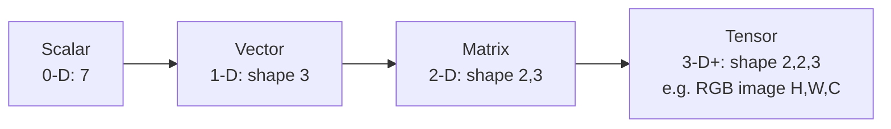

# Introduction & Setup

## What is NumPy?

| | |
|---|---|
| **What** | A Python library providing the `ndarray` — a fast, fixed-type, N-dimensional array — and hundreds of functions that operate on whole arrays at once. |
| **Why** | Python lists are flexible but slow for numbers: each element is a full Python object. NumPy stores numbers **contiguously in memory** with one data type and runs loops in **compiled C**, typically **10–100× faster** with far less memory. |
| **How** | You express computations on whole arrays (**vectorisation**) instead of writing Python loops; NumPy dispatches them to optimised C/SIMD code and BLAS/LAPACK for linear algebra. |

Used by: pandas (columns are arrays), scikit-learn (inputs `X`, `y`), Matplotlib, SciPy, OpenCV (images are arrays), PyTorch/TensorFlow (tensor interop), Jax (NumPy-like API).

## Installation

```bash
pip install numpy               # or: uv add numpy / conda install numpy
python -c "import numpy as np; print(np.__version__)"
```

NumPy 2.5 supports Python **3.12–3.14** (including free-threaded builds). Check your build configuration (BLAS library, SIMD support):

```python
import numpy as np
np.show_config()        # prints build & BLAS info
```

## The import convention

```python
import numpy as np      # universal convention — always use "np"
```

## List vs. ndarray

```python
import numpy as np

py_list = [1, 2, 3, 4]
arr = np.array([1, 2, 3, 4])

py_list * 2        # -> [1, 2, 3, 4, 1, 2, 3, 4]   (repetition)
arr * 2            # -> array([2, 4, 6, 8])        (element-wise math)

[x ** 2 for x in py_list]   # -> [1, 4, 9, 16]   Python loop
arr ** 2                    # -> array([ 1,  4,  9, 16])  vectorised
```

| | Python list | NumPy ndarray |
|---|---|---|
| Element types | Mixed | One dtype for all elements |
| Memory | Array of pointers to objects | Contiguous raw values |
| Size | Grows/shrinks (`append`) | Fixed at creation |
| Math | Loops / comprehensions | Vectorised operators & ufuncs |
| Dimensions | Nested lists | True N-D with `shape` |
| Speed | Slow for numerics | Fast (C, SIMD, BLAS) |

### A quick speed comparison

```python
import numpy as np
import time

n = 1_000_000
data = list(range(n))
arr = np.arange(n)

t = time.perf_counter(); total = sum(x * x for x in data); t_list = time.perf_counter() - t
t = time.perf_counter(); total_np = int((arr * arr).sum()); t_np = time.perf_counter() - t

assert total == total_np
print(f"list: {t_list:.4f}s   numpy: {t_np:.4f}s")   # NumPy is usually 10–50x faster
```

In Jupyter use `%timeit arr * arr` for reliable timings.

## Key vocabulary

| Term | Meaning |
|---|---|
| **ndarray** | NumPy's N-dimensional array object |
| **axis** | A dimension. In a 2-D array, **axis 0 = rows (down)**, **axis 1 = columns (across)** |
| **shape** | Tuple of sizes per axis, e.g. `(3, 4)` = 3 rows × 4 columns |
| **ndim / rank** | Number of axes |
| **dtype** | Element data type (`int64`, `float32`, `bool`…) |
| **vectorisation** | Operating on whole arrays without explicit Python loops |
| **ufunc** | Universal function — element-wise function like `np.sqrt`, `np.add` |
| **broadcasting** | Rules that let arrays of different shapes combine |
| **view** | A new array object looking at the **same data** (no copy) |



## Getting help

```python
import numpy as np
help(np.linspace)          # docstring
np.info(np.linspace)       # NumPy-style info
# In IPython/Jupyter:  np.linspace?   or   np.linspace??  (source)
```

## Quick recap

- [x] `import numpy as np`; core object = `ndarray` (one dtype, fixed size, N-D).
- [x] Vectorised operations replace Python loops → much faster.
- [x] axis 0 = rows, axis 1 = columns; `shape`, `ndim`, `dtype` describe an array.
