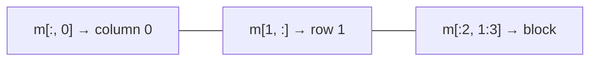

# Indexing, Slicing, Views & Copies

## 1-D indexing and slicing

Same rules as Python lists: zero-based, negative indices count from the end, `start:stop:step` excludes `stop`.

```python
import numpy as np

a = np.arange(10)          # [0 1 2 3 4 5 6 7 8 9]

a[0]          # -> np.int64(0)
a[-1]         # -> np.int64(9)
a[2:5]        # -> array([2, 3, 4])
a[:3]         # -> array([0, 1, 2])
a[7:]         # -> array([7, 8, 9])
a[::2]        # -> array([0, 2, 4, 6, 8])
a[::-1]       # -> array([9, 8, 7, 6, 5, 4, 3, 2, 1, 0])   reversed
```

## Multi-dimensional indexing

Use **one bracket with commas**: `a[row, col]` (faster and clearer than `a[row][col]`).

```python
import numpy as np

m = np.arange(1, 13).reshape(3, 4)
# [[ 1  2  3  4]
#  [ 5  6  7  8]
#  [ 9 10 11 12]]

m[1, 2]       # -> np.int64(7)        row 1, column 2
m[0]          # -> array([1, 2, 3, 4])   first row
m[:, 0]       # -> array([1, 5, 9])      first column
m[-1, -1]     # -> np.int64(12)
m[:2, 1:3]    # -> array([[2, 3], [6, 7]])   sub-matrix
m[::2, ::2]   # -> array([[ 1,  3], [ 9, 11]])
m[:, ::-1]    # columns reversed
```



### Ellipsis and new axes

```python
import numpy as np

t = np.zeros((2, 3, 4, 5))
t[..., 0].shape           # -> (2, 3, 4)   "all leading axes"
t[0, ...].shape           # -> (3, 4, 5)

v = np.array([1, 2, 3])
v[np.newaxis, :].shape    # -> (1, 3)   row vector
v[:, None].shape          # -> (3, 1)   column vector (None == np.newaxis)
```

## Boolean (mask) indexing

```python
import numpy as np

a = np.array([4, -1, 7, 0, -5, 3])

mask = a > 0
mask                    # -> array([ True, False,  True, False, False,  True])
a[mask]                 # -> array([4, 7, 3])
a[a % 2 == 0]           # -> array([4, 0])
a[(a > 0) & (a < 5)]    # -> array([4, 3])     use & | ~ with parentheses
a[~(a > 0)]             # -> array([-1,  0, -5])

a[a < 0] = 0            # assign through a mask
a                       # -> array([4, 0, 7, 0, 0, 3])
```

!!! warning
    Use `&`, `|`, `~` — **not** `and`, `or`, `not` — on arrays, and wrap each condition in parentheses: `(a > 0) & (a < 5)`.

### `np.where`, `np.nonzero`, `np.select`

```python
import numpy as np

a = np.array([4, -1, 7, 0, -5, 3])

np.where(a > 0)                     # -> (array([0, 2, 5]),)   indices
np.where(a > 0, a, 0)               # -> array([4, 0, 7, 0, 0, 3])   if/else element-wise
np.nonzero(a)                       # -> (array([0, 1, 2, 4, 5]),)
np.argwhere(a < 0)                  # -> array([[1], [4]])
np.select([a < 0, a == 0], ["neg", "zero"], default="pos")
# -> array(['pos', 'neg', 'pos', 'zero', 'neg', 'pos'], dtype='<U4')
np.clip(a, -2, 5)                   # -> array([ 4, -1,  5,  0, -2,  3])
```

## Fancy (integer-array) indexing

```python
import numpy as np

a = np.array([10, 20, 30, 40, 50])
a[[0, 2, 4]]            # -> array([10, 30, 50])
a[[4, 4, 0]]            # -> array([50, 50, 10])   repeats allowed

m = np.arange(1, 13).reshape(3, 4)
m[[0, 2]]               # rows 0 and 2
m[[0, 1, 2], [3, 2, 1]] # -> array([4, 7, 10])   pairs (0,3), (1,2), (2,1)
m[np.ix_([0, 2], [1, 3])]   # -> array([[ 2,  4], [10, 12]])   cross-product selection

np.take(a, [1, 3])      # -> array([20, 40])
```

## Views vs. copies

| Operation | Returns |
|---|---|
| Basic slicing `a[1:3]`, `a[::2]`, `a[:, 0]` | **View** (shares data) |
| `reshape`, `ravel`, `.T`, `.view()` | Usually a **view** |
| Boolean / fancy indexing `a[mask]`, `a[[0, 2]]` | **Copy** |
| `a.copy()`, `np.array(a)`, `flatten()` | **Copy** |

```python
import numpy as np

a = np.arange(5)
v = a[1:4]          # view
v[0] = 99
a                   # -> array([ 0, 99,  2,  3,  4])   original changed!

c = a[1:4].copy()   # independent copy
c[0] = -1
a[1]                # -> np.int64(99)   unchanged

np.shares_memory(a, v)   # -> True
v.base is a              # -> True
np.shares_memory(a, c)   # -> False

f = a[[1, 2]]            # fancy indexing -> copy
f.base is None           # -> True
```

!!! tip
    Slicing a big array and then modifying the slice changes the original — great for memory, dangerous for bugs. Use `.copy()` when you need independence (e.g. before mutating a slice of training data).

## Iterating (and why to avoid it)

```python
import numpy as np

m = np.arange(6).reshape(2, 3)
for row in m:               # iterates over the first axis
    print(row)
for x in m.flat:            # every element
    pass
for idx, val in np.ndenumerate(m):   # (index tuple, value)
    pass
```

Loops are slow — prefer vectorised expressions ([next page](05-ufuncs-broadcasting.md)).

## Quick recap

- [x] `a[i]`, `a[start:stop:step]`, `a[row, col]`, `a[:, col]`, `...`, `None`.
- [x] Boolean masks with `& | ~`; `np.where(cond, x, y)` for element-wise if/else.
- [x] Fancy indexing with integer lists; `np.ix_` for row × column selection.
- [x] Slices are **views**; boolean/fancy indexing returns **copies**; check with `np.shares_memory`.
