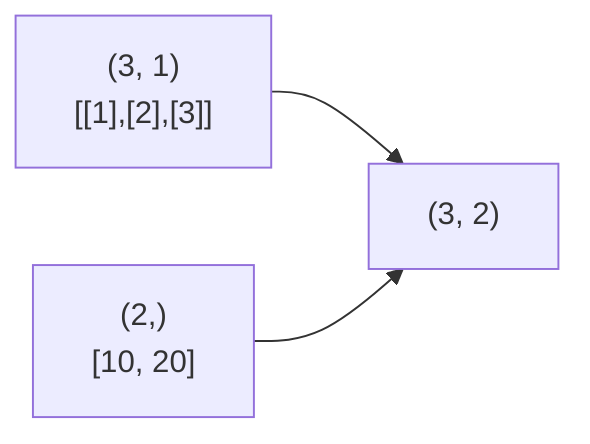

# Operations, ufuncs & Broadcasting

## Vectorised arithmetic

Operators work **element-wise** on arrays of the same shape:

```python
import numpy as np

a = np.array([1, 2, 3, 4])
b = np.array([10, 20, 30, 40])

a + b        # -> array([11, 22, 33, 44])
b - a        # -> array([ 9, 18, 27, 36])
a * b        # -> array([ 10,  40,  90, 160])   element-wise, NOT matrix product
b / a        # -> array([10., 10., 10., 10.])   true division -> float
b // 3       # -> array([ 3,  6, 10, 13])       floor division
b % 3        # -> array([1, 2, 0, 1])
a ** 2       # -> array([ 1,  4,  9, 16])
-a           # -> array([-1, -2, -3, -4])

a == b / 10  # -> array([ True,  True,  True,  True])
np.array_equal(a, b // 10)   # -> True
np.allclose(0.1 + 0.2, 0.3)  # -> True   compare floats with tolerance
```

Matrix multiplication uses `@` — see [Linear Algebra](08-linear-algebra.md).

### In-place operations

```python
import numpy as np

a = np.arange(5, dtype=np.float64)
a += 1           # modifies a in place (no new array allocated)
a *= 2
a                # -> array([ 2.,  4.,  6.,  8., 10.])
np.multiply(a, 3, out=a)   # write result into an existing array
```

In-place ops keep the array's dtype: `int_array += 0.5` raises an error (can't cast float result to int).

## Universal functions (ufuncs)

Fast element-wise functions implemented in C.

| Category | ufuncs |
|---|---|
| Arithmetic | `add`, `subtract`, `multiply`, `divide`, `power`, `mod`, `negative`, `abs` |
| Exponential/log | `exp`, `expm1`, `log`, `log2`, `log10`, `log1p`, `sqrt`, `cbrt`, `square` |
| Trigonometric | `sin`, `cos`, `tan`, `arcsin`, `arctan2`, `hypot`, `deg2rad` |
| Rounding | `round`, `floor`, `ceil`, `trunc`, `rint` |
| Comparison | `greater`, `less`, `equal`, `maximum`, `minimum`, `fmax` |
| Logical | `logical_and`, `logical_or`, `logical_not`, `logical_xor` |
| Floating checks | `isnan`, `isinf`, `isfinite`, `sign` |

```python
import numpy as np

x = np.array([1.0, 4.0, 9.0])
np.sqrt(x)                     # -> array([1., 2., 3.])
np.exp([0, 1])                 # -> array([1.        , 2.71828183])
np.log(np.e)                   # -> np.float64(1.0)
np.maximum([1, 5, 3], [4, 2, 6])   # -> array([4, 5, 6])   element-wise max of two arrays
np.round(np.array([1.234, 5.678]), 1)   # -> array([1.2, 5.7])
np.trunc([-1.7, 1.7])          # -> array([-1.,  1.])
```

### ufunc methods

```python
import numpy as np

np.add.reduce([1, 2, 3, 4])        # -> np.int64(10)       same as sum
np.add.accumulate([1, 2, 3, 4])    # -> array([ 1,  3,  6, 10])   same as cumsum
np.multiply.outer([1, 2, 3], [1, 10])
# -> array([[ 1, 10], [ 2, 20], [ 3, 30]])
np.maximum.reduce([3, 9, 2])       # -> np.int64(9)
```

### Floating-point errors

```python
import numpy as np

with np.errstate(divide="ignore", invalid="ignore"):
    r = np.array([1.0, 0.0, -1.0]) / 0.0
r                      # -> array([ inf,  nan, -inf])
np.isnan(r)            # -> array([False,  True, False])
np.nan_to_num(r)       # replace nan/inf with numbers
```

Use `np.nan` and `np.inf` (not the removed `np.NaN` / `np.Inf`). Remember `np.nan != np.nan` — test with `np.isnan`.

### Custom element-wise functions

```python
import numpy as np

def relu_scalar(x):
    return x if x > 0 else 0

relu = np.vectorize(relu_scalar)        # convenience only — still a Python loop!
relu(np.array([-2, 3]))                 # -> array([0, 3])

np.maximum(np.array([-2, 3]), 0)        # -> array([0, 3])   truly vectorised — prefer this
```

## Broadcasting

Broadcasting lets NumPy combine arrays of **different shapes** without copying data.

**Rules** (compare shapes from the **right**, dimension by dimension):

1. If the arrays differ in `ndim`, prepend 1s to the smaller shape.
2. Two dimensions are **compatible** if they are **equal** or one of them is **1**.
3. Dimensions of size 1 are stretched to match the other.
4. Otherwise → `ValueError: operands could not be broadcast together`.

| A shape | B shape | Result |
|---|---|---|
| `(3, 4)` | `()` scalar | `(3, 4)` |
| `(3, 4)` | `(4,)` | `(3, 4)` |
| `(3, 4)` | `(3, 1)` | `(3, 4)` |
| `(3, 1)` | `(1, 4)` | `(3, 4)` |
| `(8, 1, 6)` | `(7, 1)` | `(8, 7, 6)` |
| `(3, 4)` | `(3,)` | **Error** (4 vs 3) |

```python
import numpy as np

m = np.arange(12).reshape(3, 4)

m + 100                            # scalar broadcast to every element
m + np.array([0, 10, 20, 30])      # (3,4) + (4,): added to each ROW
m + np.array([[0], [100], [200]])  # (3,4) + (3,1): added to each COLUMN

col = np.array([1, 2, 3])[:, None]  # (3, 1)
row = np.array([10, 20])            # (2,)
col * row                           # -> array([[10, 20], [20, 40], [30, 60]])   outer product (3, 2)
```



### Practical examples

```python
import numpy as np

X = np.array([[1.0, 200.0], [2.0, 300.0], [3.0, 400.0]])   # 3 samples, 2 features

X_centered = X - X.mean(axis=0)                        # subtract per-column mean (2,)
X_scaled = (X - X.mean(axis=0)) / X.std(axis=0)        # standardise each feature
row_normalized = X / X.sum(axis=1, keepdims=True)      # keepdims -> (3,1) so rows divide

pts = np.array([[0, 0], [3, 4], [6, 8]])
diff = pts[:, None, :] - pts[None, :, :]               # (3,1,2) - (1,3,2) -> (3,3,2)
dist = np.sqrt((diff ** 2).sum(axis=-1))               # pairwise distance matrix (3,3)
dist[0, 1]                                             # -> np.float64(5.0)
```

!!! tip "`keepdims=True`"
    Reductions drop the reduced axis (`(3, 4).sum(axis=1)` → `(3,)`). `keepdims=True` keeps it as size 1 (`(3, 1)`), so the result broadcasts back against the original.

```python
import numpy as np

np.broadcast_shapes((8, 1, 6), (7, 1))     # -> (8, 7, 6)
a, b = np.broadcast_arrays(np.zeros((3, 1)), np.zeros(4))
a.shape                                     # -> (3, 4)
```

## Quick recap

- [x] Arithmetic and comparisons are element-wise; `*` is not matrix multiplication.
- [x] ufuncs (`np.sqrt`, `np.exp`, `np.maximum`…) are fast; they have `reduce`, `accumulate`, `outer`, `out=`.
- [x] Broadcasting: align shapes on the right; dims must be equal or 1.
- [x] Use `keepdims=True` and `[:, None]` to line up shapes.
- [x] `np.vectorize` is convenience, not speed.
