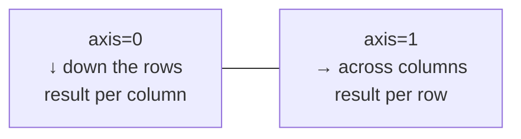

# Math, Statistics & Sorting

## Aggregations and the `axis` argument

```python
import numpy as np

m = np.array([[1, 2, 3],
              [4, 5, 6]])

m.sum()               # -> np.int64(21)            all elements
m.sum(axis=0)         # -> array([5, 7, 9])        collapse rows -> one value per COLUMN
m.sum(axis=1)         # -> array([ 6, 15])         collapse columns -> one value per ROW
m.sum(axis=1, keepdims=True).shape   # -> (2, 1)

m.min(), m.max()      # -> (np.int64(1), np.int64(6))
m.mean(axis=0)        # -> array([2.5, 3.5, 4.5])
m.prod()              # -> np.int64(720)
m.argmax()            # -> np.int64(5)             index in the flattened array
m.argmax(axis=1)      # -> array([2, 2])           column index of max in each row
np.unravel_index(m.argmax(), m.shape)   # -> (np.int64(1), np.int64(2))
```



!!! tip "Remember"
    The `axis` you pass is the one that **disappears**. `(2, 3).sum(axis=0)` → shape `(3,)`.

## Statistics

```python
import numpy as np

x = np.array([2.0, 4.0, 4.0, 4.0, 5.0, 5.0, 7.0, 9.0])

np.mean(x)                 # -> np.float64(5.0)
np.median(x)               # -> np.float64(4.5)
np.std(x)                  # -> np.float64(2.0)        population std (ddof=0)
np.std(x, ddof=1)          # sample std (divide by n-1) — matches pandas default
np.var(x)                  # -> np.float64(4.0)
np.percentile(x, [25, 50, 75])   # -> array([4.  , 4.5 , 5.5 ])
np.quantile(x, 0.9)        # 90th percentile
np.ptp(x)                  # -> np.float64(7.0)        max - min (peak to peak)
np.average(x, weights=np.arange(1, 9))   # weighted mean

a = np.array([1, 2, 3, 4, 5]); b = np.array([2, 4, 5, 4, 5])
np.corrcoef(a, b)[0, 1]    # Pearson correlation
np.cov(a, b)               # 2x2 covariance matrix

np.histogram([1, 2, 2, 3, 3, 3], bins=3)
# -> (array([1, 2, 3]), array([1.        , 1.66666667, 2.33333333, 3.        ]))
np.bincount([0, 1, 1, 3])  # -> array([1, 2, 0, 1])   counts of non-negative ints
```

## Missing values (NaN-aware functions)

```python
import numpy as np

x = np.array([1.0, np.nan, 3.0])
np.mean(x)          # -> np.float64(nan)     NaN propagates
np.nanmean(x)       # -> np.float64(2.0)
np.nansum(x)        # -> np.float64(4.0)
np.nanmax(x)        # -> np.float64(3.0)
np.isnan(x).sum()   # -> np.int64(1)         count missing
x[~np.isnan(x)]     # -> array([1., 3.])     drop missing
np.where(np.isnan(x), 0.0, x)   # -> array([1., 0., 3.])   fill missing
```

Also: `nanmin`, `nanstd`, `nanvar`, `nanmedian`, `nanpercentile`, `nanargmax`.

## Cumulative & difference

```python
import numpy as np

a = np.array([1, 2, 3, 4])
np.cumsum(a)        # -> array([ 1,  3,  6, 10])
np.cumprod(a)       # -> array([ 1,  2,  6, 24])
np.diff(a)          # -> array([1, 1, 1])
np.diff([1, 4, 9, 16], n=2)   # -> array([2, 2])
np.gradient([1.0, 4.0, 9.0, 16.0])   # -> array([3., 4., 6., 7.])
np.trapezoid([1, 2, 3])        # -> np.float64(4.0)   numerical integral
```

!!! warning "Renamed"
    `np.trapz` → **`np.trapezoid`**, `np.product` → `np.prod`, `np.cumproduct` → `np.cumprod`, `np.alltrue`/`np.sometrue` → `np.all`/`np.any`.

## Logic tests

```python
import numpy as np

a = np.array([3, 0, 5])
np.any(a == 0)        # -> np.True_
np.all(a >= 0)        # -> np.True_
(a > 2).sum()         # -> np.int64(2)     count matches
(a > 2).mean()        # fraction of matches
np.count_nonzero(a)   # -> 2
np.isin(a, [0, 5])    # -> array([False,  True,  True])
```

## Sorting & searching

```python
import numpy as np

a = np.array([3, 1, 2, 5, 4])

np.sort(a)                     # -> array([1, 2, 3, 4, 5])   returns a copy
np.sort(a, descending=True)    # -> array([5, 4, 3, 2, 1])   NumPy 2.5+
np.sort(a)[::-1]               # descending on older versions
np.argsort(a)                  # -> array([1, 2, 0, 4, 3])   indices that would sort
a.sort()                       # sorts in place

m = np.array([[3, 1], [2, 4]])
np.sort(m, axis=0)             # -> array([[2, 1], [3, 4]])   sort each column

b = np.array([7, 2, 9, 4, 1])
np.partition(b, 2)[:2]         # 2 smallest (unordered) — O(n), faster than sort
np.argpartition(b, -2)[-2:]    # indices of the 2 largest

sorted_arr = np.array([1, 3, 5, 7])
np.searchsorted(sorted_arr, 4) # -> np.int64(2)   insertion index

np.unique([3, 1, 3, 2, 1], return_counts=True)   # -> (array([1, 2, 3]), array([2, 1, 2]))

people = np.array([[25, 170], [30, 160], [25, 150]])
people[np.lexsort((people[:, 1], people[:, 0]))]  # sort by col 0, then col 1
```

### Top-k pattern (ML)

```python
import numpy as np

scores = np.array([0.1, 0.7, 0.05, 0.9, 0.3])
k = 2
topk_idx = np.argsort(scores, descending=True)[:k]
topk_idx                      # -> array([3, 1])
scores[topk_idx]              # -> array([0.9, 0.7])
```

## Set operations

```python
import numpy as np

a = np.array([1, 2, 3, 4]); b = np.array([3, 4, 5])
np.intersect1d(a, b)    # -> array([3, 4])
np.union1d(a, b)        # -> array([1, 2, 3, 4, 5])
np.setdiff1d(a, b)      # -> array([1, 2])
np.setxor1d(a, b)       # -> array([1, 2, 5])
```

Use `np.isin` (not the deprecated `np.in1d`).

## Rounding

```python
import numpy as np

x = np.array([-1.5, -0.5, 0.5, 1.5, 2.5])
np.round(x)        # -> array([-2., -0.,  0.,  2.,  2.])   round half to EVEN (banker's)
np.floor(x)        # -> array([-2., -1.,  0.,  1.,  2.])
np.ceil(x)         # -> array([-1., -0.,  1.,  2.,  3.])
np.trunc(x)        # -> array([-1., -0.,  0.,  1.,  2.])   toward zero (np.fix is deprecated)
```

## Quick recap

- [x] Reductions take `axis` (the axis that disappears) and `keepdims`.
- [x] `mean/median/std/var/percentile`; `ddof=1` for sample std.
- [x] `nan*` functions ignore NaN.
- [x] `sort` (copy) vs `.sort()` (in place); `argsort`, `descending=True` (2.5+), `partition` for top-k.
- [x] `unique(return_counts=True)`, `isin`, set ops; `round` is half-to-even.
