# NumPy

**NumPy** (Numerical Python) is the foundation of the Python data & ML stack: a fast **N-dimensional array** (`ndarray`) plus vectorised math, linear algebra, random numbers and I/O. pandas, scikit-learn, SciPy, Matplotlib, PyTorch and TensorFlow all build on — or interoperate with — NumPy arrays.

!!! note "Version baseline"
    Written for **NumPy 2.5** (current release line, Python 3.12–3.14). Every example on these pages was executed against NumPy 2.5.4. Names removed in NumPy 2.x (`np.float_`, `np.NaN`, `np.row_stack`…) appear only in :material-alert: *Removed / Deprecated* boxes — see [NumPy 2 Migration](15-numpy2-migration.md).

Comments like `# -> array([1, 2, 3])` show the result of the line.

## Learning path

```mermaid
flowchart LR
    A[Intro & setup] --> B[Creating arrays]
    B --> C[dtypes & attributes]
    C --> D[Indexing & slicing]
    D --> E[Operations, ufuncs, broadcasting]
    E --> F[Reshaping & combining]
    F --> G[Math & statistics]
    G --> H[Linear algebra]
    H --> I[Random]
    I --> J[I/O & interop]
    J --> K[Performance]
    K --> L[NumPy for ML]
    L --> M[Exercises]
```

## Pages

| # | Page | Level |
|---|------|-------|
| 1 | [Introduction & Setup](01-introduction.md) | Beginner |
| 2 | [Creating Arrays](02-creating-arrays.md) | Beginner |
| 3 | [Array Attributes & dtypes](03-dtypes-attributes.md) | Beginner |
| 4 | [Indexing, Slicing, Views & Copies](04-indexing-slicing.md) | Beginner → Intermediate |
| 5 | [Operations, ufuncs & Broadcasting](05-ufuncs-broadcasting.md) | Intermediate |
| 6 | [Reshaping, Stacking & Splitting](06-reshaping.md) | Intermediate |
| 7 | [Math, Statistics & Sorting](07-math-statistics.md) | Intermediate |
| 8 | [Linear Algebra](08-linear-algebra.md) | Intermediate |
| 9 | [Random Numbers](09-random.md) | Intermediate |
| 10 | [File I/O & Interoperability](10-io-interop.md) | Intermediate |
| 11 | [Performance & Memory](11-performance.md) | Advanced |
| 12 | [NumPy for Machine Learning](12-numpy-for-ml.md) | Applied |
| 13 | [Exercises with Solutions](13-exercises.md) | Practice |
| 14 | [Cheat Sheet](14-cheatsheet.md) | Quick review |
| 15 | [NumPy 2 Migration](15-numpy2-migration.md) | Reference |

## Useful links

- Official docs: <https://numpy.org/doc/stable/>
- Absolute beginner's guide: <https://numpy.org/doc/stable/user/absolute_beginners.html>
- API reference: <https://numpy.org/doc/stable/reference/>
- Release notes: <https://numpy.org/doc/stable/release.html>
