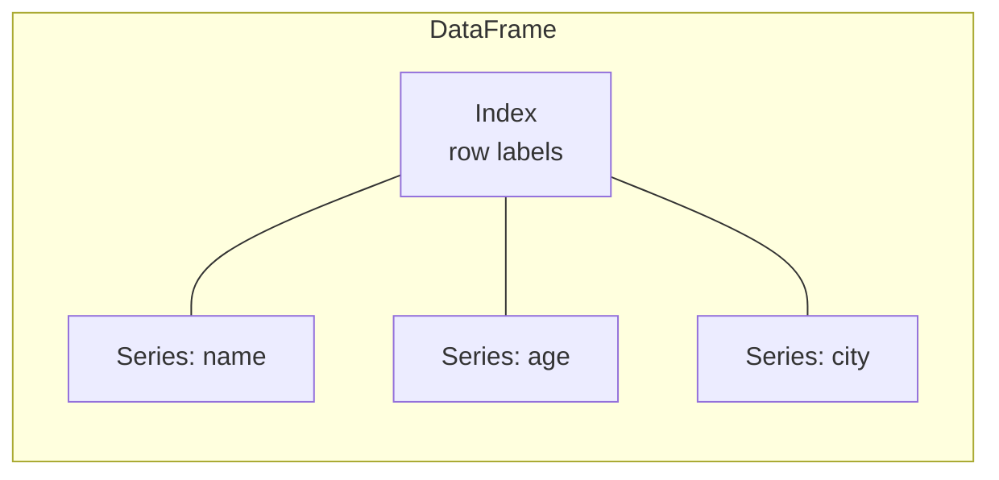

# Introduction & Setup

## What is pandas?

| | |
|---|---|
| **What** | A library providing labelled, column-oriented data structures — **`Series`** (1-D) and **`DataFrame`** (2-D table) — plus tools to read, clean, reshape, aggregate and analyse data. |
| **Why** | Real data is tabular, messy and mixed-type (numbers, text, dates, missing values). NumPy arrays hold one dtype and have no labels; pandas adds **column names, row labels, per-column dtypes, missing-data handling, group-by, joins and time series**. |
| **How** | Each column is stored as a typed array (NumPy or Apache Arrow). Operations are **vectorised** over whole columns and **aligned by labels**. |

Typical uses: exploratory data analysis (EDA), ETL, reporting, feature engineering for ML, log/metrics analysis, finance and time-series work.

## Installation

```bash
pip install pandas                 # core
pip install "pandas[performance]"  # numexpr, bottleneck, numba
pip install pyarrow                # recommended: fast strings, Parquet, Arrow interop
pip install openpyxl               # Excel files
```

pandas 3.x requires **Python ≥ 3.11** and **NumPy ≥ 1.26**. With **PyArrow** installed, the default string dtype is Arrow-backed (faster, less memory).

```python
import pandas as pd
import numpy as np

pd.__version__              # e.g. '3.1.1'
# pd.show_versions()        # full dependency report (useful in bug reports)
```

The universal convention is `import pandas as pd`.

## The two core objects



```python
import pandas as pd

s = pd.Series([25, 32, 41], index=["ana", "ben", "cy"], name="age")
s["ben"]                    # -> np.int64(32)

df = pd.DataFrame({
    "name": ["Ana", "Ben", "Cy"],
    "age": [25, 32, 41],
    "city": ["Cairo", "Berlin", "Cairo"],
})
df.shape                    # -> (3, 3)
df.columns.tolist()         # -> ['name', 'age', 'city']
df["age"].mean()            # -> np.float64(32.666666666666664)
#   name  age    city
# 0  Ana   25   Cairo
# 1  Ben   32  Berlin
# 2   Cy   41   Cairo
```

| Object | Is | Like |
|---|---|---|
| **Series** | 1-D labelled array with one dtype | A column / a NumPy array with an index |
| **DataFrame** | 2-D table of columns (Series) sharing one index | A spreadsheet / SQL table |
| **Index** | Immutable labels for rows (or columns) | Row names / primary key |

## pandas vs. NumPy vs. SQL vs. Excel

| Task | pandas | NumPy | SQL | Excel |
|---|---|---|---|---|
| Mixed column types | ✅ | ❌ one dtype | ✅ | ✅ |
| Labels | ✅ index + columns | ❌ positions only | ✅ | ✅ |
| Missing data | ✅ | NaN for floats only | ✅ NULL | blanks |
| Group / join / pivot | ✅ | ❌ | ✅ | ✅ (limited) |
| Fast numeric math | ✅ (via NumPy) | ✅✅ | — | slow |
| Data size | Fits in memory | Fits in memory | Disk | ~1M rows |

## A first analysis in a few lines

```python
import pandas as pd

sales = pd.DataFrame({
    "region": ["North", "South", "North", "East", "South"],
    "units": [10, 4, 7, 12, 3],
    "price": [2.5, 3.0, 2.5, 1.5, 3.0],
})
sales = sales.assign(revenue=sales["units"] * sales["price"])
by_region = sales.groupby("region")["revenue"].sum().sort_values(ascending=False)
by_region.index.tolist()     # -> ['North', 'South', 'East']
by_region.tolist()           # -> [42.5, 21.0, 18.0]
```

## Getting help

```python
import pandas as pd

help(pd.DataFrame.merge)            # docstring
pd.set_option("display.max_columns", 50)   # show more columns when printing
pd.get_option("display.max_rows")   # -> 60
pd.reset_option("display.max_columns")
```

In Jupyter: `df.merge?` for the docstring, `Tab` for completion.

## Quick recap

- [x] `import pandas as pd`; install `pyarrow` alongside.
- [x] `Series` = labelled 1-D column; `DataFrame` = table of Series sharing an `Index`.
- [x] Operations are vectorised and **label-aligned**.
- [x] pandas 3.x: Python ≥ 3.11, Copy-on-Write always on, `str` dtype by default.
