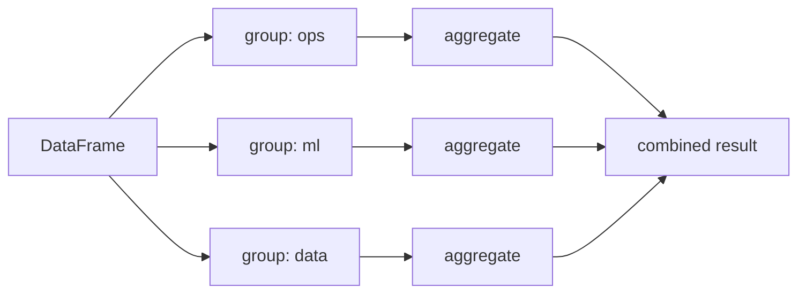

---
tags:
  - pandas
  - Python for ML
---

# GroupBy, Aggregation & Pivot Tables

## Split → apply → combine



```python
import pandas as pd

df = pd.DataFrame({
    "team": ["ops", "ml", "ops", "ml", "data", "ops"],
    "level": ["jr", "sr", "sr", "jr", "sr", "jr"],
    "salary": [3000, 5200, 4800, 3600, 5000, 3100],
    "projects": [2, 5, 4, 3, 6, 1],
})

df.groupby("team")["salary"].mean().to_dict()   # -> {'data': 5000.0, 'ml': 4400.0, 'ops': 3633.3333333333335}
df.groupby("team").size().to_dict()             # -> {'data': 1, 'ml': 2, 'ops': 3}   rows per group
df.groupby("team")["projects"].sum().to_dict()  # -> {'data': 6, 'ml': 8, 'ops': 7}
df.groupby("team", sort=False).ngroups          # -> 3
```

Common aggregations: `sum`, `mean`, `median`, `min`, `max`, `count` (non-null), `size` (all rows), `nunique`, `std`, `var`, `first`, `last`, `quantile`, `idxmax`.

## `agg` — several aggregations at once

```python
import pandas as pd

df = pd.DataFrame({
    "team": ["ops", "ml", "ops", "ml", "data", "ops"],
    "salary": [3000, 5200, 4800, 3600, 5000, 3100],
    "projects": [2, 5, 4, 3, 6, 1],
})

# Named aggregation (recommended): new_column=(column, function)
summary = df.groupby("team").agg(
    headcount=("salary", "size"),
    avg_salary=("salary", "mean"),
    max_projects=("projects", "max"),
    salary_range=("salary", lambda s: s.max() - s.min()),
)
summary.loc["ops"].tolist()                     # -> [3.0, 3633.3333333333335, 4.0, 1800.0]
summary.columns.tolist()                        # -> ['headcount', 'avg_salary', 'max_projects', 'salary_range']

df.groupby("team")["salary"].agg(["min", "max"]).loc["ml"].tolist()   # -> [3600, 5200]
df.groupby("team", as_index=False)["salary"].sum().columns.tolist()  # -> ['team', 'salary']   group as a column
```

## Multiple keys & MultiIndex results {#multiindex-results}

```python
import pandas as pd

df = pd.DataFrame({
    "team": ["ops", "ml", "ops", "ml", "ops"],
    "level": ["jr", "sr", "sr", "jr", "jr"],
    "salary": [3000, 5200, 4800, 3600, 3100],
})

g = df.groupby(["team", "level"])["salary"].mean()
g.index.nlevels                     # -> 2
g.loc[("ops", "jr")]                # -> np.float64(3050.0)
g.unstack().loc["ml"].to_dict()     # -> {'jr': 3600.0, 'sr': 5200.0}   level -> columns
g.reset_index().columns.tolist()    # -> ['team', 'level', 'salary']   flatten
```

## `transform` — same shape as the input

`transform` returns one value **per original row** — ideal for group-level features.

```python
import pandas as pd

df = pd.DataFrame({"team": ["a", "a", "b", "b", "b"], "sales": [10, 30, 5, 5, 20]})

df["team_total"] = df.groupby("team")["sales"].transform("sum")
df["share"] = df["sales"] / df["team_total"]
df["rank_in_team"] = df.groupby("team")["sales"].rank(ascending=False)
df["zscore"] = df.groupby("team")["sales"].transform(lambda s: (s - s.mean()) / s.std())

df["team_total"].tolist()      # -> [40, 40, 30, 30, 30]
df["share"].round(2).tolist()  # -> [0.25, 0.75, 0.17, 0.17, 0.67]
df.groupby("team").cumcount().tolist()   # -> [0, 1, 0, 1, 2]   position within group
df.groupby("team")["sales"].shift(1).tolist()   # -> [nan, 10.0, nan, 5.0, 5.0]
```

## `filter` groups & `apply`

```python
import pandas as pd

df = pd.DataFrame({"team": ["a", "a", "b", "c", "c", "c"], "sales": [10, 30, 5, 1, 2, 3]})

# keep only groups that satisfy a condition
df.groupby("team").filter(lambda g: len(g) >= 2)["team"].unique().tolist()   # -> ['a', 'c']

# top-n rows per group
df.sort_values("sales", ascending=False).groupby("team").head(1)["sales"].tolist()   # -> [30, 5, 3]
df.loc[df.groupby("team")["sales"].idxmax(), "sales"].tolist()                      # -> [30, 5, 3]

# apply: arbitrary function per group (slowest; prefer agg/transform)
df.groupby("team")["sales"].apply(lambda s: s.max() - s.min()).to_dict()   # -> {'a': 20, 'b': 0, 'c': 2}
```

| Method | Output shape | Use |
|---|---|---|
| `agg` / reductions | One row per group | Summaries |
| `transform` | Same as input | Group features, normalisation, fill missing |
| `filter` | Subset of rows | Keep/drop whole groups |
| `apply` | Flexible | Anything else (slower) |

## Pivot tables

```python
import pandas as pd

sales = pd.DataFrame({
    "region": ["N", "N", "S", "S", "N", "S"],
    "quarter": ["Q1", "Q2", "Q1", "Q2", "Q1", "Q1"],
    "revenue": [100, 150, 80, 120, 50, 30],
})

pt = sales.pivot_table(index="region", columns="quarter", values="revenue", aggfunc="sum", fill_value=0)
pt.loc["N"].to_dict()              # -> {'Q1': 150, 'Q2': 150}
pt.loc["S"].to_dict()              # -> {'Q1': 110, 'Q2': 120}

pt_tot = sales.pivot_table(index="region", columns="quarter", values="revenue",
                           aggfunc="sum", margins=True, margins_name="Total")
int(pt_tot.loc["Total", "Total"])  # -> 530

pd.crosstab(sales["region"], sales["quarter"]).loc["S"].to_dict()   # -> {'Q1': 2, 'Q2': 1}   counts
pd.crosstab(sales["region"], sales["quarter"], normalize="index").round(2).loc["S"].to_dict()   # -> {'Q1': 0.67, 'Q2': 0.33}
```

## Grouping by bins, dates and functions

```python
import pandas as pd

df = pd.DataFrame({
    "age": [22, 35, 47, 51, 29],
    "spend": [100, 300, 250, 400, 150],
    "date": pd.to_datetime(["2026-01-05", "2026-01-20", "2026-02-03", "2026-02-28", "2026-03-10"]),
})

df.groupby(pd.cut(df["age"], [0, 30, 50, 100]), observed=True)["spend"].mean().tolist()   # -> [125.0, 275.0, 400.0]
df.groupby(df["date"].dt.month)["spend"].sum().to_dict()      # -> {1: 400, 2: 650, 3: 150}
df.groupby(pd.Grouper(key="date", freq="MS"))["spend"].sum().tolist()   # -> [400, 650, 150]
```

## Quick recap

- [x] `df.groupby(keys)[col].agg(...)`; named aggregation `new=(col, func)`.
- [x] `size` counts rows, `count` counts non-null values.
- [x] `transform` keeps the original shape (group features); `filter` keeps whole groups.
- [x] `as_index=False` or `reset_index()` to flatten; `unstack` to pivot a level.
- [x] `pivot_table` (with `aggfunc`, `margins`) and `crosstab` for counts/shares.
