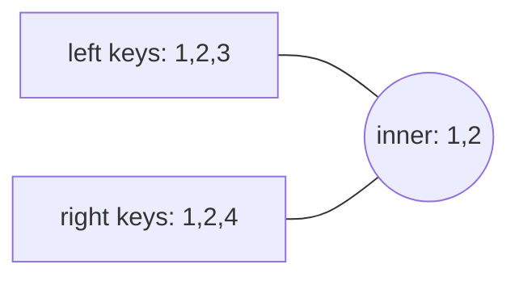
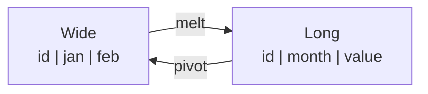

---
tags:
  - pandas
  - Python for ML
---

# Merging, Joining & Reshaping

## `concat` — stack DataFrames

```python
import pandas as pd

jan = pd.DataFrame({"id": [1, 2], "amount": [10, 20]})
feb = pd.DataFrame({"id": [3], "amount": [30]})

pd.concat([jan, feb], ignore_index=True)["id"].tolist()           # -> [1, 2, 3]    rows (axis=0)
pd.concat([jan, feb], keys=["jan", "feb"]).index.tolist()         # -> [('jan', 0), ('jan', 1), ('feb', 0)]
pd.concat([jan, pd.DataFrame({"note": ["x", "y"]})], axis=1).columns.tolist()   # -> ['id', 'amount', 'note']
pd.concat([jan, pd.DataFrame({"id": [9], "extra": [1]})], ignore_index=True).columns.tolist()   # -> ['id', 'amount', 'extra']
```

!!! warning "Removed: `DataFrame.append`"
    `df.append(other)` was removed in pandas 2.0. Use `pd.concat([df, other])`. Don't concat inside a loop — collect DataFrames in a list and concat **once**.

## `merge` — SQL-style joins

```python
import pandas as pd

customers = pd.DataFrame({"cust_id": [1, 2, 3], "name": ["Ana", "Ben", "Cy"]})
orders = pd.DataFrame({"order_id": [10, 11, 12, 13], "cust_id": [1, 1, 2, 4], "total": [50, 20, 70, 30]})

inner = customers.merge(orders, on="cust_id", how="inner")
inner["name"].tolist()                       # -> ['Ana', 'Ana', 'Ben']

left = customers.merge(orders, on="cust_id", how="left")
left["order_id"].tolist()                    # -> [10.0, 11.0, 12.0, nan]   Cy has no orders

right = customers.merge(orders, on="cust_id", how="right")
right["name"].isna().tolist()                # -> [False, False, False, True]   customer 4 unknown

outer = customers.merge(orders, on="cust_id", how="outer", indicator=True)
outer["_merge"].astype(str).tolist()         # -> ['both', 'both', 'both', 'left_only', 'right_only']

len(customers.merge(orders, how="cross"))    # -> 12   every combination
```

| `how` | Keeps | SQL |
|---|---|---|
| `inner` (default) | Keys in both | `INNER JOIN` |
| `left` | All left rows | `LEFT JOIN` |
| `right` | All right rows | `RIGHT JOIN` |
| `outer` | All keys from both | `FULL OUTER JOIN` |
| `cross` | Cartesian product | `CROSS JOIN` |



### Useful merge options

```python
import pandas as pd

a = pd.DataFrame({"key": [1, 2], "value": ["a1", "a2"]})
b = pd.DataFrame({"id": [1, 2], "value": ["b1", "b2"]})

m = a.merge(b, left_on="key", right_on="id", suffixes=("_a", "_b"))
m.columns.tolist()          # -> ['key', 'value_a', 'id', 'value_b']

dup = pd.DataFrame({"id": [1, 1], "v": [0, 0]})
try:
    a.merge(dup, left_on="key", right_on="id", validate="one_to_one")
except pd.errors.MergeError as e:
    print("caught:", type(e).__name__)      # validate catches unexpected duplicate keys
```

- `on` / `left_on` + `right_on` / `left_index=True` for keys.
- `validate="one_to_one" | "one_to_many" | "many_to_one"` — guard against row explosion.
- `indicator=True` adds `_merge` to see where each row came from.
- Check row counts before and after a merge.

### `join` (on the index) and `merge_asof` (nearest key)

```python
import pandas as pd

prices = pd.DataFrame({"price": [10.0, 20.0]}, index=["a", "b"])
stock = pd.DataFrame({"qty": [5, 7]}, index=["a", "c"])
prices.join(stock, how="left")["qty"].tolist()          # -> [5.0, nan]

trades = pd.DataFrame({"time": pd.to_datetime(["2026-01-05 10:00:03", "2026-01-05 10:00:07"]), "qty": [100, 50]})
quotes = pd.DataFrame({"time": pd.to_datetime(["2026-01-05 10:00:00", "2026-01-05 10:00:05"]), "bid": [99.5, 99.7]})
pd.merge_asof(trades, quotes, on="time")["bid"].tolist()   # -> [99.5, 99.7]   last quote at or before each trade
```

## Reshaping: wide ↔ long



```python
import pandas as pd

wide = pd.DataFrame({"store": ["A", "B"], "jan": [100, 80], "feb": [120, 90]})

long = wide.melt(id_vars="store", var_name="month", value_name="sales")
long.values.tolist()
# -> [['A', 'jan', 100], ['B', 'jan', 80], ['A', 'feb', 120], ['B', 'feb', 90]]

back = long.pivot(index="store", columns="month", values="sales")
back.loc["A"].to_dict()          # -> {'feb': 120, 'jan': 100}
```

- `pivot` requires unique index/column pairs; use `pivot_table` (with `aggfunc`) when there are duplicates.

### `stack` / `unstack`

```python
import pandas as pd

df = pd.DataFrame({"jan": [1, 2], "feb": [3, 4]}, index=["A", "B"])

stacked = df.stack()                     # columns -> inner index level (Series)
stacked.index.tolist()                   # -> [('A', 'jan'), ('A', 'feb'), ('B', 'jan'), ('B', 'feb')]
stacked.unstack().equals(df)             # -> True
df.T.loc["feb"].tolist()                 # -> [3, 4]   transpose
```

### `explode` and dummies

```python
import pandas as pd

posts = pd.DataFrame({"id": [1, 2], "tags": [["ml", "ops"], ["ml"]]})
posts.explode("tags")["tags"].tolist()               # -> ['ml', 'ops', 'ml']   one row per list item

colors = pd.Series(["red", "blue", "red"])
pd.get_dummies(colors, dtype=int).values.tolist()    # -> [[0, 1], [1, 0], [0, 1]]   columns: blue, red
pd.from_dummies(pd.get_dummies(colors)).iloc[:, 0].tolist()   # -> ['red', 'blue', 'red']
```

## Comparing DataFrames

```python
import pandas as pd

old = pd.DataFrame({"price": [10, 20, 30]})
new = pd.DataFrame({"price": [10, 25, 30]})
old.equals(new)                          # -> False
old.compare(new).index.tolist()          # -> [1]   only differing rows
```

## Quick recap

- [x] `pd.concat` stacks rows (or columns with `axis=1`); `append` is gone.
- [x] `merge(on=, how=)` = SQL joins; use `validate=` and `indicator=True`; check row counts.
- [x] `join` for index-based joins; `merge_asof` for nearest-time joins.
- [x] `melt` (wide → long) and `pivot` / `pivot_table` (long → wide); `stack`/`unstack`.
- [x] `explode` list columns; `get_dummies` for one-hot.
