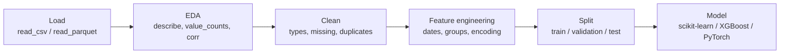

---
tags:
  - pandas
  - Python for ML
  - Machine learning
---

# pandas for Machine Learning

pandas is where most ML projects spend their time: **loading, EDA, cleaning, feature engineering and splitting** before data goes to scikit-learn, XGBoost or a deep-learning framework.



## A sample dataset

```python
import pandas as pd
import numpy as np

rng = np.random.default_rng(42)
n = 500
df = pd.DataFrame({
    "customer_id": np.arange(n),
    "signup": pd.to_datetime("2025-01-01") + pd.to_timedelta(rng.integers(0, 365, n), unit="D"),
    "plan": rng.choice(["free", "pro", "team"], n, p=[0.6, 0.3, 0.1]),
    "country": rng.choice(["EG", "DE", "US"], n),
    "monthly_spend": rng.gamma(2, 20, n).round(2),
    "support_tickets": rng.poisson(1.5, n),
})
df.loc[rng.choice(n, 25, replace=False), "monthly_spend"] = np.nan
df["churned"] = ((df["support_tickets"] > 2) | (df["plan"] == "free") & (rng.random(n) < 0.3)).astype(int)
df.shape                                  # -> (500, 7)
```

## Exploratory data analysis (EDA)

```python
import pandas as pd
import numpy as np

rng = np.random.default_rng(42)
n = 500
df = pd.DataFrame({
    "plan": rng.choice(["free", "pro", "team"], n, p=[0.6, 0.3, 0.1]),
    "monthly_spend": rng.gamma(2, 20, n).round(2),
    "support_tickets": rng.poisson(1.5, n),
})
df["churned"] = (df["support_tickets"] > 2).astype(int)

df.describe().loc[["mean", "50%"]]                 # central tendency
df["plan"].value_counts(normalize=True).round(2)   # class/category balance
df["churned"].mean() < 0.5                         # -> np.True_   target rate
df.groupby("plan")["churned"].mean()               # target rate by segment
df.select_dtypes("number").corr()["churned"]       # linear correlation with target
df.isna().mean().sort_values(ascending=False)      # missing share per column
```

EDA checklist: shape & dtypes · missing values · duplicates · target balance · distributions & outliers · relationships with the target · leakage suspects (columns that only exist *after* the outcome).

## Feature engineering

```python
import pandas as pd
import numpy as np

df = pd.DataFrame({
    "customer_id": [1, 1, 2, 3, 3, 3],
    "ts": pd.to_datetime(["2026-01-03", "2026-02-10", "2026-01-20", "2026-01-05", "2026-01-25", "2026-03-01"]),
    "amount": [20.0, 35.0, 10.0, 50.0, np.nan, 40.0],
    "plan": ["pro", "pro", "free", "team", "team", "team"],
})

feats = (
    df
    .assign(
        amount=pd.col("amount").fillna(df["amount"].median()),          # impute
        month=pd.col("ts").dt.month,                                     # date parts
        is_weekend=pd.col("ts").dt.day_of_week >= 5,
        log_amount=lambda d: np.log1p(d["amount"]),                      # skew fix
    )
    .sort_values(["customer_id", "ts"])
    .assign(
        prev_amount=lambda d: d.groupby("customer_id")["amount"].shift(1),         # lag
        cust_mean=lambda d: d.groupby("customer_id")["amount"].transform("mean"),  # group stat
        days_since_prev=lambda d: d.groupby("customer_id")["ts"].diff().dt.days,
    )
)
feats["cust_mean"].round(1).tolist()          # -> [27.5, 27.5, 10.0, 41.7, 41.7, 41.7]
feats["days_since_prev"].tolist()             # -> [nan, 38.0, nan, nan, 20.0, 35.0]

# Aggregate to one row per customer (typical for churn models)
per_customer = df.groupby("customer_id").agg(
    n_tx=("amount", "size"),
    total=("amount", "sum"),
    last_tx=("ts", "max"),
)
per_customer["n_tx"].tolist()                 # -> [2, 1, 3]
```

## Encoding categorical variables

```python
import pandas as pd

df = pd.DataFrame({"plan": ["free", "pro", "team", "pro"], "size": ["S", "L", "M", "S"]})

pd.get_dummies(df, columns=["plan"], dtype=int).columns.tolist()
# -> ['size', 'plan_free', 'plan_pro', 'plan_team']
pd.get_dummies(df["plan"], drop_first=True, dtype=int).columns.tolist()   # -> ['pro', 'team']

order = {"S": 0, "M": 1, "L": 2}
df["size_ord"] = df["size"].map(order)                         # ordinal encoding
df["size_ord"].tolist()                                        # -> [0, 2, 1, 0]
df["plan_code"] = df["plan"].astype("category").cat.codes      # integer codes
df["plan_code"].tolist()                                       # -> [0, 1, 2, 1]
df["plan_freq"] = df["plan"].map(df["plan"].value_counts(normalize=True))   # frequency encoding
df["plan_freq"].tolist()                                       # -> [0.25, 0.5, 0.25, 0.5]
```

!!! warning "Fit on training data only"
    Category lists, medians, means and target encodings must be learned on the **training** split and reused on validation/test — otherwise you leak information. scikit-learn's `ColumnTransformer` / `OneHotEncoder(handle_unknown="ignore")` handle this inside a `Pipeline`.

## Train / validation / test splits

```python
import pandas as pd
import numpy as np

rng = np.random.default_rng(0)
df = pd.DataFrame({"x": rng.random(100), "y": rng.integers(0, 2, 100),
                   "date": pd.date_range("2026-01-01", periods=100, freq="D")})

# Random split with pandas only
train = df.sample(frac=0.8, random_state=42)
test = df.drop(train.index)
len(train), len(test)                        # -> (80, 20)

# Stratified sample (keep class ratio)
strat = df.groupby("y", group_keys=False).sample(frac=0.8, random_state=42)
abs(strat["y"].mean() - df["y"].mean()) < 0.02   # -> np.True_

# Time-based split (no future data in training!)
cutoff = pd.Timestamp("2026-03-15")
train_t, test_t = df[df["date"] < cutoff], df[df["date"] >= cutoff]
train_t["date"].max() < test_t["date"].min()     # -> True
```

## Handing data to scikit-learn

```python
import pandas as pd
import numpy as np
from sklearn.compose import ColumnTransformer
from sklearn.impute import SimpleImputer
from sklearn.linear_model import LogisticRegression
from sklearn.model_selection import train_test_split
from sklearn.pipeline import Pipeline
from sklearn.preprocessing import OneHotEncoder, StandardScaler

rng = np.random.default_rng(42)
n = 400
df = pd.DataFrame({
    "plan": rng.choice(["free", "pro", "team"], n),
    "country": rng.choice(["EG", "DE", "US"], n),
    "spend": rng.gamma(2, 20, n),
    "tickets": rng.poisson(1.5, n).astype(float),
})
df.loc[rng.choice(n, 20, replace=False), "spend"] = np.nan
y = ((df["tickets"] > 2) | (df["plan"] == "free")).astype(int)

X_train, X_test, y_train, y_test = train_test_split(df, y, test_size=0.25, stratify=y, random_state=0)

pre = ColumnTransformer([
    ("num", Pipeline([("impute", SimpleImputer(strategy="median")), ("scale", StandardScaler())]),
     ["spend", "tickets"]),
    ("cat", OneHotEncoder(handle_unknown="ignore", sparse_output=False), ["plan", "country"]),
])
model = Pipeline([("pre", pre), ("clf", LogisticRegression(max_iter=1000))])
model.set_output(transform="pandas")           # transformers output DataFrames with feature names
model.fit(X_train, y_train)                    # DataFrames go straight in — columns by name
model.score(X_test, y_test) > 0.8              # -> True

model[:-1].transform(X_test.head(2)).columns.tolist()[:3]   # -> ['num__spend', 'num__tickets', 'cat__plan_free']
```

Convert explicitly when a library wants arrays: `X = df[features].to_numpy(dtype="float32")`, `y = df["target"].to_numpy()`.

## Saving datasets & predictions

```python
import pandas as pd

preds = pd.DataFrame({"customer_id": [1, 2], "churn_proba": [0.81, 0.07]})
preds.to_parquet("predictions.parquet", index=False)        # typed, compact — for pipelines
pd.read_parquet("predictions.parquet")["churn_proba"].tolist()   # -> [0.81, 0.07]
```

In MLOps pipelines, version datasets (DVC, lakeFS, Delta Lake), log dataset hashes with experiments (MLflow), and validate schemas (pandera) before training.

## Quick recap

- [x] EDA: `describe`, `value_counts(normalize=True)`, `groupby(...)[target].mean()`, `corr`, `isna().mean()`.
- [x] Features: date parts, lags (`groupby().shift`), group stats (`transform`), log transforms, per-entity `agg`.
- [x] Encode with `get_dummies`, `map`, `cat.codes`; learn encodings on train only.
- [x] Split randomly, stratified, or **by time**; avoid leakage.
- [x] scikit-learn `Pipeline` + `ColumnTransformer` accept DataFrames; `set_output(transform="pandas")`.
