# pandas

**pandas** is Python's library for **tabular data**: loading, cleaning, transforming, aggregating, joining and analysing data in labelled tables (`DataFrame`) and columns (`Series`). It sits on top of [NumPy](../numpy/index.md) (and optionally Apache Arrow) and feeds scikit-learn, plotting libraries and ML pipelines.

!!! note "Version baseline"
    Written for **pandas 3.1** (current line; pandas 3.0 was released Jan 2026). Every example on these pages was executed against pandas 3.1.1 with warnings treated as errors. Removed or deprecated APIs (`append`, `applymap`, `fillna(method=)`, `inplace=True`, frequency aliases like `"H"`/`"M"`…) appear only in :material-alert: *Removed / Deprecated* boxes — see [pandas 3 Migration](15-pandas3-migration.md).

Comments like `# -> 3` show the result of the line. Full tables are shown as comment blocks.

## Learning path

```mermaid
flowchart LR
    A[Intro] --> B[Series & DataFrame]
    B --> C[Reading & writing data]
    C --> D[Selecting & filtering]
    D --> E[Cleaning]
    E --> F[Transforming]
    F --> G[GroupBy & pivots]
    G --> H[Merge & reshape]
    H --> I[Time series]
    I --> J[Performance & Copy-on-Write]
    J --> K[Visualisation]
    K --> L[pandas for ML]
    L --> M[Exercises]
```

## Pages

| # | Page | Level |
|---|------|-------|
| 1 | [Introduction & Setup](01-introduction.md) | Beginner |
| 2 | [Series, DataFrame & dtypes](02-series-dataframe.md) | Beginner |
| 3 | [Reading & Writing Data](03-io.md) | Beginner |
| 4 | [Selecting & Filtering](04-selection.md) | Beginner → Intermediate |
| 5 | [Cleaning Data](05-cleaning.md) | Intermediate |
| 6 | [Transforming Data](06-transforming.md) | Intermediate |
| 7 | [GroupBy, Aggregation & Pivot Tables](07-groupby.md) | Intermediate |
| 8 | [Merging, Joining & Reshaping](08-merge-reshape.md) | Intermediate |
| 9 | [Time Series](09-time-series.md) | Intermediate |
| 10 | [Performance & Copy-on-Write](10-performance.md) | Advanced |
| 11 | [Visualisation & Styling](11-visualisation.md) | Intermediate |
| 12 | [pandas for Machine Learning](12-pandas-for-ml.md) | Applied |
| 13 | [Exercises with Solutions](13-exercises.md) | Practice |
| 14 | [Cheat Sheet](14-cheatsheet.md) | Quick review |
| 15 | [pandas 3 Migration](15-pandas3-migration.md) | Reference |

## Useful links

- Official docs: <https://pandas.pydata.org/docs/>
- 10 minutes to pandas: <https://pandas.pydata.org/docs/user_guide/10min.html>
- User guide: <https://pandas.pydata.org/docs/user_guide/>
- API reference: <https://pandas.pydata.org/docs/reference/>
- Release notes: <https://pandas.pydata.org/docs/whatsnew/>
