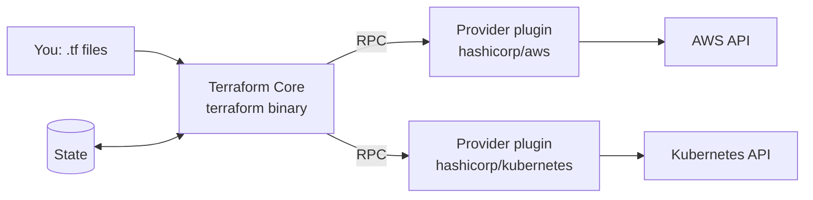

# Introduction & Infrastructure as Code

<span class="exam-tag">Obj 1a</span><span class="exam-tag">Obj 1b</span><span class="exam-tag">Obj 1c</span>

## What is Infrastructure as Code (IaC)?

**IaC** is managing and provisioning infrastructure (networks, VMs, load balancers, DNS, IAM, Kubernetes objects…) through **machine-readable configuration files** instead of manual console clicks or ad-hoc scripts. The files are versioned like application code.

### Benefits of IaC

| Benefit | Why it matters |
|---|---|
| **Speed** | Environments (dev / test / prod) are created by automation in minutes. |
| **Consistency & repeatability** | Same code → same result every time; removes "snowflake" servers and human error. |
| **Version control** | Code lives in Git: history, diff, review (pull requests), rollback. |
| **Collaboration** | Teams review and share infrastructure like software. |
| **Cost** | Less manual work; easy to destroy unused environments. |
| **Security & compliance** | Configs can be scanned and checked by policy-as-code (Sentinel, OPA, tfsec/Trivy, Checkov) **before** deploy. |
| **Documentation** | The code itself documents what exists. |

### Declarative vs. imperative

- **Declarative** (Terraform, CloudFormation, Kubernetes manifests): you describe the **desired end state**; the tool works out how to get there.
- **Imperative** (shell scripts, SDK calls): you write the **steps**.

### Provisioning vs. configuration management

- **Provisioning tools** (Terraform, CloudFormation, Pulumi) create the infrastructure itself.
- **Configuration management tools** (Ansible, Chef, Puppet, Salt) configure software *inside* existing servers.
- They are often combined: Terraform creates the VM → cloud-init / Ansible configures it.

## What is Terraform?

- A source-available tool by **HashiCorp** (see licensing note below) for **building, changing and versioning** infrastructure safely and efficiently.
- **Declarative**: you write the desired state; Terraform compares it to the real world and makes only the needed changes.
- Uses its own language: **HCL** (HashiCorp Configuration Language). JSON syntax (`.tf.json`) is also supported.
- Written in **Go**, shipped as a single binary.
- **Platform-agnostic**: thousands of providers (AWS, Azure, GCP, Kubernetes, GitHub, Datadog, Cloudflare, vSphere…) — one workflow for all of them.

### Why Terraform?

- **Multi-cloud & hybrid**: one language and workflow for every provider; you can mix providers in one configuration (e.g., create an AWS instance and a Cloudflare DNS record pointing to it).
- **Service-agnostic**: not limited to clouds — SaaS, monitoring, VCS, databases.
- **Plan before apply**: `terraform plan` is a dry run that shows exactly what will change.
- **State tracking**: Terraform remembers what it created, so it can update or destroy precisely.
- **Dependency graph**: creates independent resources in parallel and dependent ones in order.
- **Reusable modules** and a public **Registry**.
- Large community and ecosystem.

!!! info "Licensing & ecosystem (context)"
    - Since **Terraform 1.6 (Aug 2023)** Terraform is released under the **Business Source License (BSL 1.1)**, not MPL. Using it to manage your own infrastructure is free; the license restricts building competing commercial products.
    - The Linux Foundation fork **OpenTofu** continues under MPL 2.0 and is largely compatible.
    - **IBM** completed its acquisition of HashiCorp in **February 2025**.
    - *Terraform Cloud* was renamed **HCP Terraform** in 2024 (see [HCP Terraform](13-hcp-terraform.md)).

## Terraform editions

| Edition | What it is |
|---|---|
| **Terraform CLI (Community Edition)** | Free binary you run locally / in CI. |
| **HCP Terraform** (formerly Terraform Cloud) | HashiCorp-managed SaaS: remote runs, remote state, private registry, policies, team access. Has a free tier. |
| **Terraform Enterprise** | Self-hosted distribution of HCP Terraform (supports air-gapped installs). |

## Installation

Download from <https://developer.hashicorp.com/terraform/install> (macOS, Windows, Linux, FreeBSD…).

=== "macOS"

    ```bash
    brew tap hashicorp/tap
    brew install hashicorp/tap/terraform
    ```

=== "Ubuntu / Debian"

    ```bash
    wget -O- https://apt.releases.hashicorp.com/gpg | \
      sudo gpg --dearmor -o /usr/share/keyrings/hashicorp-archive-keyring.gpg
    echo "deb [signed-by=/usr/share/keyrings/hashicorp-archive-keyring.gpg] \
      https://apt.releases.hashicorp.com $(lsb_release -cs) main" | \
      sudo tee /etc/apt/sources.list.d/hashicorp.list
    sudo apt update && sudo apt install terraform
    ```

=== "RHEL / Amazon Linux"

    ```bash
    sudo yum install -y yum-utils
    sudo yum-config-manager --add-repo https://rpm.releases.hashicorp.com/RHEL/hashicorp.repo   # AL2023: .../AmazonLinux/hashicorp.repo
    sudo yum -y install terraform
    ```

=== "Windows"

    ```powershell
    choco install terraform      # or: winget install Hashicorp.Terraform
    # or download the zip, extract terraform.exe and add its folder to PATH
    ```

Verify and enable tab completion:

```bash
terraform -version
terraform -install-autocomplete
```

!!! tip "Managing several versions"
    Use **tfenv** or **tfswitch** to switch between Terraform versions per project.

### Editor setup

- **VS Code** + the official **HashiCorp Terraform** extension: syntax highlighting, validation, auto-completion, format on save (runs `terraform fmt`).

## Terraform architecture: Core & Plugins

Terraform is split into two parts that talk over **RPC (gRPC)**:



**Terraform Core** — the statically-compiled Go binary (`terraform` CLI). Responsibilities:

- Reading and interpolating configuration files and modules (IaC)
- Resource **state** management
- Building the **resource dependency graph**
- **Plan** execution
- Communicating with plugins over RPC

**Terraform Plugins** — separate Go executables started by Core:

- **Providers**: initialise API client libraries, **authenticate** with the platform, and define **resources and data sources** that map to services.
- **Provisioners** (built-in: `local-exec`, `remote-exec`, `file`): run commands/scripts on a resource after creation or before destruction.

## Quick recap

- [x] IaC = infra described in versioned config files → speed, consistency, review, security scanning.
- [x] Terraform is **declarative**, uses **HCL**, is **provider-agnostic**, and keeps **state**.
- [x] Core (binary) ↔ RPC ↔ Plugins (providers/provisioners).
- [x] Editions: CLI · HCP Terraform (SaaS) · Terraform Enterprise (self-hosted).
