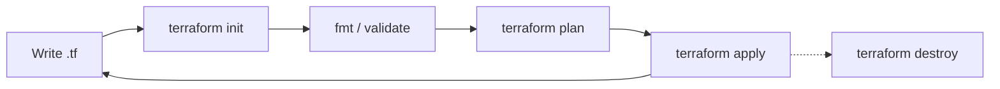

# Core Workflow & CLI

<span class="exam-tag">Obj 3a–3g</span><span class="exam-tag">Obj 7c</span>

## The core workflow

**Write → Plan → Apply** (and eventually **Destroy**).



| Command | What it does |
|---|---|
| `terraform init` | Prepares the working directory: backend, providers, modules, lock file. |
| `terraform fmt` | Formats code to the canonical style. |
| `terraform validate` | Checks syntax and internal consistency. |
| `terraform plan` | Shows what would change (speculative / dry run). |
| `terraform apply` | Makes the changes. |
| `terraform destroy` | Removes everything managed by the configuration. |

## `terraform init` <span class="exam-tag">Obj 3b</span>

The **first command** to run after writing a new configuration or cloning one from Git. Safe to run many times.

It does:

1. **Initialises the backend** (local or remote state storage).
2. **Downloads modules** referenced by `module` blocks into `.terraform/modules/`.
3. **Installs providers** into `.terraform/providers/` and creates/updates **`.terraform.lock.hcl`**.

| Flag | Use |
|---|---|
| `-upgrade` | Upgrade providers (and modules) to the newest versions allowed by constraints. |
| `-reconfigure` | Re-initialise the backend, ignoring existing backend config (no migration). |
| `-migrate-state` | Move existing state to a newly configured backend. |
| `-backend-config=FILE` or `-backend-config="KEY=VALUE"` | Partial backend configuration (keep secrets out of code). |
| `-backend=false` | Skip backend init. |
| `-get=false` | Skip module download. |
| `-input=false` | No interactive prompts (CI). |

!!! note "`terraform get`"
    Downloads/updates **modules only** (`terraform get -update`). `init` already does this, so `get` is rarely needed.

## `terraform fmt` <span class="exam-tag">Obj 3g</span>

Rewrites `.tf` / `.tfvars` files to the canonical HCL style (indentation, `=` alignment).

```bash
terraform fmt              # current directory only
terraform fmt -recursive   # include sub-directories (modules)
terraform fmt -check       # exit code ≠ 0 if files need formatting (CI)
terraform fmt -diff        # show the changes
```

## `terraform validate` <span class="exam-tag">Obj 3c</span>

Checks that the configuration is **syntactically valid and internally consistent**: unknown arguments, missing required arguments, undeclared variables, wrong types, invalid references.

- Requires `init` first (needs provider schemas).
- Does **not** contact remote APIs or check state — it can't tell you an AMI doesn't exist.
- `terraform validate -json` for machine-readable output.

## `terraform plan` <span class="exam-tag">Obj 3d</span>

Creates an **execution plan**. By default it:

1. **Refreshes**: reads the current state of existing remote objects.
2. **Compares** the configuration (desired) with the prior state + real infrastructure.
3. **Proposes** actions to make reality match the configuration.

Plan symbols:

| Symbol | Action |
|---|---|
| `+` | create |
| `-` | destroy |
| `~` | update in-place |
| `-/+` | destroy then create (replace) |
| `+/-` | create then destroy (replace with `create_before_destroy`) |
| `<=` | read (data source) |

Plan is **speculative** — nothing changes. To apply exactly what you reviewed, **save** it:

```bash
terraform plan -out=tfplan        # binary plan file (may contain secrets!)
terraform show tfplan             # human-readable
terraform show -json tfplan       # machine-readable (policy tools)
terraform apply tfplan            # applies with NO approval prompt
```

Useful flags (most work on `apply` too):

| Flag | Use |
|---|---|
| `-out=FILE` | Save plan. |
| `-var 'k=v'`, `-var-file=FILE` | Set variables. |
| `-target=ADDRESS` | Limit to one resource/module (+ its dependencies). For exceptional cases only. |
| `-replace=ADDRESS` | Force replacement of a resource (replaces `taint`). |
| `-refresh=false` | Skip refreshing remote objects (faster, but may miss drift). |
| `-refresh-only` | Only update state to match reality; propose no infra changes. |
| `-destroy` | Plan a destroy. |
| `-detailed-exitcode` | `0` no changes, `1` error, `2` changes present (CI drift checks). |
| `-parallelism=N` | Concurrent operations (default 10). |
| `-lock=false` / `-lock-timeout=60s` | State-locking control. |
| `-input=false` | Fail instead of prompting. |
| `-generate-config-out=FILE` | Generate HCL for `import` blocks ([Import](10-import-refactor.md)). |

## `terraform apply` <span class="exam-tag">Obj 3e</span>

- Without a plan file: runs a new plan, shows it, asks **"yes"** to confirm, then applies.
- With a saved plan file: applies it directly (no prompt).
- `-auto-approve`: skip the prompt (automation only).
- Updates the **state** after each resource operation.
- If an apply partially fails, successfully created resources stay in state; fix the problem and apply again.

## `terraform destroy` <span class="exam-tag">Obj 3f</span>

Destroys **all** remote objects managed by the configuration (in reverse dependency order).

```bash
terraform destroy                       # asks for confirmation
terraform destroy -auto-approve
terraform apply -destroy                # same thing (destroy is an alias)
terraform plan -destroy                 # preview a destroy
terraform destroy -target=aws_instance.web   # only one resource (+ dependents)
```

!!! tip "Remove just one resource permanently"
    Better than `-target`: delete the resource block from the code and `apply`, or use a [`removed` block](10-import-refactor.md#removed-blocks) to stop managing it without destroying it.

## Inspection commands

| Command | Use |
|---|---|
| `terraform show` | Human-readable current **state** (or a plan file). `-json` for machine output. |
| `terraform output [NAME]` | Show root-module outputs from state. `-json`, `-raw` (plain string for scripts). |
| `terraform state list` / `state show ADDR` | List / inspect resources in state. |
| `terraform console` | Interactive REPL to test expressions & functions against current state. |
| `terraform graph` | DOT-format dependency graph (render with Graphviz `dot`). |
| `terraform providers` | Providers required by config & state. |
| `terraform version` | Versions of CLI and providers. |

```bash
$ terraform console
> upper("hello")
"HELLO"
> cidrsubnet("10.0.0.0/16", 8, 2)
"10.0.2.0/24"
> aws_instance.web.public_ip
"54.12.34.56"
```

## `terraform test` (good to know)

Since Terraform **1.6**, you can write tests in `*.tftest.hcl` files with `run` blocks and `assert` conditions; `terraform test` executes them (plan or apply against real or mocked providers).

```hcl
# tests/bucket.tftest.hcl
run "bucket_name_is_prefixed" {
  command = plan
  assert {
    condition     = startswith(aws_s3_bucket.this.bucket, "app-")
    error_message = "Bucket name must start with app-"
  }
}
```

## Debugging & logging <span class="exam-tag">Obj 7c</span>

Enable detailed logs with environment variables:

| Variable | Values / meaning |
|---|---|
| `TF_LOG` | `TRACE` (most verbose) · `DEBUG` · `INFO` · `WARN` · `ERROR` · `JSON` (TRACE level as JSON) · `OFF` |
| `TF_LOG_CORE` | Log level for Terraform Core only |
| `TF_LOG_PROVIDER` | Log level for provider plugins only |
| `TF_LOG_PATH` | Write logs to this file (needs `TF_LOG` set) |

```bash
export TF_LOG=TRACE
export TF_LOG_PATH=./terraform.log
terraform apply
unset TF_LOG TF_LOG_PATH
```

- If Terraform itself **crashes** (panic), it writes a `crash.log` file — attach it to a bug report.
- Logs may contain secrets: don't share them unchecked.

## Other environment variables worth knowing

| Variable | Purpose |
|---|---|
| `TF_VAR_<name>` | Set an input variable. |
| `TF_CLI_ARGS`, `TF_CLI_ARGS_plan` | Extra args for all / a specific command. |
| `TF_INPUT=0` | Disable prompts. |
| `TF_DATA_DIR` | Change the `.terraform` directory location. |
| `TF_WORKSPACE` | Select a workspace. |
| `TF_PLUGIN_CACHE_DIR` | Shared provider cache. |
| `TF_IN_AUTOMATION` | Adjust output for CI. |

## Quick recap

- [x] `init` → (`fmt`, `validate`) → `plan` → `apply` → `destroy`.
- [x] `init` = backend + modules + providers + lock file; `-upgrade` to update versions.
- [x] `validate` = static checks only, no API calls.
- [x] `plan -out` + `apply planfile` = apply exactly what was reviewed, no prompt.
- [x] `apply -destroy` ≡ `destroy`; `-target` only for exceptions.
- [x] `TF_LOG=TRACE` + `TF_LOG_PATH=file` for debugging.
