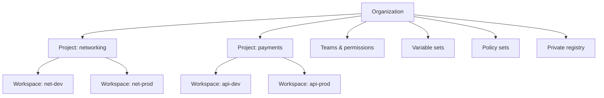

# HCP Terraform & Terraform Enterprise

<span class="exam-tag">Obj 8a–8d</span>

!!! info "Naming"
    **Terraform Cloud** was renamed **HCP Terraform** in 2024. Same product, same URL: <https://app.terraform.io>. Older material (and the course) says "Terraform Cloud".

## What is HCP Terraform?

HashiCorp's managed **SaaS** that helps teams use Terraform together:

- **Remote runs** in a consistent environment (plan/apply on HashiCorp-managed workers or your own **agents**).
- **Remote state** storage — encrypted, versioned, with **locking** built in.
- **Variables & secrets** stored per workspace or shared via **variable sets**.
- **Access control**: organizations, teams, permissions, SSO.
- **VCS integration**: automatic speculative plans on pull requests, apply on merge.
- **Private registry** for modules and providers; **no-code** provisioning.
- **Policy as code**: **Sentinel** and **OPA**.
- **Run tasks**: call third-party tools (security scanners, cost estimation) during runs.
- **Health**: drift detection and continuous validation (`check` blocks).
- **Cost estimation**, audit trails, API, notifications.

## Editions & plans

| | HCP Terraform | Terraform Enterprise |
|---|---|---|
| Hosting | SaaS by HashiCorp | **Self-hosted** (your cloud / data center) |
| Plans | Free, Essentials, Standard, Premium (check current pricing) | Commercial licence |
| Notes | Free tier limited by managed resources | Private instance, no resource limits, **air-gapped** installs, audit logging, SAML SSO |

Pricing: <https://www.hashicorp.com/products/terraform/pricing>

Terraform Enterprise is a **self-hosted distribution of HCP Terraform** — the same application.

### Air-gapped environments

- Networks isolated physically and logically — **no internet** (military/government, finance, energy / SCADA systems).
- Terraform Enterprise supports **air-gapped installation** (all images, providers and modules provided offline).
- CLI in air-gapped setups: provider **network mirrors** / filesystem mirrors (`terraform providers mirror`), private registries.

## Organization structure <span class="exam-tag">Obj 8c</span>



- **Organization** — top level: billing, users, teams, SSO, policies, registry.
- **Project** — groups related workspaces; permissions and variable sets can be assigned per project.
- **Workspace** — the unit of work. Each workspace has:
    - its own **state** (and state history),
    - **configuration source** (VCS repo/branch/directory, or CLI uploads),
    - **variables** (Terraform variables and environment variables, can be marked sensitive),
    - **run history**, settings (Terraform version, auto-apply, execution mode), **permissions**.
- Recommended: **one workspace per configuration per environment** (e.g., `api-dev`, `api-prod`).
- **Variable sets** — reusable groups of variables (e.g., cloud credentials) applied to many workspaces/projects.

!!! note "HCP workspace vs. CLI workspace"
    A **CLI workspace** is only a separate state for the same directory. An **HCP Terraform workspace** is closer to a separate working directory: its own config source, variables, credentials, permissions and state.

## Run workflows <span class="exam-tag">Obj 8a</span>

| Workflow | How runs start | Use case |
|---|---|---|
| **VCS-driven** | Push / pull request to a connected repo → speculative plan on PRs, plan+apply on merge | Standard GitOps team flow |
| **CLI-driven** | `terraform plan` / `apply` from your terminal, executed **remotely** with logs streamed back | Developers who like the CLI, CI pipelines |
| **API-driven** | Upload configuration + create runs via the API | Custom tooling / pipelines |

Run stages: **Pending → Plan → Cost estimation → Policy check → (Run tasks) → Apply** (manual confirm or auto-apply).

### Execution modes

- **Remote** (default): plan/apply run in HCP Terraform.
- **Local**: HCP Terraform only stores state; runs happen on your machine.
- **Agent**: runs on self-hosted **HCP Terraform agents** inside your network (reach private resources).

## Connecting the CLI — the `cloud` block <span class="exam-tag">Obj 8d</span>

```bash
terraform login        # opens browser, stores API token in ~/.terraform.d/credentials.tfrc.json
```

```hcl
terraform {
  cloud {
    organization = "my-org"
    # hostname = "app.terraform.io"     # default; set for Terraform Enterprise

    workspaces {
      name = "api-prod"                 # a single workspace
      # tags = ["app:api"]             # OR: all workspaces with these tags
      # project = "payments"
    }
  }
}
```

```bash
terraform init         # connects (and can migrate local state to HCP Terraform)
terraform plan         # runs remotely, output streams locally
terraform apply
```

- Remote plan/apply use the **variables and credentials configured in the workspace** (and variable sets), **not** your local environment variables or local credentials.
- Environment variables can override: `TF_CLOUD_ORGANIZATION`, `TF_CLOUD_PROJECT`, `TF_WORKSPACE`, `TF_CLOUD_HOSTNAME`.

!!! warning "Legacy: `backend \"remote\"`"
    Before Terraform 1.1 the integration used `backend "remote" { organization = ... workspaces { name = ... } }` (an "enhanced" backend that both stores state **and** runs operations). It still works, but the **`cloud` block** is the recommended way.

### Reading another workspace's outputs

```hcl
data "tfe_outputs" "network" {
  organization = "my-org"
  workspace    = "net-prod"
}

# data.tfe_outputs.network.values.vpc_id   (values are sensitive by default)
```

## Collaboration & governance <span class="exam-tag">Obj 8b</span>

- **Teams & permissions** at organization, project and workspace levels (read, plan, write, admin).
- **SSO** (SAML/OIDC), 2FA, audit trails.
- **Private registry** with module/provider versioning and no-code modules.
- **Run triggers**: a run in one workspace triggers another (e.g., network → app).
- **Notifications**: Slack, Microsoft Teams, email, webhooks.
- **Health assessments**: drift detection + continuous validation.
- **Explorer**: inventory of resources, modules and providers across workspaces.

### Policy as code — Sentinel & OPA

Policies run **after `plan` and before `apply`**, so bad changes are blocked before reaching infrastructure. They are grouped into **policy sets** applied to workspaces/projects.

- **Sentinel** — HashiCorp's policy-as-code language (also used in Vault, Consul, Nomad enterprise).
- **OPA** (Open Policy Agent, **Rego** language) — also supported.

Sentinel **enforcement levels**:

| Level | Behaviour |
|---|---|
| **Advisory** | Policy may fail; a **warning** is shown/logged; run continues. |
| **Soft mandatory** | Must pass **unless** an authorised user **overrides** it. |
| **Hard mandatory** | Must pass — **no override**. Only way around it is removing the policy. |

OPA uses **advisory** and **mandatory**.

Example Sentinel policy — only allow small EC2 types:

```text
import "tfplan/v2" as tfplan

allowed_types = ["t3.micro", "t3.small"]

ec2 = filter tfplan.resource_changes as _, rc {
  rc.type is "aws_instance" and
  (rc.change.actions contains "create" or rc.change.actions contains "update")
}

main = rule {
  all ec2 as _, i { i.change.after.instance_type in allowed_types }
}
```

### Run tasks

Integrate external services at **pre-plan, post-plan, pre-apply or post-apply** stages (e.g., Snyk, Wiz, Infracost). Can be advisory or mandatory.

## Supported VCS providers

GitHub.com (GitHub App or OAuth), GitHub Enterprise, GitLab.com, GitLab EE/CE, Bitbucket Cloud, Bitbucket Data Center/Server, Azure DevOps Services, Azure DevOps Server.

## Other HCP Terraform features (good to know)

- **Dynamic provider credentials** — short-lived cloud credentials via OIDC; no static keys stored.
- **Stacks** — manage many related configurations ("components") deployed across many environments/regions as one unit.
- **Terraform version** per workspace, auto-apply option, speculative plans.

## Quick recap

- [x] HCP Terraform (ex-Terraform Cloud) = SaaS; Terraform Enterprise = self-hosted, supports air-gapped.
- [x] Organization → Projects → Workspaces; variable sets share variables.
- [x] Workflows: VCS-driven, CLI-driven, API-driven; execution modes remote / local / agent.
- [x] `terraform login` + `cloud {}` block; remote runs use workspace variables.
- [x] Sentinel/OPA run **between plan and apply**; levels advisory / soft-mandatory / hard-mandatory.
