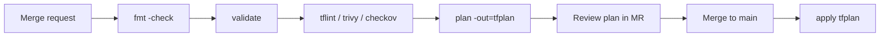

# Team Workflow & Best Practices

## Why keep Terraform code in a VCS repo?

- **Collaboration**: everyone works on the same code, with reviews (pull/merge requests).
- **Protection**: code isn't lost when a laptop dies; full history and rollback.
- **Automation**: CI/CD pipelines run `fmt`, `validate`, `plan` on every change.

**Right approach for teams:** configuration in **Git**, state in a **remote backend** with **locking**.

## Challenges with Git repos — and fixes

| Challenge | Fix |
|---|---|
| Credentials in code get pushed | Keep secrets out of code (env vars, profiles, Vault, OIDC). Add credential files to `.gitignore`. |
| State file contains secrets | Store state in a secure remote backend, **never** in Git. |
| Huge `.terraform/` folder | Ignore it — it's re-created by `terraform init`. |
| Two people applying at once | Remote backend with state locking / HCP Terraform. |

## `.gitignore` for Terraform

Based on GitHub's official template (<https://github.com/github/gitignore/blob/main/Terraform.gitignore>):

```gitignore
# Local .terraform directories
**/.terraform/*

# State files
*.tfstate
*.tfstate.*

# Crash logs
crash.log
crash.*.log

# Variable files that may contain secrets
*.tfvars
*.tfvars.json

# Override files
override.tf
override.tf.json
*_override.tf
*_override.tf.json

# CLI config
.terraformrc
terraform.rc

# Saved plans
*.tfplan
tfplan
```

!!! tip "Do commit"
    **`.terraform.lock.hcl`** — so everyone uses the same provider versions.
    Commit **non-secret** `.tfvars` (e.g., `dev.tfvars` with sizes and names) if you remove `*.tfvars` from the ignore list or name them explicitly with `!dev.tfvars`.

## CI/CD pipeline pattern



Example GitLab CI job (simplified):

```yaml
stages: [validate, plan, apply]

default:
  image: hashicorp/terraform:1.12
  before_script:
    - terraform init -input=false

validate:
  stage: validate
  script:
    - terraform fmt -check -recursive
    - terraform validate

plan:
  stage: plan
  script:
    - terraform plan -input=false -out=tfplan
  artifacts:
    paths: [tfplan]     # contains secrets — keep artifacts private & short-lived

apply:
  stage: apply
  script:
    - terraform apply -input=false tfplan
  when: manual
  rules:
    - if: $CI_COMMIT_BRANCH == $CI_DEFAULT_BRANCH
```

## Best-practices checklist

**Code**

- [ ] Host code in Git; review every change through pull/merge requests.
- [ ] Run `terraform fmt` and `terraform validate` (VS Code extension or pre-commit hooks).
- [ ] Avoid hard-coding: use variables, locals and data sources (e.g., look up AMIs).
- [ ] Follow a **naming convention** (snake_case names; don't repeat the type: `aws_instance.web`, not `aws_instance.web_instance`).
- [ ] Standard files: `main.tf`, `variables.tf`, `outputs.tf`, `providers.tf`/`versions.tf`.
- [ ] Add `description` (and `type`) to every variable and output.
- [ ] Use functions, `for_each`, dynamic blocks — but keep code readable.
- [ ] Prefer `for_each` over `count` for named items.

**Modules**

- [ ] DRY: reuse code with modules; call them from root modules per environment.
- [ ] Write a **README** for each module with inputs and outputs (tool: `terraform-docs`).
- [ ] Pin module versions (`version` / `?ref=`).

**Versions**

- [ ] Constrain Terraform (`required_version`) and providers (`~>`).
- [ ] Commit `.terraform.lock.hcl`.

**State**

- [ ] Remote, encrypted, versioned backend with **locking**.
- [ ] Separate state per environment / component (small blast radius).
- [ ] Never edit state by hand — use `terraform state`, `moved`, `removed`, `import` blocks.
- [ ] Back up state (bucket versioning; HCP Terraform keeps history).

**Security**

- [ ] No credentials in code; use roles/OIDC/dynamic credentials.
- [ ] Mark secrets `sensitive`; prefer `ephemeral` + write-only arguments.
- [ ] Scan code (Trivy, Checkov) and enforce policy (Sentinel/OPA).
- [ ] Least-privilege IAM for the identity running Terraform.

**Operations**

- [ ] Automate plan/apply in a **CI/CD pipeline**; apply the reviewed plan file.
- [ ] Use `-var-file` per environment (`dev.tfvars`, `prod.tfvars`).
- [ ] Bring manually-created resources under management with **import**.
- [ ] Protect critical resources with `prevent_destroy`.
- [ ] Use `-target` only in emergencies.
- [ ] Detect drift regularly (`plan -detailed-exitcode` on a schedule, or HCP health assessments).
