# Terraform

HashiCorp Terraform is an **Infrastructure as Code (IaC)** tool that lets you describe infrastructure in declarative configuration files, preview changes, and apply them safely across any cloud or API.

!!! note "Version baseline"
    These notes target **Terraform 1.12+** (the version tested by the **Terraform Associate 004** exam) and stay valid for current releases (1.15 / 1.16). Older syntax is kept only where you may still meet it, inside :material-alert: *Deprecated* boxes.

## Learning path

```mermaid
flowchart LR
    A[IaC & Terraform] --> B[Providers]
    B --> C[Resources & Data]
    C --> D[Workflow & CLI]
    D --> E[Variables & Outputs]
    E --> F[Expressions & Functions]
    F --> G[Validation]
    G --> H[Provisioners]
    H --> I[State & Backends]
    I --> J[Import & Refactor]
    J --> K[Modules]
    K --> L[Secrets]
    L --> M[HCP Terraform]
    M --> N[Best Practices]
    N --> O[Labs → Exam]
```

## Pages

| # | Page | Exam objectives |
|---|------|-----------------|
| 1 | [Introduction & IaC](01-introduction.md) | 1a, 1b, 1c |
| 2 | [Providers](02-providers.md) | 2a, 2b, 2c |
| 3 | [Resources, Data Sources & Dependencies](03-resources-data.md) | 4a, 4b, 4f |
| 4 | [Core Workflow & CLI](04-workflow-cli.md) | 3a – 3g, 7c |
| 5 | [Variables, Locals & Outputs](05-variables-outputs.md) | 4c, 4d |
| 6 | [Expressions, Loops & Functions](06-expressions-functions.md) | 4d, 4e |
| 7 | [Validation & Custom Conditions](07-validation-conditions.md) | 4g |
| 8 | [Provisioners & terraform_data](08-provisioners.md) | — (good to know) |
| 9 | [State, Backends & Workspaces](09-state-backends.md) | 2d, 6a – 6d |
| 10 | [Import & Refactoring](10-import-refactor.md) | 6d, 7a, 7b |
| 11 | [Modules & Registry](11-modules.md) | 5a – 5d |
| 12 | [Secrets & Sensitive Data](12-secrets-security.md) | 4h |
| 13 | [HCP Terraform & Enterprise](13-hcp-terraform.md) | 8a – 8d |
| 14 | [Team Workflow & Best Practices](14-best-practices.md) | — |
| 15 | [Hands-on Labs & Projects](15-labs.md) | practice |
| 16 | [CLI Cheat Sheet](16-cheatsheet.md) | quick review |
| 17 | [Associate Exam (004) Guide](17-exam.md) | all |
| 18 | [What Changed vs. the Course](18-changes.md) | — |

## Useful links

- Docs: <https://developer.hashicorp.com/terraform/docs>
- Registry (providers & modules): <https://registry.terraform.io>
- Download: <https://developer.hashicorp.com/terraform/install>
- Exam study path (004): <https://developer.hashicorp.com/terraform/tutorials/certification-004/associate-study-004>
